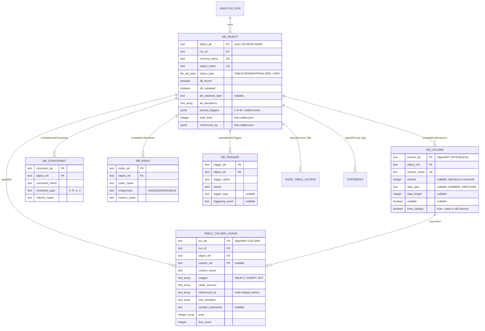

# Relational Model Plan — PL/SQL + JAR Analysis Output

Planning document only. No DDL has been run and no product code changed.

## Assumptions (unconfirmed by the user — flag if wrong)

1. **One model for both sides.** PL/SQL analyses and JAR analyses are stored in a single
   database/schema, sharing `analysis`-level tables. They could equally be two schemas;
   nothing in the data forces the union.
2. **Postgres-flavoured DDL for the logical model.** Types in §5 and §11 are Postgres
   (`jsonb`, `text`, `bigserial`, `citext`-style case handling). Engine differences are noted
   inline where they matter.
2b. **MongoDB is the physical destination** (confirmed after the first draft). §4–§12 remain
   the canonical normalised *logical* specification — they define the entities, keys and
   constraints. **§13 maps that model onto MongoDB** under the user's explicit constraint:
   *"make relation clear and possible to save information from first hand, don't believe
   relation auto resolve"* — every relationship materialised at write time, every `_id`
   computable before insert, no post-hoc linking pass, no `$lookup` on a hot path.
3. Archived runs (directories containing `_2026`) are excluded from all measurement and
   from the initial ingest scope.
4. `data/config/**` was not read (production credentials); anything about connection
   configuration is therefore out of scope.

## Headline measurements (measured, not estimated)

| Side | Files | Bytes | Notes |
|---|---|---|---|
| PL/SQL (live) | 1,050 JSON | 82.9 MB | 5 dialects: DB2, MYSQL, ORACLE, SQLSERVER, POSTGRES |
| JAR | 121,591 | 1.17 GB | 321 endpoint dirs under `data/jar/<jar>/endpoints/` |

PL/SQL largest kinds: `api/nodes/*` 356 files / 27.8 MB; `api/statements/*` 5 / 20.7 MB;
`edges.json` 5 / 1.8 MB; `api/tables/*` 5 / 1.2 MB; `tables.json` 5 / 1.0 MB;
`api/call_graph.json` 5 / 0.76 MB; plus ~100 `chunk_*.json` and ~120 `edges_*.json` per analysis.

Statement rows in `api/statements/index.json`: DB2 4,063 · MYSQL 5,015 · ORACLE 2,436 ·
SQLSERVER 1,729 · POSTGRES 2,581 — **total 15,824**.

JAR per-endpoint: ~4,930 files including `nodes.json` (~18.9 MB), `call-tree.json` (~7.6 MB),
`endpoint.json` (~1.1 MB), and one `nodes/node_*.json` per node. Top-level `analysis.json` 49.3 MB.

Tested: endpoint directories are **not** duplicates — 405 sampled relative paths across
6 endpoint dirs yielded only 5 byte-identical files.

## Contents

- [x] 1. Document inventory (PL/SQL)
- [x] 2. Document inventory (JAR)
- [x] 3. Identifiers, references, repetition
- [x] 4. Conceptual entity model
- [x] 5. Logical schema
- [x] 6. Normalization
- [x] 7. Indexes
- [x] 8. Volumes
- [x] 9. Ingest plan
- [x] 10. Open questions and risks
- [x] 11. Node-scoped entities in full (dynamic SQL, cursors, exception handlers, sequences)
- [x] 12. Coverage matrix — every document kind on disk, with a verdict
- [x] 13. **MongoDB target architecture** — identity, embed/reference, denormalisation,
      collections, ingest, compensating controls, relational→Mongo mapping
- [x] 17. **Uniform decomposition — every entity** (supersedes parts of §5, §12, §13.2)
      · 17.0 corrections to supplied measurements · 17.1 the pattern + storage rules
      · 17.2–17.3 worked examples (`java_class`, `proc_node`) · **17.4 lossless mandate:
      three reversals, three defects found** · 17.5 field-level completeness proof
      · **17.6 every collection, before/after worst case** · **17.7 relation-chain proof**
      · 17.8 ingest size ceiling
- [x] 18. **Entity–relationship diagrams** — (a) PL/SQL core · (b) node-scoped entities
      · (c) catalogue objects · (d) JAR/Java model · (e) call graph + DAG · 18.1 cross-links
- [x] 19. Addendum — the 16 earlier decisions superseded, each named

*(Sections 14–16 are unused: §17 was requested by that number, and renumbering the sections
already reviewed would have broken every cross-reference in the document.)*

> **Reading order note.** §17 and §18 are the current design. Where §5, §12 or §13.2 conflict
> with them, **§17/§18 win** — the earlier sections are retained as the reasoning that led
> there, and each superseded decision is named explicitly in §17.4 and §19.

---

## 1. Document inventory — PL/SQL side

Analyses live at `data/plsql-parse/<DIALECT>/<PROJECT>/<ENV>/<ENTRYPOINT>/`. The four path
segments are the natural key and match the analysis-name format `DBTYPE~PROJECT~ENV~ENTRYPOINT`
(e.g. `ORACLE/ORACLEDEMO/LOCAL/ERP_USP_RUN_CYCLE`). All shapes below were read from the live
ORACLE analysis unless stated; enum tallies span all five live analyses.

Per-analysis directory contents (measured on the ORACLE run): `api/` (6 entries), `chunks/`
(52 files), `edges/` (32 files), `sources/` (50 files), `resolver/` (4 files), plus
`edges.json`, `tables.json`, `progress.json`, `.node-cache`, `.parse-cache`.

### 1.1 `api/index.json` — analysis manifest (one object)

Scalars: `entryPoint`, `entrySchema`, `project`, `environment`, `connectionName`, `jdbcUrl`
(str); `totalNodes` 52, `maxDepth` 11, `totalLinesOfCode` 18829, `totalFlowLinesOfCode` 18824,
`totalTables` 41, `totalEdges` 2258, `uniqueEdges` 218, `totalCycles` 3, `crawlTimeMs` 9030,
`dbCallCount` 259, `totalDurationMs` 10743 (int). Objects: `columnCoverage`
(`tables`, `tablesWithColumnDetail`, `columnRows`, `tablesWithDdl`, `ddlRows`,
`pctTablesWithColumnDetail`), `transactionSummary` (`commits` 14, `rollbacks` 77,
`savepoints` 44, `autonomousProcs` 1). Arrays: `nodes` (52), `transactionStatements` (135),
`cycles` (3), `errors` (0).

`jdbcUrl` and `connectionName` are *derived from* connection config; they are stored in the
analysis output itself, so ingesting them does not require reading `data/config/**`. They still
name a production endpoint and should be treated as sensitive columns.

`.nodes[]` — every field present 52/52 except three trigger-only ones:

| field | type | presence | example |
|---|---|---|---|
| `nodeId` | str | 52/52 | `ANALYZER$ERP_USP_RUN_CYCLE` |
| `order`, `depth` | int | 52/52 | 1, 0 |
| `schema`, `objectName`, `name` | str | 52/52 | `ANALYZER`, `ERP_USP_RUN_CYCLE` |
| `packageName` | str\|null | 52/52 | `ERP_PKG_PLANNER` |
| `objectType` | str | 52/52 | `PROCEDURE` |
| `lineStart`, `lineEnd`, `linesOfCode` | int | 52/52 | 1, 1725, 1725 |
| `readable` | bool | 52/52 | true |
| `parentNodeId` | str\|null | 52/52 | root has null |
| `callCount` | int | 52/52 | 0 |
| `counts` | obj | 52/52 | `{tables, callsOut, internalCalls, externalCalls, …}` |
| `sourceFile` | str | 52/52 | `ANALYZER.ERP_USP_RUN_CYCLE.sql` |
| `detailFile` | str | 52/52 | `nodes/ANALYZER$ERP_USP_RUN_CYCLE.json` |
| `message` | str | **2/52** | `Oracle TABLE object - no parseable source` |
| `triggerTable`/`triggerEvent`/`triggerTiming` | str | **2/52** | `ERP_SALES_ORDER`/`DELETE`/`AFTER` |

`.transactionStatements[]` (135): `nodeId`, `proc`, `schema`, `type`, `line`, `autonomous`
all 135/135; `name` 44/135 (savepoint name only). `.cycles[]` (3): `nodeIds` (list),
`path` (list of display names), `length` (int).

### 1.2 `api/statements/index.json` — the flat statement fact table (largest document)

Top level: `{ totalStatements, statementsWithColumns, statements[] }`. 3.3 MB for ORACLE;
20.7 MB across 5 dialects. Row shape, presence measured over the ORACLE 2,436 rows:

| field | type | presence | example |
|---|---|---|---|
| `nodeId` | str | 2436/2436 | `ANALYZER$ERP_USP_RUN_CYCLE` |
| `nodeName` | str | 2436/2436 | `ERP_USP_RUN_CYCLE` |
| `sourceFile` | str | 2436/2436 | `ANALYZER.ERP_USP_RUN_CYCLE.sql` |
| `schema` | str | 2436/2436 | `ANALYZER` |
| `tableName` | str | 2436/2436 | `ERP_SALES_ORDER` |
| `objectType` | str | 2436/2436 | TABLE 2430 · VIEW 4 · MATERIALIZED_VIEW 2 |
| `operation` | str | 2436/2436 | SELECT 2082 · DYNAMIC 124 · UPDATE 97 · INSERT 68 · DELETE 34 · MERGE 31 |
| `line` | int | 2436/2436 | 32 |
| `accessKind` | str | 2436/2436 | JOIN_READ 1548 · READ 339 · WRITE 230 · SUBQUERY_READ 191 · DYNAMIC 124 · AGGREGATE_READ 4 |
| `columns` | list[str] | 2436/2436 | `["STATUS"]` |
| `columnsKnown` | bool | 2436/2436 | true |
| `sqlText` | str | **2250**/2436 | full statement text |
| `sqlTruncated` | bool | 2250/2436 | false |
| `columnsParsed` | bool | 2242/2436 | true |
| `columnDetail` | list[obj] | **2177**/2436 | 5,679 child rows |
| `joins` | list[obj] | **1548**/2436 | 2,858 child rows |
| `predicates` | list[obj] | **906**/2436 | 912 child rows |
| `predicateScope` | str | 906/2436 | `table` 272 · `statement` 634 (null 1530) |
| `ddl` | list[obj] | 0/2436 in ORACLE | 492 rows across all 5 dialects |

The four nested arrays are the M:N relationships in disguise — each becomes its own child table.

`columnDetail[]` (5,679 rows, ORACLE): `usage` str 5679/5679 (SELECT 5532 · INSERT 81 · SET 66);
`line` int 5679/5679; `expression` str 5615/5679; `name` str 3887/5679; `qualifier` str
3545/5679 (the table alias, e.g. `mp`); `into` str 1075/5679 (PL/SQL INTO target, e.g.
`v_orders`); `valueSource` str **147**/5679 (e.g. `LITERAL`). Note `name` is absent for 1,792
rows — expression-only columns such as `COUNT(DISTINCT so.order_id)` — so a column-name FK
must be nullable.

`predicates[]` (912): `column`, `operator`, `value` (str) and `line` (int), all 912/912.
`value` is raw text and may be a bind variable (`v_run_id`), not a literal.

`joins[]` (2,858): `type` str 2858/2858 (INNER 2572 · CROSS 64 · LEFT 62 · FULL/FULL OUTER/
RIGHT/RIGHT OUTER/LEFT OUTER 32 each — note the writer emits both the short and long spelling
of outer joins, so `type` needs canonicalisation before it can be a clean enum); `right`
2858/2858; `line` 2858/2858; `left` 2794/2858; `on` str 2794/2858 (`ON sol.order_id = so.order_id`);
`rightAlias` 981/2858; `leftAlias` 917/2858.

`ddl[]` (492 rows measured across all five analyses; zero in ORACLE): `action` (e.g.
`CREATE_TABLE`), `objectType` (`TABLE`), `objectName` (e.g. `#STAGE6` — SQL Server temp table),
`line`. All four present 492/492.

### 1.3 `api/nodes/<nodeId>.json` — per-node detail (356 files, 27.8 MB — the bulk of the PL/SQL side)

One file per node; filename is the `nodeId` with `$` separators, matching `detailFile` in
`api/index.json`. Keys (from `api/nodes/ANALYZER$ERP_USP_RUN_CYCLE.json`): `nodeId`, `name`,
`schema`, `objectType`, `depth`, `lineStart`, `lineEnd`, `linesOfCode`, `sourceFile` (scalars);
`variables`, `statementSummary`, `transactionScope` (objects); `tables` (30), `directTables`
(30), `subtreeTables` (42), `cursors` (43), `calls` (21), `sequences` (1), `dynamicSql` (32),
`exceptionHandlers` (86) (arrays).

- `tables[]`: `schema`, `name`, `objectType`, `operations` (obj: operation → array of line
  numbers, e.g. `{"SELECT":[32,113,…],"UPDATE":[…]}`), `joins[]` (`joinType`, `joinedTable`,
  `joinedTableAlias`, …). All 30/30.
- `directTables` vs `subtreeTables`: 30 vs 42 — the latter is the transitive closure over the
  call graph. **This is derived data** and should be a view or materialised rollup, not a
  stored base table.
- `cursors[]` (43): `name` (43/43, may be synthetic `(FOR R)`), `line`, `lineEnd`, `forLoop`,
  `refCursor` (bool), `query` (str), `tables` (list[str]) — all 43/43.
- `sequences[]` (1): `name`, `schema`, `operations` (obj: `{"NEXTVAL":[231,811,1391]}`).
- `dynamicSql[]` (32): `type` (`EXECUTE_IMMEDIATE`), `line`, `sqlExpression` (the *variable
  name*, e.g. `v_sql`, not resolved SQL) all 32/32; `usingVariables` list 5/32.
- `calls[]` (21): `target`, `objectName`, `type` (`EXTERNAL`), `schema`, `lines` (list[int]),
  `count` (int) all 21/21; `packageName` str|null 21/21; `argCount` **2/21**.
- `exceptionHandlers[]` (86): `exception`, `line`, `lineEnd`, `statementsCount`, all 86/86.
- `variables` is an aggregate object, not an array: `total` 197, `typeRefCount`,
  `rowtypeRefCount`, `collectionCount`, `plainCount`, plus `typeRefs[]` with `name`,
  `dataType` (`ERP_PRODUCT.SKU%TYPE`), `line`, `constant`, `refColumn`, `refTable` — the
  `refTable`/`refColumn` pair is a real foreign reference to the table/column entities.
- `statementSummary` is a `type → count` map (23 distinct types in this node: SELECT 36,
  ASSIGNMENT 138, CURSOR_FOR_LOOP 43, …). Pure aggregate; derivable from statements.
- `transactionScope`: `commits`, `rollbacks`, `savepoints`, `autonomous`, `statements[]`
  (`type`, `line`, optional `name`) — the same rows the manifest aggregates.

### 1.4 `api/tables/index.json` — table catalogue with live DB metadata

Top level `{ totalTables, operationSummary, tables[], totalTablesRaw, dbValidated }`.
42 rows. Fields: `schema`, `name`, `objectType`, `allOperations` (list[str]), `usedBy`
(list of `{nodeId, nodeName, nodeDepth, operations:{OP:[lines]}}`), `dbFound`, `dbValidated`,
`dbResolvedType` all 42/42; `dbColumns` **41/42** (`columnName`, `dataType`, `dataLength`,
`nullable`, `columnId`); `dbConstraints` 36/42 (`constraintName`, `constraintType` e.g. `P`,
`columnName`); `dbIndexes` 36/42 (`indexName`, `uniqueness`, `columnName`); `dbTriggers` 5/42
(`triggerName`, `owner`, …); `triggers` **2/42** (parsed-side triggers, `nodeId` + `name`).

This document is the only source of *real database catalogue* data (column types, PK/FK,
indexes) as opposed to parsed-source inference. It deserves its own tables, distinct from the
parsed usage tables, because the two can disagree — `dbFound` is exactly that flag.

### 1.5 Call graph and edges

- `edges.json` — a bare JSON **array** of 2,258 objects (1.8 MB / 5 files). Fields:
  `fromNodeId`, `toNodeId`, `toSchema`, `toObject`, `line`, `depth` 2258/2258;
  `fromSchema`/`fromObject` 2257/2258 (one root-ish row lacks them); `toPackage` 113/2258;
  `fromPackage` 8/2258; `edgeType` **1/2258** (`FIRES_TRIGGER`) — i.e. `edgeType` defaults to
  a plain call and is only emitted for the trigger case.
- `api/call_graph.json` — `{ totalEdges: 2258, uniqueEdges: 218, backEdges: 1, edges[218] }`.
  The 218 are the *deduplicated* edges; 2,258 is the call-site count. Relationally these are
  one table (call site) plus a distinct/aggregate view — storing both would denormalise.
- `edges/edges_NNNN.json` — per-node shards of the same rows (208 in shard 0001). Redundant
  with `edges.json`; ingest one, not both.

### 1.6 Raw and auxiliary documents

- `chunks/chunk_NNNN.json` — the writer's raw per-node output, one object per node, produced by
  `plsql-parser/src/main/java/com/plsql/parser/flow/ChunkedFlowWriter.java`. Keys: `nodeId`,
  `order`, `depth`, `schema`, `objectName`, `objectType`, `lineStart`, `lineEnd`,
  `localVariables`, `statements[]`, `calls`, `cursors`, `dynamicSql`, `tableOperations`,
  `exceptionHandlers`, `linesOfCode`, `callCount`, `statementSummary`, `readable`,
  `overloadParamCount`, `autonomousTransaction`. `statements[]` here is finer-grained than the
  API view: `type`, `line`, `lineEnd`, `nestingDepth` (all present) plus optional `sqlText`
  (57/200 in the sample), `tables` (23/200), `savepointName`, `indexVariable`,
  `boundsExpression`, `dmlType`. **`api/*` is a projection of `chunks/*`** — the chunk is the
  source of truth and the only place `nestingDepth`, `lineEnd` per statement and loop metadata
  survive. Ingest from chunks, not from `api/`, if statement-level fidelity matters.
- `tables.json` — a map keyed `"SCHEMA.TABLE"` → 7-key object. Same content as
  `api/tables/index.json` in map form. Redundant.
- `progress.json` — map nodeKey → `"DONE"`. Run bookkeeping, not analysis output.
- `resolver/q*.json` — arrays of resolution results, e.g.
  `q1_object_resolution.json` (85 rows of `{objectName, schema, objectType}`),
  `q1_ambiguous_objects.json`, `q3_reverse_dependencies.json`, `q4_direct_dependencies.json`.
- `sources/<SCHEMA>.<OBJECT>.<ext>` — 50 raw source files (`.sql`, `.prc`, `.fnc`). Not JSON;
  candidates for a `source_file` table with the text in a `text` column, or left on disk.

---

## 2. Document inventory — JAR side

Root: `data/jar/<jarId>/` (one live jar: `unified-web-1.0.0-SNAPSHOT`). Contents:
`analysis.json` (49.3 MB), `_header.json`, `_summary_static.json` (+`.gz`),
`bundled-jars.json` (100 entries), `connections.json`, `domain-config.json`,
`external-links.json`, `external-links-pending.json`, `jar-dep-map.json` (14 keys),
`stored.jar`, `resources/`, `endpoints/` (321 dirs).

### 2.1 `analysis.json` — already a normalised store

This document is the single most important discovery for this plan: **the JAR analyser has
already invented a relational model inside JSON.** Top level (measured):

| key | type | size |
|---|---|---|
| `jarName`, `analysedAt`, `analysisMode` (`STATIC`), `callTreeFormat` (`dag-v1`) | str | — |
| `jarSize` | int | 84,679,601 |
| `totalClasses` | int | 1,633 |
| `totalEndpoints` | int | 321 |
| `callTreeNodes` | obj | **3,784** entries — global content-addressed DAG pool |
| `invocationPool` | list | **64,446** rows, all 64,446 distinct |
| `endpointPool` | obj | 3 pools: `externalCalls` 2,080, `dynamicFlows` 1,635, `beans` 220 |
| `classes` | list | 1,633 |
| `endpoints` | list | 321 |
| `advice` | list | 2 |

`classes[]` (1,633; every field present 1633/1633): `fullyQualifiedName`, `packageName`,
`simpleName`, `superClass`, `interfaces` (list[str]), `annotations` (list[obj]), `fields`
(list), `methods` (list), `stereotype`, `accessFlags` (int), `isInterface`, `isAbstract`,
`isEnum` (bool), `sourceJar` (str|null), `jarName`, `sourcePath`, `repositoryEntityType`
(null in all 1,633 rows measured).

Flattened `classes[].methods` = **33,407 rows**; all 14 fields present in every row (nulls
written explicitly): `name`, `descriptor` (JVM descriptor), `returnType`, `parameters` (list),
`annotations` (list), `invocationRefs` (**list[int] indices into `invocationPool`**),
`accessFlags`, `httpMethod` (str|null), `path` (str|null), `stringLiterals`, `fieldAccesses`,
`localVariables` (obj name→type), `startLine`, `endLine`.

Flattened `classes[].fields` = **8,649 rows**: `name`, `type`, `annotations`, `accessFlags`,
`constantValue` (str|null), `mongoFieldName` (null throughout), `idField` (bool),
`jpaColumnName` (null throughout), `genericElementType` (str|null).

`classes[].annotations` = 146 rows total: `name`, `attributes` (obj).

`invocationPool[]` rows: `{ownerClass, methodName, descriptor, returnType, opcode (int, e.g.
183), lineNumber}`. This is a call-site table already deduplicated and referenced by integer.

`endpoints[]` (321): `httpMethod`, `fullPath`, `controllerClass`, `controllerSimpleName`,
`methodName`, `returnType`, `parameters`, `aggregatedCollections`,
`aggregatedCollectionDomains`, `aggregatedOperations`, `derivedOperationType` (str|null),
`totalDbOperations`, `totalMethods`, `totalLoc`, `inScopeCalls`, `externalScopeCalls`,
`modules`, `httpCalls`, `beansRefs` (list[int]), `operationTypesList`, `procNames`,
`aggregationFlows`, `dynamicCollectionFlows`, `collectionLifecycleFlows`, `callTreeRootId`
— all 321/321. Non-empty subsets: `externalCalls` 236/321, `dynamicFlows` 162/321,
`dynamicFlowsRefs` 159/321, `externalCallsRefs` 85/321.

Note the coexistence of `externalCalls` (inline) and `externalCallsRefs` (pool indices) — the
format is mid-migration from inline to pooled. A relational model should keep only the pooled
form; the inline arrays are the same data unnormalised.

### 2.2 `endpoints/<NNN>_<Controller>.<method>/` — 321 dirs, ~4,930 files each

Directory name pattern: three-digit ordinal, underscore, `SimpleClassName.methodName`
(e.g. `001_WarAnalyzerController.uploadAndAnalyze`). Four members:

**`endpoint.json`** (~1.1 MB) — the same row as `analysis.json.endpoints[i]` but with pools
resolved inline (`beans` 106 objects instead of `beansRefs`, `externalCalls` 2,027 objects,
`dynamicFlows` 364) plus `sourceJar`, `jarName`, `sourcePath`, `analyzedAt`. Pure
denormalisation for the UI; **redundant** with `analysis.json` once pools are tables.

**`call-tree.json`** (~7.6 MB) — `{callTreeFormat: "dag-v1", callTreeRootId, callTreeNodes}`.
For endpoint 001: root id `5e71af8eadfa18333dfd`, `callTreeNodes` a map of **2,285** entries
keyed by a **20-hex-character content hash**. Each value carries `id` — the JVM-style method
key `com.foo.Bar#method(Lx;)Ly;` — plus `childIds` (list of content hashes).

This is the sharing structure the relational design must preserve. Measured for endpoint 001:

| quantity | measured value |
|---|---|
| physical DAG nodes | 2,285 |
| distinct method `id` among them | 2,232 |
| total `childIds` references | 4,927 |
| **logical nodes if the DAG were expanded to a tree** | **20,300,167,285** |

The expansion factor is ~8.9 million to one *for this one endpoint*. Any design that stores
one row per tree path is not merely large, it is impossible. The DAG must be stored as
`(node, child, ordinal)` edges.

All 44 keys appear in all 2,285 values (nulls are written explicitly), so **presence is
useless for nullability here — non-null counts are what matter**:

| field | non-null / 2285 |
|---|---|
| `id`, `className`, `simpleClassName`, `methodName`, `returnType`, `stereotype`, `recursive`, `jarName`, `sourcePath`, `module`, `domain`, `crossModule`, `callType`, `lineCount`, `hasDbInteraction` | 2285 |
| `dispatchType` | 2284 |
| `sourceCode` | 2123 |
| `sourceJar` | 2080 |
| `childIds` (non-empty) | 1455 |
| `parameterTypes` (non-empty) | 755 |
| `stringLiterals` | 168 |
| `operationTypes` / `operationType` | 64 / 62 |
| `resolvedFrom` | 15 |
| `qualifierHint` | 10 |
| `collectionsAccessed` / `collectionDomains` / `collectionSources` / `collectionVerification` | 9 each |
| `sqlStatements` | 7 |
| `annotations` / `annotationDetails` | 2 |
| `aggregationPipeline`, `dynamicCollectionRefs` | 1 |
| `entityFieldMappings`, `cacheOperations`, `oracleProcRef`, `oracleSchema`, `fragmentRef`, `truncatedChildCount`, `httpTargetMethod`, `httpTargetPath`, `httpTargetModuleHint`, `lifecycleStageTags` | **0** |

Ten fields are null in every row of this endpoint. They cannot be typed from data alone —
see Open Questions.

Enum tallies (endpoint 001): `stereotype` OTHER 2166 · SERVICE 61 · COMPONENT 56 ·
REST_CONTROLLER 2. `callType` CROSS_MODULE 2035 · APPLICATION 202 · RECURSIVE 48.
`dispatchType` DIRECT 2054 · LAMBDA 163 · RECURSIVE 48 · AMBIGUOUS_IMPL 10 ·
INTERFACE_FALLBACK 5 · METHOD_REFERENCE 4 · null 1. `operationType` READ 41 · WRITE 17 ·
AGGREGATE 4 · null 2223. `module` Plsql Parser 1928 · Main App 205 · Plsql Analyzer Core 114 ·
Plsql Config 38. `crossModule` true 2080. `recursive` true 48. `hasDbInteraction` true 39.

`recursive`/`RECURSIVE` appears in three places (`recursive` bool, `callType`, `dispatchType`)
with the same 48 rows — a functional dependency to collapse.

**`nodes.json`** (~18.9 MB) — `{totalNodes: 4927, nodes[], endpoint}`. This is the DAG
**flattened one level per reference**: 4,927 rows but only **2,232 distinct `id`** values —
i.e. 55% of the rows are repeats of a method already present. Row shape adds `nodeId` (int,
sequential 0..N), `depth`, `signature`, `childCount` to the DAG node fields; 47 keys.
Non-null counts over 4,927: `dispatchType` 4926, `sourceCode` 4765, `sourceJar` 4648,
`parameterTypes` 1168, `stringLiterals` 244, `operationTypes` 76, `operationType` 74,
`resolvedFrom` 24, `qualifierHint` 10, `collections*` 10, `sqlStatements` 8,
`annotations`/`annotationDetails` 2, `aggregationPipeline`/`dynamicCollectionRefs` 1.
Ten fields absent from the row entirely (vs null in `call-tree.json`).

**`nodes/node_<i>.json`** — 4,927 files, one per `nodes.json` row. Verified byte-for-byte
key-identical to the corresponding `nodes.json` element (`set(node_0.json) == set(nodes.json[0])`,
47 keys, no extras either way). **Pure UI-paging duplication.** These 4,927 × 321 ≈ 1.58 M
files are the reason the JAR tree is 121,591 files / 1.17 GB, and they contribute *zero* new
information to the model.

Endpoint dirs are **not** duplicates of one another — 405 sampled relative paths across 6
endpoint dirs yielded only 5 byte-identical files. But `nodes.json` and `nodes/node_*.json`
*within* a directory are, and `endpoint.json` duplicates `analysis.json`. The redundancy is
vertical (per endpoint), not horizontal (across endpoints).

---

## 3. Identifiers, references and measured repetition

### 3.1 Identifier vocabulary

| identifier | form | where minted | where referenced |
|---|---|---|---|
| analysis name | `DBTYPE~PROJECT~ENV~ENTRYPOINT` | directory path `data/plsql-parse/<DIALECT>/<PROJECT>/<ENV>/<ENTRYPOINT>` | everywhere; the analysis-scoping key |
| `nodeId` (PL/SQL) | `SCHEMA$OBJECT` or `SCHEMA$PKG$PROC__1` | `chunks/chunk_*.json` | `api/index.json.nodes[]`, statements, edges (`fromNodeId`/`toNodeId`), `tables[].usedBy[]`, `progress.json` |
| `detailFile` | `nodes/<nodeId>.json` | `api/index.json` | filesystem pointer to `api/nodes/*` — becomes an FK |
| `sourceFile` | `SCHEMA.OBJECT.ext` | node | statement rows, node rows, `sources/` dir |
| `(schema, tableName)` | e.g. `ANALYZER.ERP_SALES_ORDER` | statements | `tables.json` map key, `api/tables/index.json` |
| `callTreeRootId` | 20-hex content hash | JAR call-tree builder | `analysis.json.endpoints[].callTreeRootId` and `call-tree.json` |
| DAG node key | 20-hex content hash | JAR | `callTreeNodes` map key, `childIds[]` |
| method `id` (JAR) | `com.foo.Bar#name(Ldesc;)Lret;` | JAR | DAG node `.id`, `nodes.json.id` |
| `invocationRefs` | int index | `analysis.json` | into `invocationPool[]` |
| `beansRefs` / `externalCallsRefs` / `dynamicFlowsRefs` | int index | `analysis.json` | into `endpointPool.*` |

Two distinct identity notions coexist on the JAR side: **method identity** (`id`, 2,232
distinct in endpoint 001) and **DAG-position identity** (content hash, 2,285). They are not
1:1 — a method reached with a different resolved subtree hashes differently. Both need
modelling; conflating them loses the sharing.

### 3.2 Repetition, quantified (measured over all 5 live PL/SQL analyses)

| repeated value | distinct | occurrences | ratio |
|---|---|---|---|
| `(schema, tableName)` on statement rows | **570** | **15,824** | 27.8× |
| `sourceFile` on statement rows | **299** | 15,824 | 52.9× |
| `nodeId` on statement rows | **298** | 15,824 | 53.1× |
| `sqlText` | **4,810** | 15,417 non-null | 3.2× |
| `columnDetail.name` | **196** | 26,487 named rows (of 37,290 total) | 135× |
| `predicates.column` | **57** | 6,173 | 108× |
| `joins (left,right,type)` triple | **358** | 16,756 | 46.8× |

Byte cost of that repetition: `sqlText` occupies **3,749,857 bytes** as stored but only
**1,008,802 bytes** of distinct text — 2.74 MB, 73%, is verbatim duplication of the same SQL
strings. The four repeated identifier columns (`schema`, `tableName`, `sourceFile`, `nodeId`)
account for a further **1,256,791 bytes**. Together that is ~4 MB of the 20.7 MB statements
payload, before considering that `columnDetail`, `joins` and `predicates` repeat table and
column names again inside every row.

On the JAR side the equivalent measurement is the `nodes.json` expansion: **4,927 rows for
2,232 distinct methods** per endpoint, plus one file per row in `nodes/`, plus a full copy of
`endpoint.json` content already in `analysis.json`.

### 3.3 The nested arrays are M:N relationships

- `statement.columnDetail[]` → statement ⋈ column, with role (`usage`, `into`, `qualifier`).
  37,290 rows across 5 analyses.
- `statement.predicates[]` → statement ⋈ column with `operator`/`value`. 6,173 rows.
- `statement.joins[]` → statement ⋈ (table, table), an M:N over *pairs*, with alias
  attributes. 16,756 rows.
- `statement.ddl[]` → statement ⋈ created/altered object. 492 rows.
- `node.tables[].operations` → node ⋈ table ⋈ operation ⋈ line — a 4-way relationship
  currently encoded as `{"SELECT":[32,113,…]}`, i.e. the line array *is* the relation.
- `tables[].usedBy[]` → the inverse of the above, stored a second time.
- `method.invocationRefs[]` → method ⋈ invocation, already an integer join in the JSON.

### 3.4 Ambiguities confirmed against the writer

`plsql-parser/src/main/java/com/plsql/parser/flow/ChunkedFlowWriter.java` (1,794 lines) is the
producer of `chunks/*.json`; the `api/*` documents are a downstream projection of it. Chunk
statement rows carry `nestingDepth`, per-statement `lineEnd`, `savepointName`,
`indexVariable`, `boundsExpression` and `dmlType` that the `api/statements` projection drops.
**Ingest from `chunks/` if statement fidelity matters; `api/` alone loses information.**

---

## 4. Conceptual entity model

### 4.1 Shared spine

```
AnalysisRun ──1:N── (everything below)
```
`AnalysisRun` is the one entity both sides share: a single execution of an analyser producing
one output tree. It carries `kind` (PLSQL | JAR), the identity tuple, and run metadata.

### 4.2 PL/SQL side

| relationship | cardinality | evidence |
|---|---|---|
| AnalysisRun 1—N ProcNode | 52 nodes in the ORACLE run | `api/index.json.nodes[]` |
| ProcNode 0..1—N ProcNode (parent) | `parentNodeId`, null at root | `api/index.json.nodes[].parentNodeId` |
| ProcNode 1—N Statement | 2,436 statements over 52 nodes | `api/statements/index.json` |
| Statement N—1 DbObject (table/view/mview) | 570 distinct objects, 15,824 uses | measured §3.2 |
| Statement 1—N ColumnUsage | 37,290 rows / 15,824 statements | `columnDetail[]` |
| ColumnUsage N—0..1 Column | 26,487 of 37,290 name a column; rest are expressions | `columnDetail.name` |
| Statement 1—N Predicate | 6,173 | `predicates[]` |
| Statement 1—N Join | 16,756; each references two DbObjects | `joins[]` |
| Statement 1—N DdlAction | 492 | `ddl[]` |
| ProcNode 1—N Cursor | 43 in the root node | `api/nodes/*.cursors[]` |
| Cursor N—M DbObject | `cursors[].tables` list[str] | same |
| ProcNode 1—N DynamicSql | 32 | `dynamicSql[]` |
| ProcNode N—M Sequence | via `sequences[].operations` map | `sequences[]` |
| ProcNode 1—N ExceptionHandler | 86 | `exceptionHandlers[]` |
| ProcNode 1—N TxnStatement | 135 across the run | `api/index.json.transactionStatements[]` |
| ProcNode 1—N CallEdge —N—1 ProcNode | 2,258 call sites / 218 distinct pairs | `edges.json`, `api/call_graph.json` |
| AnalysisRun 1—N Cycle; Cycle 1—N ProcNode (ordered) | 3 cycles | `api/index.json.cycles[]` |
| DbObject 1—N DbColumn / DbConstraint / DbIndex / DbTrigger | catalogue metadata, 41/36/36/5 of 42 tables | `api/tables/index.json` |
| ProcNode 1—N VariableTypeRef —N—0..1 Column | `refTable`/`refColumn` | `api/nodes/*.variables.typeRefs[]` |
| AnalysisRun 1—N SourceFile 1—0..N ProcNode | 50 files, 52 nodes | `sources/` |

`Dialect` is a 5-row lookup (DB2, MYSQL, ORACLE, SQLSERVER, POSTGRES) rather than an entity
with behaviour. Note that `objectType` (TABLE / VIEW / MATERIALIZED_VIEW) means DbObject is a
supertype, not a "Table" — the current JSON field is called `tableName` even for views.

### 4.3 JAR side

| relationship | cardinality | evidence |
|---|---|---|
| AnalysisRun(JAR) 1—N JavaClass | 1,633 | `analysis.json.classes[]` |
| JavaClass 1—N JavaMethod | 33,407 total | `classes[].methods[]` |
| JavaClass 1—N JavaField | 8,649 | `classes[].fields[]` |
| JavaClass N—M Annotation, JavaMethod N—M Annotation | 146 class-level rows | `annotations[]` |
| JavaMethod N—M Invocation | `invocationRefs` → 64,446-row pool, all distinct | `invocationPool[]` |
| AnalysisRun 1—N Endpoint | 321 | `analysis.json.endpoints[]` |
| Endpoint N—1 JavaMethod (the handler) | `controllerClass` + `methodName` | `endpoints[]` |
| AnalysisRun 1—N DagNode | 3,784 global; 2,285 reachable from endpoint 001 | `callTreeNodes` |
| DagNode N—1 JavaMethod | 2,285 DagNodes → 2,232 distinct `id` | measured §2.2 |
| **DagNode N—M DagNode (childIds, ordered)** | 4,927 edges for endpoint 001 | `childIds[]` |
| Endpoint N—1 DagNode (root) | `callTreeRootId` | `endpoints[].callTreeRootId` |
| Endpoint N—M Bean / ExternalCall / DynamicFlow | pools of 220 / 2,080 / 1,635 | `endpointPool`, `*Refs` |
| DagNode 1—N SqlStatement / CollectionAccess | 7 and 9 non-null of 2,285 | `sqlStatements`, `collectionsAccessed` |
| AnalysisRun 1—N BundledJar | 100 | `bundled-jars.json` |

The DagNode↔DagNode M:N with ordinal **is** the call tree. Storing it as edges keeps 4,927
rows where a materialised tree would need 20,300,167,285 (measured). This is the single
strongest argument for the relational model on the JAR side, and the single hardest constraint
on it: no query may expand the tree.

### 4.4 The join between the two sides

`callTreeNodes[].oracleProcRef` and `.oracleSchema` exist in the JAR schema and are the
intended bridge to PL/SQL `ProcNode`. **Both are null in all 2,285 rows of endpoint 001**
(measured). The link is designed but not populated, so the unified model is currently two
disjoint subgraphs sharing only `AnalysisRun`. Flagging this against assumption 1: if the
bridge is never populated, one database buys little over two.

---

## 5. Logical schema

Postgres types. `text` throughout rather than `varchar(n)` — Postgres stores them identically
and no length limit in the data is knowable (SQL text runs to kilobytes). On SQL Server or
Oracle these become `nvarchar(max)` / `clob`, and the `citext`/`lower()` notes below matter
more because those engines' default collations may already be case-insensitive.

### 5.1 Enums

Created as Postgres `enum` types where the domain is closed and small, as a lookup table where
new values arrive with new dialects. Measured domains:

```sql
CREATE TYPE dialect      AS ENUM ('DB2','MYSQL','ORACLE','SQLSERVER','POSTGRES');
CREATE TYPE db_operation AS ENUM ('SELECT','INSERT','UPDATE','DELETE','MERGE','DYNAMIC');
CREATE TYPE access_kind  AS ENUM ('READ','JOIN_READ','SUBQUERY_READ','AGGREGATE_READ','WRITE','DYNAMIC');
CREATE TYPE col_usage    AS ENUM ('SELECT','INSERT','SET');
CREATE TYPE db_obj_type  AS ENUM ('TABLE','VIEW','MATERIALIZED_VIEW');
CREATE TYPE join_kind    AS ENUM ('INNER','LEFT','RIGHT','FULL','CROSS');
CREATE TYPE pred_scope   AS ENUM ('table','statement');
CREATE TYPE call_kind    AS ENUM ('APPLICATION','CROSS_MODULE','RECURSIVE');
CREATE TYPE dispatch_kind AS ENUM ('DIRECT','LAMBDA','RECURSIVE','AMBIGUOUS_IMPL',
                                   'INTERFACE_FALLBACK','METHOD_REFERENCE');
CREATE TYPE op_type      AS ENUM ('READ','WRITE','CALL','AGGREGATE');
```

- `join_kind` is 5 values, not the 8 spellings in the data: the writer emits both `LEFT` and
  `LEFT OUTER` (62 and 32 occurrences), `RIGHT`/`RIGHT OUTER` (32/32), `FULL`/`FULL OUTER`
  (32/32). Ingest canonicalises by stripping ` OUTER`, and keeps `outer_explicit boolean` if
  the distinction is ever wanted. **This is a normalisation decision that changes data** and
  needs product sign-off.
- `valueSource` (147 non-null rows of 37,290) is left as `text` — the observed domain is one
  value (`LITERAL`) and one sample is not a domain.
- `stereotype` (OTHER/SERVICE/COMPONENT/REST_CONTROLLER measured) is a **lookup table**, not an
  enum: new Spring stereotypes are a plausible additive change and `ALTER TYPE … ADD VALUE`
  is not transactional in older Postgres.
- `module`/`domain` (measured: 4 values each, e.g. `Plsql Parser`, `Core`) come from
  `data/jar/*/domain-config.json` and are configuration, so: lookup tables.

### 5.2 Run identity, and what a re-run does

```sql
CREATE TABLE analysis_run (
  run_id        bigserial PRIMARY KEY,
  kind          text      NOT NULL CHECK (kind IN ('PLSQL','JAR')),
  dialect       dialect   NULL,          -- PL/SQL only
  project       text      NULL,          -- 'ORACLEDEMO'
  environment   text      NULL,          -- 'LOCAL'
  entry_point   text      NULL,          -- 'ERP_USP_RUN_CYCLE'
  jar_id        text      NULL,          -- 'unified-web-1.0.0-SNAPSHOT'
  analysis_name text      GENERATED ALWAYS AS (...) STORED,  -- DBTYPE~PROJECT~ENV~ENTRYPOINT
  started_at    timestamptz NOT NULL,
  finished_at   timestamptz NULL,
  duration_ms   integer   NULL,          -- api/index.json.totalDurationMs
  crawl_time_ms integer   NULL,
  is_current    boolean   NOT NULL DEFAULT true,
  source_root   text      NOT NULL,      -- the directory this was ingested from
  CHECK ((kind='PLSQL') = (dialect IS NOT NULL)),
  CHECK ((kind='JAR')   = (jar_id  IS NOT NULL))
);
CREATE UNIQUE INDEX ON analysis_run (dialect, project, environment, entry_point)
  WHERE is_current AND kind='PLSQL';
CREATE UNIQUE INDEX ON analysis_run (jar_id) WHERE is_current AND kind='JAR';
```

**Surrogate key here, deliberately.** The natural key is the 4-tuple, and it is a perfectly
good candidate key — but it is 4 wide, all text, and would propagate into every one of the
~30 child tables as a 4-column FK. `run_id bigint` in `statement` saves roughly 40 bytes ×
15,824 rows per analysis and makes every index narrower. The natural key survives as a partial
unique constraint, so it is enforced, not merely documented.

**Re-run policy: versioned rows, not replace.** The product today *archives* the previous run
into a sibling directory whose name contains a `_2026` timestamp and writes the new one live —
i.e. it already keeps history, it just keeps it in the filesystem. The relational equivalent is
a new `analysis_run` row with `is_current = false` flipped on the old one, inside one
transaction. Rationale:
- Replace-in-place would lose the comparison the archived directories exist to support.
- The partial unique indexes above make "the live run" a first-class, enforced concept, which
  the directory naming convention only implies.
- Cost: storage grows linearly with re-runs. Mitigation is a retention job deleting
  `analysis_run` rows older than N versions; every child FK is `ON DELETE CASCADE` precisely
  so that this is one `DELETE`.

An alternative worth naming: partition every large child table by `run_id` (Postgres
declarative partitioning) so retention becomes `DETACH PARTITION`, which is O(1) rather than
O(rows). At the measured volumes (§7) this is premature; at 100 analyses it is not.

### 5.3 PL/SQL tables

```sql
CREATE TABLE proc_node (
  node_pk        bigserial PRIMARY KEY,
  run_id         bigint  NOT NULL REFERENCES analysis_run ON DELETE CASCADE,
  node_id        text    NOT NULL,               -- 'ANALYZER$ERP_USP_RUN_CYCLE'
  node_order     integer NOT NULL,               -- .order, 1..52
  depth          integer NOT NULL CHECK (depth >= 0),
  schema_name    text    NOT NULL,
  package_name   text    NULL,                   -- null for non-package objects
  object_name    text    NOT NULL,
  display_name   text    NOT NULL,               -- .name
  object_type    text    NOT NULL,               -- PROCEDURE|FUNCTION|TRIGGER|TABLE|...
  line_start     integer NOT NULL,
  line_end       integer NOT NULL CHECK (line_end >= line_start),
  lines_of_code  integer NOT NULL,
  readable       boolean NOT NULL,
  parent_node_pk bigint  NULL REFERENCES proc_node ON DELETE CASCADE,
  call_count     integer NOT NULL DEFAULT 0,
  source_file_pk bigint  NULL REFERENCES source_file ON DELETE SET NULL,
  unreadable_msg text    NULL,                   -- .message, 2/52
  trigger_table  text    NULL,                   -- 3 trigger-only fields, 2/52
  trigger_event  text    NULL,
  trigger_timing text    NULL,
  UNIQUE (run_id, node_id),
  UNIQUE (run_id, node_order),
  CHECK ((object_type = 'TRIGGER') OR trigger_table IS NULL)
);
```

`(run_id, node_id)` is the natural key and is enforced. `node_pk` exists because `node_id`
averages ~30 characters and is referenced from `statement` (15,824 rows), `call_edge` (2,258),
`cursor_decl`, `dynamic_sql`, `exception_handler` and `txn_statement`. `parentNodeId` becomes a
self-FK resolved at ingest, which turns an unvalidated string into an enforced tree.

The `counts` object (`tables`, `callsOut`, `internalCalls`, `externalCalls`) and
`statementSummary` are **not stored**: both are `GROUP BY` over `statement` and `call_edge`.
Storing them would be a denormalisation with no query behind it — the UI reads them once per
node-detail page, which is a cheap aggregate at 52 nodes.

```sql
CREATE TABLE db_object (                 -- table / view / materialized view
  object_pk    bigserial PRIMARY KEY,
  run_id       bigint NOT NULL REFERENCES analysis_run ON DELETE CASCADE,
  schema_name  text   NOT NULL,
  object_name  text   NOT NULL,
  object_type  db_obj_type NOT NULL,
  db_found     boolean NOT NULL DEFAULT false,   -- api/tables/index.json
  db_validated boolean NOT NULL DEFAULT false,
  db_resolved_type text NULL,
  UNIQUE (run_id, schema_name, object_name)
);
```

This is the table that pays for itself: **570 rows replace 15,824 repetitions** of
`(schema, tableName)` (§3.2). It is also where object identity gets *decided* — today a
statement row and a `tables/index.json` row can disagree about `objectType` and nothing
detects it; here the FK forces one answer per run.

Case sensitivity is an open problem: the data mixes `STATUS` (statements `.columns`) with
`status` (`columnDetail.name`) for what is presumably the same column, and join aliases appear
as both `SOL` and `sol`. The plan stores the value as written and adds
`UNIQUE (run_id, schema_name, upper(object_name))` — an expression index — rather than
silently upper-casing. On MySQL/SQL Server a case-insensitive collation would do this
implicitly, which is exactly why it must be explicit here.

```sql
CREATE TABLE statement (
  stmt_pk        bigserial PRIMARY KEY,
  run_id         bigint  NOT NULL REFERENCES analysis_run ON DELETE CASCADE,
  node_pk        bigint  NOT NULL REFERENCES proc_node   ON DELETE CASCADE,
  object_pk      bigint  NOT NULL REFERENCES db_object   ON DELETE CASCADE,
  operation      db_operation NOT NULL,
  access_kind    access_kind  NOT NULL,
  line           integer NOT NULL,
  line_end       integer NULL,          -- only from chunks/*, not api/*
  nesting_depth  integer NULL,          -- only from chunks/*
  sql_text_pk    bigint  NULL REFERENCES sql_text ON DELETE SET NULL,
  sql_truncated  boolean NULL,
  columns_known  boolean NOT NULL,
  columns_parsed boolean NULL,
  predicate_scope pred_scope NULL,
  UNIQUE (run_id, node_pk, operation, line, object_pk)
);
```

**Measured, load-bearing:** `(nodeId, operation, line)` is **not** unique.
ORACLE 2,436 rows → 2,373 distinct triples; POSTGRES 2,581 → 2,500; DB2 4,063 → 3,999;
MYSQL and SQLSERVER are unique. Adding `(schema, tableName)` makes it unique in all five
(2,436/2,581/4,063/5,015/1,729 distinct = row count). One statement touching two tables
produces two rows sharing the triple.

This matters beyond the schema: `unified-web/src/main/resources/static/shared/access-details.js`
builds `byKey[nodeId|operation|line]` (~line 345) and documents the join as being on
"(nodeId, operation, line), the three things both sides agree on" (~line 320). On ORACLE that
key collides on 63 rows, POSTGRES 81, DB2 64 — the later row silently overwrites the earlier,
so `_accessKind`, `_columnDetail` and the predicate-coverage percentage at ~line 424 are
attributed to the wrong row for multi-table statements. **The relational unique constraint
above would have made this impossible; as a file-based join it is undetectable.** Worth raising
as a defect independent of this plan.

`sql_text` is extracted to its own table:
```sql
CREATE TABLE sql_text (
  sql_text_pk bigserial PRIMARY KEY,
  run_id      bigint NOT NULL REFERENCES analysis_run ON DELETE CASCADE,
  body        text   NOT NULL,
  body_sha256 bytea  NOT NULL,
  UNIQUE (run_id, body_sha256)
);
```
Measured justification: 15,417 non-null `sqlText` values, **4,810 distinct**, 3,749,857 bytes
stored vs **1,008,802 bytes distinct** — a 73% reduction, and it makes "which procedures run
this exact statement" a join instead of a scan. Hashing rather than `UNIQUE (run_id, body)`
because Postgres btree entries are capped at ~2,704 bytes and SQL bodies exceed that.

The four nested arrays, resolved:

```sql
CREATE TABLE db_column (               -- parsed + catalogue columns of an object
  column_pk   bigserial PRIMARY KEY,
  object_pk   bigint NOT NULL REFERENCES db_object ON DELETE CASCADE,
  column_name text   NOT NULL,
  ordinal     integer NULL,            -- dbColumns[].columnId
  data_type   text    NULL,            -- dbColumns[].dataType, NULL when parse-only
  data_length integer NULL,
  nullable    boolean NULL,
  from_catalog boolean NOT NULL,       -- true = seen in api/tables dbColumns
  UNIQUE (object_pk, upper(column_name))
);

CREATE TABLE column_usage (            -- was statement.columnDetail[]
  usage_pk    bigserial PRIMARY KEY,
  stmt_pk     bigint NOT NULL REFERENCES statement ON DELETE CASCADE,
  column_pk   bigint NULL REFERENCES db_column ON DELETE SET NULL,
  column_name text   NULL,             -- raw as written; NULL for pure expressions
  usage       col_usage NOT NULL,
  line        integer NOT NULL,
  expression  text   NULL,
  qualifier   text   NULL,             -- table alias, e.g. 'mp'
  into_target text   NULL,             -- PL/SQL INTO variable
  value_source text  NULL,
  CHECK (column_name IS NOT NULL OR expression IS NOT NULL)
);

CREATE TABLE predicate (               -- was statement.predicates[]
  predicate_pk bigserial PRIMARY KEY,
  stmt_pk   bigint NOT NULL REFERENCES statement ON DELETE CASCADE,
  column_pk bigint NULL REFERENCES db_column ON DELETE SET NULL,
  column_name text NOT NULL,
  operator  text   NOT NULL,
  value_expr text  NOT NULL,           -- may be a bind var ('v_run_id'), not a literal
  line      integer NOT NULL
);

CREATE TABLE stmt_join (               -- was statement.joins[]
  join_pk    bigserial PRIMARY KEY,
  stmt_pk    bigint NOT NULL REFERENCES statement ON DELETE CASCADE,
  join_kind  join_kind NOT NULL,
  outer_explicit boolean NOT NULL DEFAULT false,
  left_object_pk  bigint NULL REFERENCES db_object ON DELETE SET NULL,
  right_object_pk bigint NOT NULL REFERENCES db_object ON DELETE CASCADE,
  left_alias  text NULL,
  right_alias text NULL,
  on_clause   text NULL,
  line        integer NOT NULL,
  CHECK ((join_kind = 'CROSS') OR on_clause IS NOT NULL OR left_object_pk IS NULL)
);

CREATE TABLE ddl_action (              -- was statement.ddl[]
  ddl_pk      bigserial PRIMARY KEY,
  stmt_pk     bigint NOT NULL REFERENCES statement ON DELETE CASCADE,
  action      text   NOT NULL,         -- 'CREATE_TABLE'
  object_type text   NOT NULL,
  object_name text   NOT NULL,         -- '#STAGE6' — temp tables, so no FK to db_object
  line        integer NOT NULL
);
```

`column_usage.column_pk` is nullable and duplicated by `column_name` on purpose: 10,803 of the
37,290 rows (37,290 − 26,487, measured) have no column name at all, and of those that do,
a name may not resolve to a catalogue column when `dbColumns` is absent (1 of 42 objects). The
raw text is kept so nothing is lost when resolution fails; the FK is populated when it can be.
This is a *deliberate* violation of "one fact one place" and its trade is stated in §6.

`ddl_action.object_name` gets no FK: the 492 measured rows are dominated by SQL Server temp
tables (`#STAGE6`) that by definition are not in `db_object`.

Node-level children (from `api/nodes/*.json`, all `ON DELETE CASCADE` from `proc_node`):

```sql
cursor_decl(cursor_pk, node_pk FK, name, line, line_end, for_loop bool, ref_cursor bool,
            query_sql_text_pk FK NULL)
cursor_object(cursor_pk FK, object_pk FK, PRIMARY KEY(cursor_pk, object_pk))   -- cursors[].tables
dynamic_sql(dyn_pk, node_pk FK, kind text, line, sql_expression text, PK)
dynamic_sql_binding(dyn_pk FK, ordinal int, variable_name text, PK(dyn_pk, ordinal))
exception_handler(handler_pk, node_pk FK, exception_name, line, line_end, statements_count)
sequence_obj(sequence_pk, run_id FK, schema_name, name, UNIQUE(run_id,schema_name,name))
sequence_use(node_pk FK, sequence_pk FK, op text, line int,
             PRIMARY KEY(node_pk, sequence_pk, op, line))
txn_statement(txn_pk, node_pk FK, kind text, line int, savepoint_name text NULL,
              autonomous boolean NOT NULL)
variable_type_ref(node_pk FK, name, data_type, line, is_constant bool,
                  ref_object_pk FK NULL, ref_column_pk FK NULL)
```

`sequence_use` is the worked resolution of `sequences[].operations = {"NEXTVAL":[231,811,1391]}`
— a map-of-arrays becomes three rows with a 4-column natural PK and no surrogate, because
there is nothing to reference it from. Same shape for `node_table_access`, the resolution of
`node.tables[].operations`, except that one is **fully derivable from `statement`** and should
be a view:

```sql
CREATE VIEW node_table_access AS
  SELECT node_pk, object_pk, operation, line FROM statement;
```
`api/tables/index.json.usedBy[]` is the same relation transposed, and `subtreeTables` is its
transitive closure over `call_edge` — a recursive CTE, not a table.

Calls and cycles:

```sql
CREATE TABLE call_edge (               -- one row per call SITE (2,258 measured)
  edge_pk      bigserial PRIMARY KEY,
  run_id       bigint NOT NULL REFERENCES analysis_run ON DELETE CASCADE,
  from_node_pk bigint NULL REFERENCES proc_node ON DELETE CASCADE,  -- 2257/2258 resolvable
  to_node_pk   bigint NULL REFERENCES proc_node ON DELETE CASCADE,
  from_schema  text NULL, from_object text NULL, from_package text NULL,
  to_schema    text NOT NULL, to_object text NOT NULL, to_package text NULL,
  line         integer NOT NULL,
  depth        integer NOT NULL,
  edge_type    text NOT NULL DEFAULT 'CALLS',   -- 'FIRES_TRIGGER' in 1/2258
  UNIQUE (run_id, from_node_pk, to_node_pk, line)
);
CREATE VIEW call_edge_unique AS         -- api/call_graph.json's 218 rows
  SELECT DISTINCT run_id, from_node_pk, to_node_pk, edge_type FROM call_edge;

cycle(cycle_pk, run_id FK, length int)
cycle_member(cycle_pk FK, ordinal int, node_pk FK, PRIMARY KEY(cycle_pk, ordinal))
```

`edge_type` defaults to `CALLS` because the JSON omits the field for ordinary calls and only
emits `FIRES_TRIGGER` (1 of 2,258) — the absence is a value, and the schema should say so
rather than storing 2,257 NULLs.

Storing 2,258 call sites and deriving the 218 distinct edges, rather than storing both, is the
one place the current JSON is redundant in a way that the model simply removes. The `backEdges`
count (1) is `count(*) where depth` decreases — also a view.

Catalogue side of `api/tables/index.json`:
```sql
db_constraint(constraint_pk, object_pk FK, name, constraint_type char(1), column_name)
db_index(index_pk, object_pk FK, name, uniqueness text, column_name)
db_trigger(trigger_pk, object_pk FK, name, owner, ...)
source_file(source_pk, run_id FK, relative_path text, body text NULL,
            UNIQUE(run_id, relative_path))
```
`db_constraint`/`db_index` as written repeat the constraint/index name once per column, which
is how the JSON stores them; the 2NF-correct form splits into
`db_index` / `db_index_column(index_pk, ordinal, column_pk)`. Do that — the JSON's shape here
is an artifact of a flat `ALL_IND_COLUMNS` query, not a design.

### 5.4 JAR tables

```sql
CREATE TABLE java_class (
  class_pk    bigserial PRIMARY KEY,
  run_id      bigint NOT NULL REFERENCES analysis_run ON DELETE CASCADE,
  fqn         text   NOT NULL,
  package_name text  NOT NULL,
  simple_name text   NOT NULL,
  super_class text   NOT NULL,
  stereotype_pk bigint NOT NULL REFERENCES stereotype,
  access_flags integer NOT NULL,
  is_interface boolean NOT NULL,
  is_abstract  boolean NOT NULL,
  is_enum      boolean NOT NULL,
  source_jar  text NULL,          -- null for the app's own classes
  jar_name    text NOT NULL,
  source_path text NOT NULL,
  UNIQUE (run_id, fqn)
);
class_interface(class_pk FK, ordinal int, interface_fqn text, PRIMARY KEY(class_pk, ordinal))

CREATE TABLE java_method (
  method_pk   bigserial PRIMARY KEY,
  class_pk    bigint NOT NULL REFERENCES java_class ON DELETE CASCADE,
  name        text NOT NULL,
  descriptor  text NOT NULL,      -- JVM descriptor; with name it is the JVM-unique key
  return_type text NOT NULL,
  access_flags integer NOT NULL,
  http_method text NULL,          -- non-null only on handlers
  http_path   text NULL,
  start_line  integer NOT NULL,
  end_line    integer NOT NULL,
  UNIQUE (class_pk, name, descriptor)
);
```
**Natural key used here, no surrogate needed conceptually:** `(class_pk, name, descriptor)` is
guaranteed unique by the JVM itself — it is the definition of method identity in a class file.
`method_pk` is still added, because it is referenced from 64,446 invocation rows and 33,407 ×
average-descriptor-length would be a poor FK. The natural key is enforced as a constraint, and
that constraint is *free correctness*: if ingest ever produces a duplicate, the JVM's own rule
has been violated and something upstream is wrong.

```sql
method_parameter(method_pk FK, ordinal int, name text NULL, type text NOT NULL,
                 PRIMARY KEY(method_pk, ordinal))
method_string_literal(method_pk FK, ordinal int, value text, PRIMARY KEY(method_pk, ordinal))
method_local_var(method_pk FK, var_name text, var_type text, PRIMARY KEY(method_pk, var_name))
field_access(method_pk FK, ordinal int, owner_class text, field_name text, ...)

CREATE TABLE java_field (
  field_pk  bigserial PRIMARY KEY,
  class_pk  bigint NOT NULL REFERENCES java_class ON DELETE CASCADE,
  name      text NOT NULL,
  type      text NOT NULL,
  access_flags integer NOT NULL,
  constant_value text NULL,
  is_id_field boolean NOT NULL,
  generic_element_type text NULL,
  UNIQUE (class_pk, name)
);
```
`mongoFieldName`, `jpaColumnName` and `repositoryEntityType` are **null in all 8,649 / 1,633
rows measured**. They are carried as nullable `text` on the strength of their names, not the
data — see §9.

```sql
CREATE TABLE annotation (              -- deduplicated: 146 class-level rows measured
  annotation_pk bigserial PRIMARY KEY,
  run_id bigint NOT NULL REFERENCES analysis_run ON DELETE CASCADE,
  name   text NOT NULL,
  attributes jsonb NOT NULL DEFAULT '{}',
  attributes_hash bytea NOT NULL,
  UNIQUE (run_id, name, attributes_hash)
);
class_annotation(class_pk FK, annotation_pk FK, PRIMARY KEY(class_pk, annotation_pk))
method_annotation(method_pk FK, annotation_pk FK, PRIMARY KEY(method_pk, annotation_pk))
field_annotation(field_pk FK, annotation_pk FK, PRIMARY KEY(field_pk, annotation_pk))
```
`attributes` is the one place `jsonb` is justified: annotation attributes are an open,
per-annotation key space (`{"value":"warAnalyzerController"}`, `{"value":"${app.config-dir:config}"}`)
with no fixed schema. Everything else that is an object in the JSON has a knowable shape and is
modelled as columns.

```sql
CREATE TABLE invocation (              -- analysis.json.invocationPool, 64,446 rows, all distinct
  invocation_pk bigserial PRIMARY KEY,
  run_id      bigint NOT NULL REFERENCES analysis_run ON DELETE CASCADE,
  owner_class text NOT NULL,
  method_name text NOT NULL,
  descriptor  text NOT NULL,
  return_type text NOT NULL,
  opcode      smallint NOT NULL,       -- 183 = INVOKESPECIAL etc.
  line_number integer NOT NULL,
  UNIQUE (run_id, owner_class, method_name, descriptor, opcode, line_number)
);
method_invocation(method_pk FK, invocation_pk FK, PRIMARY KEY(method_pk, invocation_pk))
```
The unique constraint is asserted on the strength of a measurement: all 64,446 pool rows are
distinct as whole objects. `method_invocation` is the direct translation of `invocationRefs` —
the JSON's integer indices become real FKs, which is the whole point of the exercise.

**The DAG — the part that must not be got wrong:**

```sql
CREATE TABLE dag_node (
  dag_pk      bigserial PRIMARY KEY,
  run_id      bigint NOT NULL REFERENCES analysis_run ON DELETE CASCADE,
  content_hash char(20) NOT NULL,       -- the callTreeNodes map key, 20 hex chars
  method_pk   bigint NULL REFERENCES java_method ON DELETE SET NULL,
  method_id   text NOT NULL,            -- 'com.foo.Bar#m(Lx;)Ly;' — kept raw, see below
  call_type   call_kind NOT NULL,
  dispatch_type dispatch_kind NULL,     -- 2284/2285 non-null
  is_recursive boolean NOT NULL,
  cross_module boolean NOT NULL,
  has_db_interaction boolean NOT NULL,
  module_pk   bigint NOT NULL REFERENCES module,
  domain_pk   bigint NOT NULL REFERENCES domain,
  line_count  integer NOT NULL,
  operation_type op_type NULL,          -- 62/2285
  resolved_from text NULL,              -- 15/2285
  qualifier_hint text NULL,             -- 10/2285
  source_code text NULL,                -- 2123/2285
  UNIQUE (run_id, content_hash)
);

CREATE TABLE dag_edge (
  parent_pk bigint  NOT NULL REFERENCES dag_node ON DELETE CASCADE,
  ordinal   integer NOT NULL,
  child_pk  bigint  NOT NULL REFERENCES dag_node ON DELETE CASCADE,
  PRIMARY KEY (parent_pk, ordinal)
);
CREATE INDEX ON dag_edge (child_pk);    -- reverse traversal: "who calls this?"

CREATE TABLE endpoint (
  endpoint_pk bigserial PRIMARY KEY,
  run_id      bigint NOT NULL REFERENCES analysis_run ON DELETE CASCADE,
  ordinal     integer NOT NULL,          -- the 001_ prefix
  http_method text NOT NULL,
  full_path   text NOT NULL,
  handler_method_pk bigint NULL REFERENCES java_method ON DELETE SET NULL,
  root_dag_pk bigint NOT NULL REFERENCES dag_node ON DELETE RESTRICT,
  derived_operation_type op_type NULL,
  total_db_operations integer NOT NULL,
  total_methods integer NOT NULL,        -- 4,927 for endpoint 001 (see note)
  total_loc     integer NOT NULL,
  in_scope_calls integer NOT NULL,
  external_scope_calls integer NOT NULL,
  UNIQUE (run_id, http_method, full_path),
  UNIQUE (run_id, ordinal)
);
```

`dag_edge` is a **composite natural PK with no surrogate**. There is nothing to reference an
edge from, `(parent, ordinal)` is exactly the fact being stored, and a `bigserial` would add 8
bytes per row plus an index for no query. `ordinal` is in the key rather than `child_pk`
because the same child can legitimately appear twice under one parent at different positions,
and call order is meaningful when reading a call tree.

`ON DELETE RESTRICT` on `endpoint.root_dag_pk`, uniquely: an endpoint without its root is not a
degraded row, it is a corrupt one. Everything else cascades from `analysis_run`.

`method_pk` is nullable and `method_id` is kept raw beside it, for the same reason as
`column_usage`: 2,232 distinct method ids in endpoint 001, and DAG nodes routinely name methods
in third-party jars (`sourceJar` non-null on 2,080 of 2,285) that are not in `java_class`
(1,633 classes are the *analysed* set). Forcing the FK would mean either dropping 91% of DAG
nodes or synthesising phantom class rows. Nullable FK plus raw text is the honest shape.

`nodes.json` and `nodes/node_*.json` map to **nothing**. They are the DAG expanded one level
(4,927 rows, 2,232 distinct ids, measured) plus one file per row. Every column in them is
either in `dag_node` or derivable: `depth` is the shortest path from `root_dag_pk` in
`dag_edge`, `childCount` is `count(*) FROM dag_edge WHERE parent_pk = …`, `signature` is
`className || '.' || methodName || descriptor`, `nodeId` is a rendering-order artifact. Not
ingesting them is what turns 1.17 GB into the volumes in §7.

Endpoint pools:
```sql
bean(bean_pk, run_id FK, ..., UNIQUE(run_id, <natural cols>))           -- pool of 220
external_call(ext_pk, run_id FK, ...)                                    -- pool of 2,080
dynamic_flow(flow_pk, run_id FK, ...)                                    -- pool of 1,635
endpoint_bean(endpoint_pk FK, bean_pk FK, PRIMARY KEY(endpoint_pk, bean_pk))
endpoint_external_call(endpoint_pk FK, ext_pk FK, PRIMARY KEY(...))
endpoint_dynamic_flow(endpoint_pk FK, flow_pk FK, PRIMARY KEY(...))
endpoint_collection(endpoint_pk FK, collection_name text, domain text, operation op_type,
                    PRIMARY KEY(endpoint_pk, collection_name))
dag_sql_statement(dag_pk FK, ordinal int, sql_text_pk FK, PRIMARY KEY(dag_pk, ordinal))
dag_collection_access(dag_pk FK, collection_name text, domain text, source text,
                      verification text, PRIMARY KEY(dag_pk, collection_name))
bundled_jar(jar_pk, run_id FK, name, ...)                                -- 100 rows
jar_dependency(run_id FK, jar_name, depends_on_jar)                      -- jar-dep-map.json
```
`endpoint_collection` is the resolution of three parallel maps —
`aggregatedCollections` (list), `aggregatedCollectionDomains` (obj), `aggregatedOperations`
(obj) — all keyed by the same collection name. Three JSON structures, one relation. The same
pattern on the node side collapses `collectionsAccessed`/`collectionDomains`/
`collectionSources`/`collectionVerification` (9 non-null rows each, measured — the equal counts
are the tell that they are one relation) into `dag_collection_access`.

---

## 6. Normalization

**Target: 3NF/BCNF for all base tables**, with four named exceptions listed at the end. 3NF
rather than "as normalised as possible" because the workload is write-once/read-many analytics
where the anomalies that matter are *ingest* anomalies (a table name spelled two ways, a
statement pointing at a node that does not exist), and 3NF removes those. 4NF/5NF buy nothing
here: no table has independent multivalued dependencies once the nested arrays are split, and
the join dependencies that would motivate 5NF do not occur.

### 6.1 Functional dependencies (PL/SQL statement row)

Taking the raw `api/statements/index.json` row as a universal relation:

```
R(nodeId, nodeName, sourceFile, schema, tableName, objectType, operation, line,
  accessKind, columns, columnsKnown, sqlText, sqlTruncated, columnsParsed,
  predicateScope, columnDetail*, predicates*, joins*, ddl*)
```

Determinants measured in the data:

| FD | evidence |
|---|---|
| `nodeId → nodeName, sourceFile, schema` | 298 distinct nodeIds vs 15,824 rows; nodeName/sourceFile constant per nodeId |
| `(schema, tableName) → objectType` | 570 distinct pairs; objectType functionally dependent (TABLE/VIEW/MATERIALIZED_VIEW is a property of the object, not the access) |
| `operation → accessKind`? | **No.** SELECT maps to JOIN_READ, READ, SUBQUERY_READ and AGGREGATE_READ. Not a dependency; both columns stay. |
| `(run, nodeId, operation, line, schema, tableName) → everything else` | measured unique in all 5 dialects (§5.3) |
| `sqlText → nothing` but `sqlText` is repeated 3.2× | 4,810 distinct / 15,417 |
| `(stmt, columnDetail.line, columnDetail.expression) → usage, name, qualifier, into` | within-array key |

**1NF violations:** `columns`, `columnDetail`, `predicates`, `joins`, `ddl` are all
non-atomic. **2NF violations:** none in the flat row (the candidate key is not composite in the
JSON sense). **3NF violations:** `nodeName`, `sourceFile`, `schema` are transitively dependent
on the key via `nodeId`; `objectType` via `(schema, tableName)`.

### 6.2 Worked example: one statement row to 3NF

Raw (abbreviated from `api/statements/index.json`, ORACLE):

```json
{ "nodeId":"ANALYZER$ERP_USP_RUN_CYCLE", "nodeName":"ERP_USP_RUN_CYCLE",
  "sourceFile":"ANALYZER.ERP_USP_RUN_CYCLE.sql", "schema":"ANALYZER",
  "tableName":"ERP_SALES_ORDER", "objectType":"TABLE", "operation":"SELECT",
  "line":32, "accessKind":"JOIN_READ", "columns":["STATUS"], "columnsKnown":true,
  "sqlText":"SELECT COUNT(DISTINCT so.order_id) ...", "sqlTruncated":false,
  "columnDetail":[{"usage":"SELECT","expression":"COUNT(DISTINCT so.order_id)","line":32},
                  {"usage":"SELECT","name":"status","qualifier":"mp","line":32}],
  "joins":[{"type":"INNER","left":"ERP_SALES_ORDER","right":"ERP_SALES_ORDER_LINE",
            "leftAlias":"SO","rightAlias":"SOL","on":"ON sol.order_id = so.order_id","line":33}],
  "predicates":[{"column":"MRP_RUN_ID","operator":"=","value":"v_run_id","line":36}] }
```

**Step 1 — 1NF.** Remove the four repeating groups into their own relations keyed by the
parent's key plus a within-group discriminator. `columns` disappears entirely: it is a
projection of `columnDetail[].name` (`["STATUS"]` vs `name:"status"`) and keeping both is
storing one fact twice — *and inconsistently cased*, which is exactly the anomaly 1NF is
supposed to prevent.

**Step 2 — 2NF.** With the key now `(run, nodeId, operation, line, schema, tableName)`,
`nodeName`/`sourceFile` depend on `nodeId` alone and `objectType` on `(schema, tableName)`
alone — partial dependencies. Project them out to `proc_node` and `db_object`.

**Step 3 — 3NF.** Nothing transitive remains in `statement` itself. In `column_usage`,
`qualifier` (`mp`) determines nothing (an alias is scoped to the statement, and the same alias
means different tables in different statements — verified by `sol`/`SOL` appearing with
different casing across rows), so it stays. `sqlText` is factored to `sql_text` — note this is
*not* required by 3NF, it is the deliberate denormalisation-in-reverse discussed below.

**Result:**
```
analysis_run(run_id=7, dialect=ORACLE, project=ORACLEDEMO, …)
proc_node(node_pk=1, run_id=7, node_id='ANALYZER$ERP_USP_RUN_CYCLE',
          display_name='ERP_USP_RUN_CYCLE', schema_name='ANALYZER', source_file_pk=1)
source_file(1, 7, 'ANALYZER.ERP_USP_RUN_CYCLE.sql')
db_object(10, 7, 'ANALYZER', 'ERP_SALES_ORDER',      'TABLE')
db_object(11, 7, 'ANALYZER', 'ERP_SALES_ORDER_LINE', 'TABLE')
sql_text(900, 7, 'SELECT COUNT(DISTINCT so.order_id) …', \x…)
statement(500, 7, node_pk=1, object_pk=10, 'SELECT', 'JOIN_READ', line=32,
          sql_text_pk=900, sql_truncated=false, columns_known=true)
column_usage(_, 500, NULL,       NULL,     'SELECT', 32, 'COUNT(DISTINCT so.order_id)', NULL, …)
column_usage(_, 500, col_status, 'status', 'SELECT', 32, NULL, 'mp', …)
db_column(col_status, object_pk=10, 'STATUS', from_catalog=true)
stmt_join(_, 500, 'INNER', false, left=10, right=11, 'SO', 'SOL',
          'ON sol.order_id = so.order_id', 33)
predicate(_, 500, col_mrp_run_id, 'MRP_RUN_ID', '=', 'v_run_id', 36)
```

One JSON object of ~600 bytes becomes 11 rows across 8 tables — but `proc_node`, `source_file`
and both `db_object` rows are shared with the other 2,435 statements of this analysis, which is
the 27.8× / 52.9× repetition from §3.2 being paid once.

### 6.3 Anomalies removed

- **Update anomaly:** an object renamed from `ERP_SALES_ORDER` requires one row change, not
  up to 15,824. In the files it is not even expressible.
- **Insertion anomaly:** a table that appears in `api/tables/index.json` with catalogue
  metadata but is never accessed cannot be recorded in the statement JSON at all. `db_object`
  exists independently of `statement`, so it can.
- **Deletion anomaly:** deleting the last statement referencing an object erases the object's
  catalogue metadata (column types, indexes) as a side effect. With `db_object` separate, it
  does not.
- **Inconsistency:** `STATUS` vs `status` for one column, `SOL` vs `sol` for one alias, and
  `LEFT` vs `LEFT OUTER` for one join type all become impossible-by-constraint rather than
  found-by-luck. Likewise `objectType` can no longer differ between the statement row and the
  tables index for the same object.
- **Referential:** `statement.nodeId`, `edges.fromNodeId`, `usedBy[].nodeId` and
  `childIds[]` are currently strings nobody validates. As FKs, a dangling reference fails the
  transaction instead of rendering an empty page.

### 6.4 Deliberate denormalizations, each with its query

| # | denormalization | query it serves | cost |
|---|---|---|---|
| 1 | `column_usage.column_name` and `predicate.column_name` kept alongside the FK | preserves the 10,803 measured expression-only rows and any name that fails to resolve to a catalogue column; also lets search match raw text without a join | ~15 bytes/row × 43,463 rows; two places to change if a column is renamed — acceptable because these are *observations of source text*, not the column's identity |
| 2 | `dag_node.method_id` kept alongside nullable `method_pk` | 2,080 of 2,285 DAG nodes are in third-party jars with no `java_class` row; the raw id is the only identity they have | same shape as #1 |
| 3 | `endpoint.total_methods / total_loc / in_scope_calls / external_scope_calls` stored, not computed | the endpoint list screen shows 321 rows each with these four numbers; computing `total_methods` per endpoint means a recursive traversal of `dag_edge` from each root — 321 recursive CTEs to paint one list | must be recomputed on re-ingest; guarded by making them `NOT NULL` and written in the same transaction as the DAG |
| 4 | `analysis_run` scalar rollups (`total_nodes`, `total_edges`, `unique_edges`, `total_cycles`, `column_coverage_pct`) | the analysis-picker screen and `api/index.json`'s header; six aggregates over the largest tables, on every page load | same as #3 |

Rejected denormalizations, named so the choice is visible: `node.subtreeTables` (recursive CTE
over `call_edge`, 52 nodes — cheap), `statementSummary` (`GROUP BY` on `statement`),
`api/call_graph.json`'s 218 deduplicated edges (a `DISTINCT` view), `tables[].usedBy`
(the inverse of `statement`), and all of `nodes.json` (§5.4).

---

## 7. Indexes, derived from the actual UI

### 7.1 What the UI actually asks

`unified-web/src/main/java/com/plsqlanalyzer/web/parser/controller/PlsqlSearchController.java`:
- `GET /api/parser/analyses/{name}/search?q=…&limit=…` — `DEFAULT_LIMIT = 50`,
  `MAX_LIMIT = 500` (lines 53–55), clamped at line 128. Every query is **scoped to one
  analysis by name**, so `run_id` is the leading column of essentially every index.
- `GET /api/parser/analyses/{name}/search/summary` (line 160) — the facet counts.
- The response contract (lines 32–43) requires `total` counted over **every** match, not the
  page. That is `COUNT(*)` over the full predicate alongside a `LIMIT 50` page — so the index
  must serve both the count and the page, or the count becomes the slow half.

`unified-web/src/main/java/com/plsqlanalyzer/web/parser/search/SearchQuery.java` defines the
qualifier set (lines 55–62), which is precisely the list of columns that need indexes:

| qualifier | row field | column |
|---|---|---|
| `table:` | `tableName` | `db_object.object_name` |
| `proc:` | `nodeName` | `proc_node.display_name` |
| `col:` | `columns` | `column_usage.column_name` |
| `op:` | `operation` | `statement.operation` |
| `schema:` | `schema` | `db_object.schema_name` |
| `file:` | `sourceFile` | `source_file.relative_path` |
| `sql:` | `sqlText` | `sql_text.body` |
| `line:` | `line` | `statement.line` |

Semantics that drive index *type*, not just column: values are upper-cased at parse
(`SearchQuery.java` line 126) so matching is case-insensitive; terms support a **prefix** flag
(`Term.prefix`); bare words match **any** field; same-qualifier terms OR, different qualifiers
AND, `!` negates. `StatementSearcher` facets on `operation`, qualified table name and
`nodeName` (lines 82–84).

`unified-web/src/main/resources/static/shared/access-details.js` — `PAGE_SIZE = 50` (line 34),
and at line 338 fetches `search?q=table:<name>&limit=500`: the single hottest query in the
product is *all statements for one table in one analysis, capped at 500*. Sorts and column
filters on operation / procedure / line (lines 120–129, 481–490) are client-side within that
page.

`unified-web/src/main/resources/static/parser/js/tableDetail.js` — builds the access list from
`usedBy[].operations` (lines 234–238) into `{procedureId, procedureName, operation, lineNumber}`,
filters by operation pills (line 410), sorts by operation/procedure/line (lines 564–566).

### 7.2 Indexes

```sql
-- the hot path: all statements for one table in one analysis (access-details.js:338)
CREATE INDEX stmt_run_object_idx ON statement (run_id, object_pk, operation, line)
  INCLUDE (node_pk, access_kind);
-- op: filter and the operation facet (StatementSearcher:82)
CREATE INDEX stmt_run_op_idx     ON statement (run_id, operation) INCLUDE (object_pk, node_pk);
-- proc: filter, node-detail page, and the nodeName facet
CREATE INDEX stmt_node_idx       ON statement (node_pk, operation, line);
-- line: is only ever used with another qualifier, so it rides in the composites above.

-- table:/schema: — case-insensitive, prefix-capable
CREATE INDEX obj_run_name_idx    ON db_object (run_id, upper(object_name) text_pattern_ops);
CREATE INDEX obj_run_schema_idx  ON db_object (run_id, upper(schema_name), upper(object_name));
-- proc:
CREATE INDEX node_run_name_idx   ON proc_node (run_id, upper(display_name) text_pattern_ops);
-- col:
CREATE INDEX colusage_name_idx   ON column_usage (upper(column_name)) WHERE column_name IS NOT NULL;
CREATE INDEX colusage_stmt_idx   ON column_usage (stmt_pk);
CREATE INDEX pred_stmt_idx       ON predicate (stmt_pk);
CREATE INDEX join_stmt_idx       ON stmt_join (stmt_pk);
```
`text_pattern_ops` is what makes `LIKE 'PREFIX%'` index-usable in Postgres under a non-C
collation — without it the `prefix` term degrades to a sequential scan. This is a
Postgres-specific detail: SQL Server needs no equivalent, Oracle needs a function-based index
on `UPPER(...)` which is the same idea.

```sql
-- sql: is a substring/phrase search ('sql:"order by"'), not a prefix
CREATE INDEX sqltext_trgm_idx ON sql_text USING gin (body gin_trgm_ops);   -- pg_trgm
```
Chosen over full-text (`tsvector`): the queries are code fragments like `order by` and
`MERGE INTO`, where a tokeniser's stemming and stop-word removal actively hurt — `to_tsquery`
drops `by` as a stop word, which silently breaks `sql:"order by"`. Trigram search handles
arbitrary substrings and is the honest match for the feature. Cost: a GIN index over the
distinct-SQL corpus, ~1 MB of text per §3.2, so small. On engines without trigram indexes
(SQL Server, Oracle) this becomes a full-text index with the stop-word list disabled, and the
behaviour will differ — worth flagging before committing to a non-Postgres target.

Bare terms match any field. Rather than OR-ing eight indexed predicates, materialise a
per-statement search document:
```sql
ALTER TABLE statement ADD COLUMN search_doc tsvector;  -- or a text blob with a trgm index
CREATE INDEX stmt_search_idx ON statement USING gin (search_doc);
```
populated at ingest from node name, object name, schema, operation and column names. This is a
fifth deliberate denormalization; its query is the bare-term branch of `StatementSearcher`.

JAR side:
```sql
CREATE INDEX dag_edge_child_idx  ON dag_edge (child_pk);          -- "who calls this method?"
CREATE INDEX dag_run_method_idx  ON dag_node (run_id, method_id);
CREATE INDEX dag_db_idx          ON dag_node (run_id) WHERE has_db_interaction;  -- 39/2285
CREATE INDEX dag_optype_idx      ON dag_node (run_id, operation_type) WHERE operation_type IS NOT NULL;  -- 62/2285
CREATE INDEX method_class_idx    ON java_method (class_pk);
CREATE INDEX class_run_fqn_idx   ON java_class (run_id, fqn);
CREATE INDEX endpoint_run_path_idx ON endpoint (run_id, full_path);
CREATE INDEX minv_invocation_idx ON method_invocation (invocation_pk);
```
The two **partial** indexes are worth their keep precisely because of the measured skew: 39 of
2,285 rows have `has_db_interaction`, 62 of 2,285 have an `operation_type`. A full index would
be 37× larger and no faster for the query anyone actually runs ("show me the DB-touching
methods under this endpoint").

Not indexed, deliberately: `stereotype` (2,166 of 2,285 are `OTHER` — no selectivity),
`module`/`domain` (4 values, 1,928 in one bucket), `crossModule`/`recursive` as standalone
booleans. Any of these is a filter *after* a `run_id`/`endpoint` restriction, not a driver.

---

## 8. Volumes

All figures below are **measured** by counting the live JSON unless the row says *estimated*.

### 8.1 PL/SQL — all five live analyses

| table | rows (5 analyses) | per analysis (mean) | source |
|---|---|---|---|
| `analysis_run` | 5 | 1 | directory count |
| `proc_node` | **356** | 71 | `api/nodes/*.json` file count |
| `source_file` | ~250 *(estimated)* | 50 | `sources/` dir, 50 in ORACLE |
| `db_object` | **571** | 114 | `api/tables/index.json` rows |
| `db_column` | **705** | 141 | `dbColumns[]` |
| `db_constraint` | **304** | 61 | `dbConstraints[]` |
| `db_index` | **202** | 40 | `dbIndexes[]` |
| **`statement`** | **15,824** | 3,165 | DB2 4,063 · MYSQL 5,015 · ORACLE 2,436 · SQLSERVER 1,729 · POSTGRES 2,581 |
| `sql_text` | **4,810** | 962 | distinct `sqlText` |
| **`column_usage`** | **37,290** | 7,458 | flattened `columnDetail[]` |
| `stmt_join` | **16,756** | 3,351 | flattened `joins[]` |
| `predicate` | **6,173** | 1,235 | flattened `predicates[]` |
| `ddl_action` | **492** | 98 | flattened `ddl[]` |
| **`call_edge`** | **6,970** | 1,394 | `edges.json` array lengths |
| `cursor_decl` | **1,421** | 284 | `api/nodes/*.cursors[]` |
| `dynamic_sql` | **1,618** | 324 | `dynamicSql[]` |
| `exception_handler` | **963** | 193 | `exceptionHandlers[]` |
| `txn_statement` | **793** | 159 | `transactionScope.statements[]` |
| `sequence_obj` | **50** | 10 | `sequences[]` |
| `cycle` / `cycle_member` | ~15 / ~30 *(estimated)* | 3 / 6 | 3 cycles in ORACLE |
| **PL/SQL total** | **≈ 95,000 rows** | ≈ 19,000 | |

Dominant tables: `column_usage` (39%), `statement` (17%), `stmt_join` (18%). Everything else
is noise. Note the shape: **the child tables outweigh the parent 3.9 : 1** — the entity worth
optimising is column usage, not statements, which is the opposite of what the JSON file sizes
suggest.

Estimated storage: ~95,000 rows, dominated by `sql_text` (1.0 MB distinct text measured) and
`column_usage` (~60 bytes/row ≈ 2.2 MB). **Under 20 MB with indexes** *(estimated)*, against
82.9 MB of JSON. The reduction is real but not the point; the point is that it becomes
queryable.

### 8.2 JAR — one jar (`unified-web-1.0.0-SNAPSHOT`, 1.17 GB / 121,591 files)

| table | rows | source |
|---|---|---|
| `analysis_run` | 1 | |
| `java_class` | **1,633** | `analysis.json.classes` |
| `class_interface` | **37** | flattened `interfaces[]` |
| `java_method` | **33,407** | flattened `classes[].methods` |
| `method_parameter` | **21,489** | flattened |
| `method_string_literal` | **8,833** | flattened |
| `method_local_var` | **11,996** | flattened |
| `field_access` | **25,541** | flattened |
| `java_field` | **8,649** | flattened |
| `annotation` (deduplicated) | ~500 *(estimated)* | 146 class + 348 method + 31 field occurrences |
| `class_annotation`/`method_annotation`/`field_annotation` | **146 / 348 / 31** | measured occurrences |
| **`invocation`** | **64,446** | `invocationPool`, all distinct |
| **`method_invocation`** | **111,455** | sum of `invocationRefs` lengths |
| `endpoint` | **321** | |
| **`dag_node`** | **3,784** | `analysis.json.callTreeNodes` |
| **`dag_edge`** | **7,281** | sum of `childIds` over the global pool |
| `bean` / `external_call` / `dynamic_flow` | **220 / 2,080 / 1,635** | `endpointPool` |
| `bundled_jar` | **100** | `bundled-jars.json` |
| **JAR total** | **≈ 303,000 rows** | |

Storage estimate: `dag_node.source_code` is **5,420,845 bytes over 3,380 non-null rows**
(measured) and is the single largest column. Everything else is short strings and integers.
**Under 100 MB with indexes** *(estimated)* — against **1.17 GB of files**, a ~12× reduction.

### 8.3 Where the 1.17 GB goes, and why the model does not

The whole sizing story is one measurement, confirmed across six sampled endpoints: **every
endpoint's `call-tree.json` is a strict subset of the global `analysis.json` pool of 3,784
nodes** (`set(endpoint_hashes) ⊆ set(global_hashes)` held for all six, including endpoints of
2,285, 2,286, 124, 3, 2 and 1 nodes). Six endpoints holding 4,701 node entries between them
contain only **2,412 distinct** ones.

So the file tree stores, for a single jar:

| layer | what it holds | rows in the model |
|---|---|---|
| `analysis.json` global pool | 3,784 DAG nodes, 7,281 edges | **3,784 + 7,281 — this is the whole truth** |
| 321 × `call-tree.json` (~7.6 MB each ≈ 2.4 GB of reads) | subsets of the above | 0 new rows; becomes reachability over `dag_edge` |
| 321 × `nodes.json` (~18.9 MB each) | the DAG expanded one level: 4,927 rows / 2,232 distinct ids for endpoint 001 | 0 new rows |
| ~1.58 M × `nodes/node_*.json` | one file per `nodes.json` row, verified key-identical | 0 new rows |
| 321 × `endpoint.json` (~1.1 MB each) | `analysis.json.endpoints[i]` with pools inlined | 0 new rows |

`sum(endpoints[].totalMethods)` is **120,618** (measured) — that is how many method-occurrences
the file tree materialises across all endpoints, to describe 3,784 distinct DAG nodes. A 32×
inflation, and that is *before* the per-node files.

And the counterfactual: fully expanding endpoint 001's DAG into a tree yields
**20,300,167,285 nodes** (measured by memoised traversal). Two endpoints alone would exceed
40 billion rows. **Any design that stores a row per call-tree path is off by nine orders of
magnitude.** The DAG stays a DAG: 3,784 nodes, 7,281 edges, and recursive CTEs with a visited
set for traversal.

### 8.4 All six analyses together

≈ 95,000 PL/SQL rows + ≈ 303,000 JAR rows ≈ **400,000 rows** *(estimated total)* for
1.25 GB and 122,641 files of current output. This is a small database. It fits in RAM on a
laptop. The interesting engineering is entirely in the DAG traversal and the ingest, not in
scale — and that should be said plainly rather than dressed up.

---

## 9. Ingest plan

### 9.1 Which files to read (and which to ignore)

**PL/SQL, per analysis directory** — read `api/index.json`, `api/statements/index.json`,
`api/tables/index.json`, `edges.json`, `api/nodes/*.json`, and `chunks/chunk_*.json` if
statement-level fidelity (`nestingDepth`, per-statement `lineEnd`, `dmlType`,
`boundsExpression`) is wanted — see §3.4. **Ignore** `tables.json` (map form of
`api/tables/index.json`), `edges/edges_*.json` (shards of `edges.json`),
`api/call_graph.json` (derivable), `api/node_id_map.json` (an in-file lookup the FKs replace),
`progress.json`, `.node-cache`, `.parse-cache`. Ingest `sources/*` only if source text is
wanted in the database.

**JAR, per jar** — read `analysis.json` and `bundled-jars.json` and `jar-dep-map.json`.
**Ignore all 321 endpoint directories entirely.** Everything in them is a projection of
`analysis.json` (§8.3), and skipping them turns 1.17 GB of reads into 49.3 MB.

Never read `data/config/**`.

### 9.2 Insertion order under FK constraints

Topologically sorted; each level may be inserted in parallel within itself.

```
 1. analysis_run
 2. (lookups, once per database, not per run) dialect/enum types, stereotype, module, domain
 3. PL/SQL:  source_file → db_object → db_column → sql_text → sequence_obj
                    ↓
 4.          proc_node   (pass 1: parent_node_pk NULL)
 5.          proc_node   (pass 2: UPDATE parent_node_pk by node_id lookup)
 6.          statement
 7.          column_usage, predicate, stmt_join, ddl_action        (parallel)
 8.          cursor_decl → cursor_object; dynamic_sql → dynamic_sql_binding;
              exception_handler; txn_statement; sequence_use; variable_type_ref
 9.          call_edge   (needs all proc_node rows)
10.          cycle → cycle_member
11.          db_constraint, db_index → db_index_column, db_trigger
12. JAR:     java_class → java_method → method_parameter / method_string_literal /
                                        method_local_var / field_access
13.          java_field; annotation → {class,method,field}_annotation
14.          invocation → method_invocation
15.          dag_node    (pass 1: all nodes, method_pk resolved where possible)
16.          dag_edge    (pass 2: needs every dag_node present — childIds are forward refs)
17.          bean / external_call / dynamic_flow → endpoint → endpoint_* link tables
18.          rollups: endpoint.total_*, analysis_run.total_*  (denormalizations #3, #4)
19.          flip is_current on the prior run; commit
```

Two **two-pass** points, both forced by forward references in the JSON: `proc_node.parentNodeId`
and `dag_edge.childIds`. Alternatives are deferrable constraints
(`SET CONSTRAINTS ALL DEFERRED`, which works in Postgres and Oracle but not in MySQL) — the
two-pass version is portable and no slower at these volumes.

### 9.3 Idempotency

Re-running ingest for the same source tree must not double rows and must not require a manual
cleanup. Three layers:

1. **The whole ingest is one transaction.** At 400,000 rows this is entirely reasonable; a
   partial ingest is never visible, so there is no "half-loaded analysis" state to reason about.
2. **Content fingerprint on the run.** `analysis_run` carries `source_digest` — a SHA-256 over
   the sorted `(relative_path, size, mtime, sha256)` of the ingested files. If a run with the
   same identity tuple and the same digest is already `is_current`, ingest exits without
   writing. This is what makes a scheduled re-scan cheap.
3. **Natural keys everywhere.** Every table above has a natural unique constraint, so where
   an upsert is genuinely wanted it is expressible as
   `INSERT … ON CONFLICT (natural key) DO UPDATE`. But the default is *not* upsert: a re-run is
   a new `analysis_run` row (§5.2), so ingest only ever inserts into a fresh `run_id` scope and
   the constraints act as assertions rather than merge keys. That is the simpler contract, and
   it is why every child table carries `run_id` or reaches it by cascade.

Deletion of a superseded run is a single `DELETE FROM analysis_run WHERE run_id = ?` — every
FK is `ON DELETE CASCADE` for exactly this reason, with the one `RESTRICT` on
`endpoint.root_dag_pk` which cascades from `analysis_run` anyway.

### 9.4 Batching

- Stream the JSON. `analysis.json` is 49.3 MB and `api/statements/index.json` is 3.3 MB —
  loading either with a DOM parser is fine on a server, but a streaming reader (Jackson
  `JsonParser` over `statements[]`, which the product already depends on) keeps the memory
  ceiling flat and is what lets the whole thing be one transaction.
- Batch inserts at **1,000–5,000 rows** per round trip via `COPY` (Postgres) or JDBC
  `addBatch`/`executeBatch`. `COPY … FROM STDIN` is 5–10× faster than multi-row `INSERT` and
  matters for `method_invocation` (111,455 rows) and `column_usage` (37,290) — the only two
  tables where the difference is noticeable.
- **Drop and rebuild indexes around the load**, not during: create tables, `COPY` everything,
  then `CREATE INDEX`, then `ANALYZE`. The GIN trigram index on `sql_text` in particular is far
  cheaper to build once than to maintain across 4,810 inserts.
- Resolve FKs with **in-memory maps built during the pass that creates the parent**
  (`node_id → node_pk`, `content_hash → dag_pk`, `(schema,name) → object_pk`). At 3,784 DAG
  nodes and 356 proc nodes these maps are trivially small, and they replace ~200,000 lookup
  round trips with hash lookups. This is the single most important performance decision in the
  ingest and it is available precisely because the data is small.

### 9.5 Mapping the shared DAG without exploding it

```
analysis.json.callTreeNodes  →  3,784 × dag_node   (key: content_hash)
   for each (hash, node):
     for ordinal, child_hash in enumerate(node.childIds):
        dag_edge(parent_pk=map[hash], ordinal, child_pk=map[child_hash])   → 7,281 rows
analysis.json.endpoints[].callTreeRootId  →  endpoint.root_dag_pk
```

That is the entire DAG ingest. Three things it must **not** do:

1. **Not walk the tree.** Iterate the `callTreeNodes` *map*, never the tree from the root.
   Walking endpoint 001 to completion visits 20,300,167,285 logical nodes (measured).
2. **Not ingest per endpoint.** The per-endpoint `call-tree.json` files are subsets of the
   global pool (verified on six endpoints); ingesting them would attempt 321 × ~2,285 inserts
   against a `UNIQUE (run_id, content_hash)` and either conflict or duplicate.
3. **Not ingest `nodes.json`.** It is the one-level expansion, 4,927 rows for 2,232 distinct
   methods per endpoint (measured).

Reading the DAG back is a recursive CTE **with a visited set**, because it is a DAG with cycles
(48 nodes flagged `recursive` in endpoint 001):

```sql
WITH RECURSIVE reach(dag_pk, depth, path) AS (
  SELECT root_dag_pk, 0, ARRAY[root_dag_pk] FROM endpoint WHERE endpoint_pk = $1
  UNION ALL
  SELECT e.child_pk, r.depth + 1, r.path || e.child_pk
  FROM reach r JOIN dag_edge e ON e.parent_pk = r.dag_pk
  WHERE NOT e.child_pk = ANY(r.path)          -- cycle guard; mandatory, not defensive
    AND r.depth < 100
)
SELECT DISTINCT dag_pk FROM reach;
```
`UNION` alone would not save this — the path-array guard is what stops recursive cycles
regenerating, and the `depth` cap is a second belt. On engines without recursive CTE support
this becomes an iterative frontier expansion in the application; on Postgres it is one query.
For the common case ("which methods does this endpoint reach") a `CREATE MATERIALIZED VIEW
endpoint_reachable_node(endpoint_pk, dag_pk)` — at most 321 × 3,784 = 1.2 M rows worst case,
far fewer in practice given the measured 1-to-2,286 spread — makes it a plain join, refreshed
at ingest. That is denormalization #6.

---

## 10. Open questions and risks

### 10.1 What the JSON cannot answer

| # | gap | why it matters |
|---|---|---|
| 1 | **Fields that are null in 100% of measured rows.** `entityFieldMappings`, `cacheOperations`, `oracleProcRef`, `oracleSchema`, `fragmentRef`, `truncatedChildCount`, `httpTargetMethod`, `httpTargetPath`, `httpTargetModuleHint`, `lifecycleStageTags` — all 0/2,285 in the DAG; `mongoFieldName`, `jpaColumnName` 0/8,649 in fields; `repositoryEntityType` 0/1,633 in classes. Their **types and cardinalities are unknowable from data.** Are `httpTarget*` scalars or a list? Is `entityFieldMappings` a map? | Guessing produces a schema that breaks on the first jar that populates them. Needs the writer code or a product answer. |
| 2 | **`valueSource` domain.** 147 non-null rows of 37,290, one observed value (`LITERAL`). | Cannot be made an enum on this evidence; left as `text`. |
| 3 | **Whether `LEFT` and `LEFT OUTER` are the same thing.** Measured 62 and 32 occurrences. Almost certainly two spellings of one join, but the writer may distinguish them. | §5.1 canonicalises. If that is wrong, information is destroyed at ingest. |
| 4 | **Column identity across case.** `STATUS` in `statement.columns` vs `status` in `columnDetail.name`; `SOL` vs `sol` as aliases. | Determines whether `db_column` has one row or two per column. The plan assumes case-insensitive identity, which is right for Oracle and DB2 and *wrong* for PostgreSQL quoted identifiers. |
| 5 | **`objectType` disagreement.** The statement row and `api/tables/index.json` both carry an object type and nothing today reconciles them. | The FK to `db_object` forces one answer; whichever loses is silently discarded unless ingest reports the conflict. |
| 6 | **Cross-analysis object identity.** Is `ANALYZER.ERP_SALES_ORDER` in the ORACLE run the same entity as in the POSTGRES run? | Determines whether `db_object` is scoped by `run_id` (as planned) or global. Scoped is the safe default; a cross-dialect "where is this table used" feature would want global. |
| 7 | **PL/SQL↔JAR bridge.** `oracleProcRef`/`oracleSchema` are the designed link and are null everywhere. | Directly undermines assumption 1 (one model). See §4.4. |
| 8 | **Endpoint↔handler-method resolution.** `endpoint.controllerClass` + `methodName` need not be unique (overloads). | `endpoint.handler_method_pk` is nullable for this reason; overload resolution is unspecified. |
| 9 | **`analysisMode`.** Only `STATIC` observed (1 jar). Other modes may emit different fields. | One jar is not a sample. |
| 10 | Whether `sources/*` text belongs in the database at all. | Not answerable from the data. |

### 10.2 Product decisions needed

1. **Retention.** How many superseded runs to keep? §5.2 assumes versioned rows and defers the
   answer; the app currently keeps exactly one archive (`*_2026*`), which suggests "one", but
   that may be an implementation detail rather than a policy.
2. **Scope of the union.** Given open question 7, is one database actually wanted, or two
   schemas that share nothing? This is assumption 1 and it is the largest single unknown.
3. **Target engine.** Postgres is assumed. Trigram search (§7.2), partial indexes, expression
   unique indexes, `jsonb` for annotation attributes and recursive CTEs with array cycle guards
   (§9.5) all have materially different or absent equivalents in MySQL. If MySQL is the target,
   §7.2's `sql:` search needs rethinking from scratch.
4. **Is source text a database concern?** `dag_node.source_code` is 5.4 MB measured for one jar
   and is the largest column in the model; `sources/*` would add more. Both could stay on disk
   with a path reference.
5. **Does the UI get rewritten?** The model's value is realised only if the UI queries SQL. If
   it keeps reading files, this is a parallel store to keep in sync — the worst of both.

### 10.3 Risks

| risk | assessment |
|---|---|
| **Schema churn.** The JAR writer is visibly mid-migration (inline `externalCalls` *and* pooled `externalCallsRefs` coexist; ten fields are null placeholders). | High. A relational schema is far more expensive to evolve than a JSON writer. Mitigation: version the schema, and keep a `raw jsonb` escape column on `dag_node` and `statement` for fields not yet modelled — accepting that this is a controlled retreat from full normalisation, not a design ideal. |
| **The DAG explosion.** Any query, view or ORM lazy-load that expands the call tree will hang. | Measured at 2.03 × 10¹⁰ nodes for one endpoint. Mitigation: no view that expands paths; the materialised reachability table of §9.5; a hard `depth` cap in every recursive CTE; and a test that asserts traversal of endpoint 001 terminates. |
| **Ingest correctness is unverifiable by inspection.** 400,000 rows from 122,641 files. | Mitigation: assert the measured counts in this document as post-ingest checks (`statement` = 15,824, `dag_node` = 3,784, `dag_edge` = 7,281, `invocation` = 64,446, `method_invocation` = 111,455). They are cheap, and they are why the counts were measured rather than estimated. |
| **Case-sensitivity bugs.** Open question 4. | Medium. Cheap to get wrong, invisible until a user reports a missing search result. |
| **`jdbcUrl` / `connectionName` in `analysis_run`.** These name production endpoints and would move from a file to a queryable, backed-up, replicated table. | Needs a deliberate decision: store, redact, or reference. Do not default into it. |

### 10.4 Where the files are the better fit

An honest plan has to say where this loses.

- **Reading one whole node or endpoint.** `api/nodes/<id>.json` is a single file read that
  paints an entire screen. The relational equivalent is 8–10 joins across `proc_node`,
  `statement`, `column_usage`, `predicate`, `stmt_join`, `cursor_decl`, `dynamic_sql`,
  `exception_handler`, `txn_statement`. For the *dominant* access pattern of this UI — open one
  procedure, see everything about it — the document store is genuinely better, and no index
  changes that.
- **Serving the UI as-is.** The `nodes/node_*.json` files exist so the browser can page without
  a server round trip. That is a real, working design; replacing it with SQL paging is work
  that buys nothing the user sees.
- **Schema evolution.** Adding `truncatedChildCount` to the JSON writer is a one-line change
  with no migration. In SQL it is a migration against every environment.
- **Archival and diffing.** `diff -r` between a live directory and its `_2026` archive answers
  "what changed between runs" today. The relational equivalent is a hand-written comparison
  across ~30 tables — genuinely harder, and it is one of the things the archives exist for.
- **The DAG.** The content-addressed `dag-v1` format is already a normalised node dictionary
  with structural sharing — 3,784 physical nodes for 2.03 × 10¹⁰ logical ones. Relational
  storage preserves that but does not improve on it. The JSON is not the naive design here.

**Where it genuinely wins:** cross-analysis and cross-cutting questions. "Every UPDATE on
`ERP_SALES_ORDER` in any of the five dialects", "every procedure that reads a column that no
longer exists in the catalogue", "every endpoint whose call tree reaches a method that runs
dynamic SQL". Each of those is currently a full re-read of 82.9 MB or 1.17 GB of JSON with
bespoke matching code — `PlsqlSearchController` plus `StatementSearcher` exist to do exactly
that for one analysis at a time, and cap out at 500 rows. In SQL they are one indexed query
each, unbounded, with an exact `total`. That capability — not storage, not speed — is the case
for this model.

---

## 11. Node-scoped entities in full

§5.3 declared `cursor_decl`, `cursor_object`, `dynamic_sql`, `dynamic_sql_binding`,
`exception_handler`, `sequence_obj` and `sequence_use` in abbreviated form. They carry
1,421 + 1,618 + 963 + 50 = **4,052 measured rows** across the five live analyses — more than
`call_edge` (6,970) is far from, and more than `predicate` (6,173) is close to — and two of
them are where the analyser is least certain. They get full treatment here.

### 11.1 Dynamic SQL — 1,618 rows measured

```sql
CREATE TYPE dynsql_kind AS ENUM ('EXECUTE_IMMEDIATE','OPEN_FOR','DBMS_SQL','UNKNOWN');

CREATE TABLE dynamic_sql (
  dyn_pk         bigserial PRIMARY KEY,
  node_pk        bigint  NOT NULL REFERENCES proc_node ON DELETE CASCADE,
  kind           dynsql_kind NOT NULL,      -- .type; 'EXECUTE_IMMEDIATE' observed
  line           integer NOT NULL,
  sql_expression text    NOT NULL,          -- 'v_sql' — a VARIABLE NAME, not SQL
  is_resolved    boolean NOT NULL DEFAULT false,
  resolved_sql_text_pk bigint NULL REFERENCES sql_text ON DELETE SET NULL,
  UNIQUE (node_pk, line, sql_expression)
);

CREATE TABLE dynamic_sql_binding (          -- was dynamicSql[].usingVariables[]
  dyn_pk        bigint  NOT NULL REFERENCES dynamic_sql ON DELETE CASCADE,
  ordinal       integer NOT NULL,           -- USING position is semantically significant
  variable_name text    NOT NULL,           -- '0' observed — may be a literal, not a name
  PRIMARY KEY (dyn_pk, ordinal)
);
```

`ordinal` is in the primary key, not a surrogate: the position of a bind in a `USING` clause
determines which `?` it fills, so order is data, not presentation. Same argument as
`dag_edge`.

**The honest part.** `sqlExpression` holds `v_sql` — the *name of the variable* that will hold
the SQL at runtime, not the SQL. The analyser did not resolve it. `usingVariables` is populated
on only **5 of 32** rows in the ORACLE root node (measured), and one observed value is `'0'`,
which is a literal rather than a variable name — so the column cannot be assumed to be an
identifier. Consequences the schema must respect:

- `dynamic_sql` cannot have an FK to `db_object`. Which table a dynamic statement touches is
  **unknown**, and the model must not pretend otherwise by inventing a link.
- The 124 `operation = 'DYNAMIC'` / `access_kind = 'DYNAMIC'` statement rows measured in the
  ORACLE analysis (§1.2) are the *statement-side* shadow of these, and they carry a real
  `object_pk` only when the analyser guessed a table name from context. Nothing in the JSON
  distinguishes "confidently resolved" from "guessed".
- `is_resolved` / `resolved_sql_text_pk` are **forward-looking columns for data that does not
  exist yet**, both defaulting to false/NULL. I am flagging them as such rather than shipping
  them silently: if dynamic-SQL resolution is not on the roadmap, drop both.

This is the weakest area of the whole dataset. A reader of the database must be able to see
that a `DYNAMIC` access is an admission of ignorance and not a finding — hence
`is_resolved NOT NULL DEFAULT false` rather than leaving it implicit.

### 11.2 Cursors — 1,421 rows measured

```sql
CREATE TABLE cursor_decl (
  cursor_pk    bigserial PRIMARY KEY,
  node_pk      bigint  NOT NULL REFERENCES proc_node ON DELETE CASCADE,
  name         text    NOT NULL,          -- may be synthetic: '(FOR R)'
  is_synthetic boolean NOT NULL,          -- derived at ingest: name LIKE '(%)'
  line         integer NOT NULL,
  line_end     integer NOT NULL,
  for_loop     boolean NOT NULL,
  ref_cursor   boolean NOT NULL,
  query_sql_text_pk bigint NULL REFERENCES sql_text ON DELETE SET NULL,
  UNIQUE (node_pk, line, name)
);

CREATE TABLE cursor_object (              -- was cursors[].tables[] — an M:N
  cursor_pk bigint NOT NULL REFERENCES cursor_decl ON DELETE CASCADE,
  object_pk bigint NOT NULL REFERENCES db_object   ON DELETE CASCADE,
  PRIMARY KEY (cursor_pk, object_pk)
);
```

Measured in the ORACLE root node: 43 cursors, all 43 with `name`, `line`, `lineEnd`,
`forLoop`, `refCursor`, `query` and `tables` present. `query` is real SQL text (e.g.
`SELECT mp.action, COUNT(*) c FROM erp_mrp_plan mp JOIN …`), which is why it goes to
`sql_text` and shares the deduplication measured in §3.2 rather than getting its own column.

**Three modelling problems the counts hide:**

1. **`name` is not always a name.** `(FOR R)` is a synthesised label for an anonymous cursor
   FOR-loop. `UNIQUE (node_pk, line, name)` therefore needs `line` to be unique-making, and
   `is_synthetic` exists so a UI can avoid showing `(FOR R)` as if the developer wrote it.
   Deriving it from `name LIKE '(%)'` is a **guess about a naming convention**, not a
   documented contract — if the writer changes the placeholder format the flag silently goes
   wrong. Better would be an explicit flag from the writer; noted in §10.2.
2. **`cursors[].tables` is a list of bare names with no schema** (`['ERP_MRP_PLAN',
   'ERP_MRP_RUN', 'ERP_PRODUCT']`), whereas `db_object` is keyed by `(run_id, schema, name)`.
   Resolution requires assuming the node's own schema, which is wrong for cross-schema cursors
   — and the dataset contains cross-schema objects (`ANALYZER_REF` alongside `ANALYZER`,
   measured in `sources/`). **Ingest must record unresolved names rather than mis-attributing
   them**, so `cursor_object` gets a sibling for failures:
   `cursor_unresolved_object(cursor_pk, raw_name text, PRIMARY KEY(cursor_pk, raw_name))`.
   A silently wrong FK is worse than an honest gap.
3. **A cursor's tables overlap the statement table** — the cursor's `query` produces statement
   rows too. This is the same fact reachable two ways, and nothing reconciles them. The model
   keeps both because they come from different extraction paths and may legitimately disagree;
   that disagreement is itself worth querying for.

### 11.3 Exception handlers — 963 rows measured

```sql
CREATE TABLE exception_handler (
  handler_pk       bigserial PRIMARY KEY,
  node_pk          bigint  NOT NULL REFERENCES proc_node ON DELETE CASCADE,
  exception_name   text    NOT NULL,      -- 'OTHERS', 'NO_DATA_FOUND', …
  is_catch_all     boolean GENERATED ALWAYS AS (exception_name = 'OTHERS') STORED,
  line             integer NOT NULL,
  line_end         integer NOT NULL CHECK (line_end >= line),
  statements_count integer NOT NULL CHECK (statements_count >= 0),
  UNIQUE (node_pk, line)
);
CREATE INDEX ON exception_handler (node_pk) WHERE is_catch_all AND statements_count = 0;
```

All four fields present 86/86 in the ORACLE root node. `exception_name` stays `text`, not an
enum: the domain is every built-in exception plus every user-defined one, which is open by
construction.

The partial index is the reason this table earns its place — `WHERE OTHERS THEN NULL` (a
catch-all handler with an empty body) is the classic PL/SQL defect, and it is exactly
`is_catch_all AND statements_count = 0`. That query is why `statements_count` is stored as a
number rather than dropped as a redundant aggregate. `exception_name` is **not** normalised to
a lookup table: the join would cost more than the ~12 bytes it saves and the values are opaque
strings, not a controlled vocabulary.

### 11.4 Sequences — 50 rows measured

```sql
CREATE TABLE sequence_obj (
  sequence_pk bigserial PRIMARY KEY,
  run_id      bigint NOT NULL REFERENCES analysis_run ON DELETE CASCADE,
  schema_name text   NOT NULL,
  name        text   NOT NULL,
  UNIQUE (run_id, schema_name, name)
);

CREATE TABLE sequence_use (               -- resolves sequences[].operations map-of-arrays
  node_pk     bigint  NOT NULL REFERENCES proc_node   ON DELETE CASCADE,
  sequence_pk bigint  NOT NULL REFERENCES sequence_obj ON DELETE CASCADE,
  operation   text    NOT NULL,           -- 'NEXTVAL' | 'CURRVAL'
  line        integer NOT NULL,
  PRIMARY KEY (node_pk, sequence_pk, operation, line)
);
```

**Natural composite key, no surrogate** — and this is the clearest case in the schema for it.
The row *is* the fact "node N used sequence S via NEXTVAL at line 231"; there is no attribute
beyond the key, nothing references a usage, and a `bigserial` would add 8 bytes plus a unique
index to enforce the same thing the PK already enforces. Adding a surrogate here out of habit
would be pure cost.

`sequences[].operations = {"NEXTVAL":[231,811,1391]}` — one map entry with a 3-element array —
becomes exactly three rows. This is the map-of-arrays-to-rows transform applied throughout
(the same shape as `tables[].operations` and `usedBy[].operations`), and it is the single most
common structural change between the JSON and the relational form.

`operation` is `text` rather than a 2-value enum: `NEXTVAL` is the only value measured, one
observed value is not a domain (the same reasoning applied to `valueSource` in §5.1), and
`CURRVAL` is named above as an expectation, not a measurement.

---

## 12. Coverage matrix — every document kind on disk

Verdicts: **M** modelled (tables named) · **N** deliberately not modelled (reason given) ·
**D** derivable (from what). File kinds enumerated by `ls`/`find` over the live tree.

### 12.1 PL/SQL — 12 JSON kinds + 1 non-JSON, per analysis directory

| # | path pattern | verdict | tables / reason |
|---|---|---|---|
| 1 | `api/index.json` | **M** | `analysis_run` (scalars + rollups), `proc_node` (`.nodes[]`), `txn_statement` (`.transactionStatements[]`), `cycle`/`cycle_member` (`.cycles[]`). `.errors[]` → `run_error(run_id, message, …)` — **0 rows measured, shape unknown** (§10.1). |
| 2 | `api/statements/index.json` | **M** | `statement`, `column_usage`, `predicate`, `stmt_join`, `ddl_action`, `sql_text` |
| 3 | `api/tables/index.json` | **M** | `db_object`, `db_column`, `db_constraint`, `db_index`(+`db_index_column`), `db_trigger`. `.usedBy[]` is **D** — the inverse of `statement`. |
| 4 | `api/nodes/*.json` | **M** | `cursor_decl`+`cursor_object`, `dynamic_sql`+`dynamic_sql_binding`, `exception_handler`, `sequence_obj`+`sequence_use`, `variable_type_ref` (§11). `.directTables`/`.subtreeTables`/`.statementSummary`/`.counts` are **D** (§6.4). |
| 5 | `api/call_graph.json` | **D** | `SELECT DISTINCT` over `call_edge` — the view `call_edge_unique`. Its 218 rows are the dedup of `edges.json`'s 2,258; `backEdges` (1) is a count. |
| 6 | `api/node_id_map.json` | **N** | `shortToFull`/`fullToId` is an in-file lookup that exists *because* JSON cannot join. `proc_node.node_pk` + `UNIQUE(run_id,node_id)` replaces it entirely. Ingesting it would be storing the index alongside the thing it indexes. |
| 7 | `chunks/chunk_*.json` | **M** | The **preferred** source for `statement` (§3.4): carries `nestingDepth`, per-statement `lineEnd`, `dmlType`, `savepointName`, `indexVariable`, `boundsExpression` that `api/statements` drops. Also `proc_node.overload_param_count`, `.autonomous_transaction`, and `localVariables`. |
| 8 | `edges.json` | **M** | `call_edge` (6,970 rows measured across 5) |
| 9 | `edges/edges_*.json` | **N** | Per-node shards of the same rows already in `edges.json` (208 of 2,258 in shard 0001). Ingesting both would double-count `call_edge`. |
| 10 | `tables.json` | **N** | The `"SCHEMA.TABLE"`-keyed map form of `api/tables/index.json` (12 keys, 7-key values). Same facts, different container. |
| 11 | `progress.json` | **N** | Run bookkeeping — `nodeKey → "DONE"` for 26 keys. Describes the *crawl*, not the code. If crawl observability is wanted it belongs in an ops table, not the analysis model. **Judgement call; recommendation: skip.** |
| 12 | `resolver/q*.json` (4 files) | **M**, partially | `q1_object_resolution.json` (85 rows of `{objectName, schema, objectType}`) → `object_resolution(run_id, object_name, schema_name, object_type)`; `q1_ambiguous_objects.json` → `object_resolution_ambiguity`. `q3_reverse_dependencies` / `q4_direct_dependencies` are **D** from `call_edge` — *unverified*, I did not read their contents, so this verdict is provisional. |
| 13 | `sources/*.sql|.prc|.fnc` (50 files) | **M**, optional | `source_file(relative_path, body)`. **Judgement call:** storing 50 files/analysis of raw text in the DB vs a path reference. Recommendation: store the path always, the body only if a source-viewer feature needs it (§10.2 item 4). |
| — | `.node-cache`, `.parse-cache` | **N** | Analyser internals. |

### 12.2 JAR — 16 kinds

| # | path | verdict | collections/tables or reason |
|---|---|---|---|
| 1 | `analysis.json` (49.3 MB) | **M** | The whole JAR model: `java_class`, `java_method`, `java_field`, `annotation`, `invocation`, `method_invocation`, `dag_node`, `dag_edge`, `endpoint`, `bean`, `external_call`, `dynamic_flow` (§5.4) |
| 2 | `_header.json` | **D** | The first 6 keys of `analysis.json` verbatim (`jarName`, `jarSize`, `analyzedAt`, `totalClasses`, `totalEndpoints`, `analysisMode`) — verified identical key set. A cheap-read header, which is what `SELECT` on `analysis_run` is. |
| 3 | `_summary_static.json` | **M**, partially | Keys measured: `jarName`, `jarSize`, `analyzedAt`, `totalClasses`, `totalEndpoints`, `analysisMode`, `advice`, `classIndex`, `entityCollMap`, `repoCollMap`. First six **D** (as #2). `advice` → `analysis_advice(run_id, ordinal, body)` (2 rows in `analysis.json`). `classIndex` **D** from `java_class`. **`entityCollMap` and `repoCollMap` are not modelled and I did not inspect their contents** — they are the only JAR structures whose shape I have not measured. Gap, stated. |
| 4 | `_summary_static.json.gz` | **N** | Compressed copy of #3. |
| 5 | `bundled-jars.json` | **M** | 100 rows measured → `bundled_jar(run_id, name, size, manifest text)`. Fields verified: `name`, `size`, `manifest` (raw MANIFEST.MF text). Referenced by `java_class.source_jar` / `dag_node.source_jar` — so it is a real dimension, not decoration. |
| 6 | `jar-dep-map.json` | **M** | 14 keys measured, jar → dependency list → `jar_dependency(run_id, jar_name, depends_on_jar, PRIMARY KEY(run_id, jar_name, depends_on_jar))`. A pure M:N; the JSON map form is the adjacency list. |
| 7 | `external-links.json` | **M** | Keys measured: `jarId`, `resolved`, `ambiguous` → `external_link(run_id, …, status IN ('RESOLVED','AMBIGUOUS'))`. **Contents of `resolved`/`ambiguous` not inspected** — column list unspecified. Gap, stated. |
| 8 | `external-links-pending.json` | **M** | Keys `jarId`, `pending` → same table, `status = 'PENDING'`. Three files, one relation with a status column — a textbook case of the filesystem encoding an enum as separate files. |
| 9 | `connections.json` | **N** | **Not read.** The name indicates database connection configuration. Although it sits outside `data/config/**`, I applied the same rule and did not open it. If it holds credentials it must never be ingested; if it holds only connection *names*, `analysis_run.connection_name` already covers it. **Needs a product answer before anyone ingests it.** |
| 10 | `domain-config.json` | **M**, as reference data | 14 keys measured (`base_packages`, `module_types`, `operation_types`, `complexity_rules`, …). This is the **input configuration** that produces `dag_node.module`/`.domain`, so it populates the `module`/`domain`/`stereotype` lookup tables of §5.1. Store the whole document as `analysis_run.domain_config jsonb` for provenance: it is configuration, its schema is open, and knowing which config produced a classification is the only way to explain a reclassification between runs. |
| 11 | `stored.jar` | **N** | The 84.7 MB binary artifact (`jarSize` measured 84,679,601). Filesystem/object storage, not a database. Record a path + checksum on `analysis_run`. |
| 12 | `resources/*` (17 files) | **N** | Measured contents include `domain-config.json` and `java-*-analysis.txt` prompt/notes files. Analyser working material, not analysis output. |
| 13 | `endpoints/*/endpoint.json` (321) | **D** | `analysis.json.endpoints[i]` with `beansRefs`/`externalCallsRefs`/`dynamicFlowsRefs` resolved inline. Pure denormalisation for the UI (§2.2). |
| 14 | `endpoints/*/call-tree.json` (321) | **D** | Verified **subset** of the global `callTreeNodes` pool on all 6 endpoints sampled. Reachability over `dag_edge` from `endpoint.root_dag_pk`. |
| 15 | `endpoints/*/nodes.json` (321) | **D** | The DAG expanded one level: 4,927 rows / 2,232 distinct ids for endpoint 001. Every column derivable (§5.4). |
| 16 | `endpoints/*/nodes/node_*.json` (~1.58 M) | **N** | Verified key-identical to the corresponding `nodes.json` element (47 keys, no extras either way). UI paging artifacts. |

**Three admitted gaps**, all in row 3 and row 7: `entityCollMap`, `repoCollMap`, and the
internal shape of `external-links.json`'s `resolved`/`ambiguous`. Plus row 9 (`connections.json`),
deliberately unread. Everything else on disk has a verdict backed by a measurement.

---

## 13. MongoDB target architecture

**Status change:** the relational model in §4–§12 remains the canonical normalised *logical*
specification — it is what defines the entities, the keys and the constraints. The *physical*
destination is **MongoDB**. This section maps one to the other under a constraint stated
verbatim by the user:

> "make relation clear and possible to save information from first hand, don't believe relation
> auto resolve"

I read that as three hard rules, and everything below follows from them:

- **R1 — Identity is computed, never assigned.** No `ObjectId`. Every `_id` is derivable from
  natural keys the writer already holds, so a child can be written before, after, or at the
  same time as its parent, from any process, with no read-back.
- **R2 — Relationships are materialised at write time.** Every link is a stored field
  containing a resolvable `_id`. No relationship is inferred later, reconstructed by a
  post-pass, or discovered by matching on names.
- **R3 — `$lookup` is not load-bearing.** It may exist for ad-hoc analysis. No screen may
  depend on it. If a screen needs a field, that field is on the document the screen reads.

### 13.1 (a) Deterministic first-hand identity

**Scheme: a canonical composite string `_id`, hashed only where the string would be unwieldy.**

Every `_id` is built by joining natural-key components with `~` (already the product's own
separator, per the `DBTYPE~PROJECT~ENV~ENTRYPOINT` analysis-name format), after canonicalising
each component: trim, and upper-case *only* those components the source data itself treats
case-insensitively (schema, object, column names — see §10.1 gap 4). Where the resulting string
would exceed ~200 bytes or contain SQL text, take `sha256(canonical_string)` hex-truncated to
24 chars and **store the canonical string alongside** in a `_key` field, so an `_id` is always
explainable and never a dead end.

| collection | `_id` recipe | example |
|---|---|---|
| `analysis_run` | `{DIALECT}~{PROJECT}~{ENV}~{ENTRYPOINT}~v{version}` | `ORACLE~ORACLEDEMO~LOCAL~ERP_USP_RUN_CYCLE~v1` |
| `analysis_run` (JAR) | `JAR~{jarId}~v{version}` | `JAR~unified-web-1.0.0-SNAPSHOT~v1` |
| `proc_node` | `{runId}~{nodeId}` | `ORACLE~…~v1~ANALYZER$ERP_USP_RUN_CYCLE` |
| `db_object` | `{runId}~{SCHEMA}.{OBJECT}` | `ORACLE~…~v1~ANALYZER.ERP_SALES_ORDER` |
| `statement` | `{runId}~{nodeId}~{OP}~{line}~{SCHEMA}.{TABLE}` | see worked example below |
| `sql_text` | `{runId}~{sha256(body)[:24]}` | content-addressed |
| `call_edge` | `{runId}~{fromNodeId}>{toNodeId}~{line}` | |
| `dag_node` | `{runId}~{contentHash}` | `JAR~unified-web…~v1~5e71af8eadfa18333dfd` |
| `java_class` | `{runId}~{fqn}` | |
| `java_method` | `{runId}~{fqn}#{name}{descriptor}` | JVM-unique by construction |
| `invocation` | `{runId}~{sha256(owner~name~desc~opcode~line)[:24]}` | |
| `endpoint` | `{runId}~{HTTPMETHOD}~{fullPath}` | `JAR~…~v1~POST~/api/war/wars` |

**Why composite strings rather than hashes everywhere.** A hash `_id` is opaque: debugging a
bad link means reversing a hash you cannot reverse. A composite string is self-describing, sorts
usefully (all documents of one run are contiguous, which makes range-delete of a superseded run
a single indexed operation), and — critically for R1 — is **constructible by any writer holding
only the source JSON**. The cost is index size: `statement._id` averages ~70 bytes against 12
for an `ObjectId`, so ~4 MB of `_id` index across 15,824 statements + 303,000 JAR documents
*(estimated)*. At these volumes that is a rounding error, and it buys the ability to write every
collection in parallel with no coordination.

**The DAG is already content-addressed and the hashes are ready-made `_id`s.** The
`callTreeNodes` map keys are 20-hex-character content hashes (measured: key length 20, e.g.
`9cc3f9a9e47e6d569cae`), and `childIds[]` already contains those same hashes. This is
first-hand identity as the product already ships it:

```
dag_node._id  = runId + "~" + hash
dag_node.childRefs = [ runId + "~" + childHash, … ]     // ordered, materialised at write
endpoint.rootRef   = runId + "~" + callTreeRootId
```

No resolution pass. No read-back. The child documents need not exist yet when the parent is
written, and 3,784 nodes and 7,281 edges can be written by 3,784 independent writers in any
order. **Nothing else in the model comes closer to the user's constraint than this, and it
came free** — the relational design's only job was to not destroy it.

**Worked example** — the §6.2 statement, all identity computed before any insert:

```
runId       = "ORACLE~ORACLEDEMO~LOCAL~ERP_USP_RUN_CYCLE~v1"
nodeId      = runId + "~ANALYZER$ERP_USP_RUN_CYCLE"
objSO       = runId + "~ANALYZER.ERP_SALES_ORDER"
objSOL      = runId + "~ANALYZER.ERP_SALES_ORDER_LINE"
sqlId       = runId + "~" + sha256("SELECT COUNT(DISTINCT so.order_id) …")[:24]
stmtId      = runId + "~ANALYZER$ERP_USP_RUN_CYCLE~SELECT~32~ANALYZER.ERP_SALES_ORDER"
```
```json
{ "_id": "ORACLE~ORACLEDEMO~LOCAL~ERP_USP_RUN_CYCLE~v1~ANALYZER$ERP_USP_RUN_CYCLE~SELECT~32~ANALYZER.ERP_SALES_ORDER",
  "runId": "ORACLE~ORACLEDEMO~LOCAL~ERP_USP_RUN_CYCLE~v1",
  "nodeRef": "…~v1~ANALYZER$ERP_USP_RUN_CYCLE",
  "objectRef": "…~v1~ANALYZER.ERP_SALES_ORDER",
  "sqlTextRef": "…~v1~a3f9c1e0…",
  "operation": "SELECT", "accessKind": "JOIN_READ", "line": 32,
  "nodeName": "ERP_USP_RUN_CYCLE",          // denormalised, §13.3
  "schema": "ANALYZER", "tableName": "ERP_SALES_ORDER", "objectType": "TABLE",
  "sourceFile": "ANALYZER.ERP_USP_RUN_CYCLE.sql",
  "columnDetail": [ … ], "joins": [ … ], "predicates": [ … ]    // embedded, §13.2
}
```

Note `stmtId` uses the **five**-part key proved unique in §5.3, not the three-part
`(nodeId, operation, line)` the UI currently joins on. Had the `_id` been built from the
three-part key, ingest would have silently upserted 63 ORACLE / 81 POSTGRES / 64 DB2 rows on
top of each other — the file-based bug of §5.3 would have become permanent data loss. **This is
the concrete payoff of doing the relational key analysis before the Mongo design.**

### 13.2 (b) Embed vs reference, per relationship

**The rule applied:** *embed* when the child is (i) owned by exactly one parent, (ii) 1:few
with a **measured** bound, and (iii) always read together with the parent. *Reference* when the
child is shared by many parents, unbounded or large, or independently queried as a first-class
result. Where the two conflict, the 16 MB BSON limit wins — it is not a guideline.

**Measured document sizes** (JSON bytes; BSON is within ~10% for these shapes):

| candidate document | measured size | verdict |
|---|---|---|
| whole PL/SQL analysis as one doc | DB2 11.74 MB · MYSQL **14.06 MB** · ORACLE 7.42 MB · POSTGRES 11.60 MB · SQLSERVER 7.21 MB | **REJECTED — 14.06 MB is 88% of the 16 MB limit on existing data.** One more dialect, or one larger schema, breaks it. Not a close call. |
| `proc_node` + its statements | max **0.427 MB** (node detail, DB2) + max **0.282 MB** (per-node statements, DB2) ≈ **0.71 MB** | safe at 4% of limit |
| `endpoints/*/nodes.json` as one doc | **~18.9 MB** | **IMPOSSIBLE — exceeds 16 MB outright.** Also derivable (§12.2 row 15), so it is never written. |
| one `dag_node` | max **13,133 B**, mean 2,875 B | embed freely |
| one `java_class` with methods embedded | max **5,544,022 B** (`com.plsql.parser.PlSqlParser`, 1,245 methods), mean 14,964 B | **at 35% of the limit on one class — see below** |
| one `endpoint` (pooled refs) | max 20,063 B, mean 2,421 B | safe |
| one `java_method` | max 52,556 B, mean 563 B | safe |
| one `statement` with all four arrays | ~1.2 KB *(estimated from 3.31 MB / 2,436 rows plus children)* | safe |

**The `java_class` decision, which the numbers force.** Embedding `methods[]` in `java_class`
is the natural shape and works for 1,632 of 1,633 classes. The exception is real and measured:
`com.plsql.parser.PlSqlParser` at **5.5 MB with 1,245 methods**. That is under 16 MB *today*,
but it is one generated parser away from not being — and a 5.5 MB document is rewritten in full
on every single-method update. **Recommendation: reference.** `java_method` is its own
collection with `classRef`. This is a judgement call and I am stating the trade rather than
burying it: it costs a second query on the class-detail screen, and it removes a 35%-of-limit
document that grows with a file nobody controls. Mitigation for the read cost is §13.3 —
`java_class` carries `methodCount` and a `methodNames[]` array for the summary view.

Applying the rule to every relationship in §4:

| relationship | measured cardinality | decision | reason |
|---|---|---|---|
| statement → columnDetail | 37,290 / 15,824 = **2.4 avg** | **EMBED** | owned, few, never read without the statement |
| statement → joins | 16,756 / 15,824 = **1.1 avg** | **EMBED** | same |
| statement → predicates | 6,173 / 15,824 = **0.4 avg** | **EMBED** | same |
| statement → ddl | 492 / 15,824 = **0.03 avg** | **EMBED** | same |
| statement → sqlText | 4,810 distinct / 15,417 uses = **3.2× shared** | **REFERENCE** | shared; embedding costs the measured 2.74 MB of duplication (§3.2) |
| statement → proc_node | 15,824 / 298 = **53×** | **REFERENCE** | statement is a first-class search result (`PlsqlSearchController`) |
| statement → db_object | 15,824 / 570 = **27.8×** | **REFERENCE** | shared; `db_object` independently queried by `tableDetail.js` |
| proc_node → statements | max **0.282 MB**/node | **REFERENCE** | statements are searched across nodes; embedding forbids that |
| proc_node → cursors | 1,421 / 356 = **4.0 avg** | **EMBED** | owned, bounded, read with the node |
| proc_node → dynamicSql | 1,618 / 356 = **4.5 avg** | **EMBED** | same |
| proc_node → exceptionHandlers | 963 / 356 = **2.7 avg** | **EMBED** | same |
| proc_node → txnStatements | 793 / 356 = **2.2 avg** | **EMBED** | same |
| proc_node → sequenceUses | 50 sequences / 5 runs | **EMBED** the uses; **REFERENCE** the sequence | uses are owned; the sequence is shared across nodes |
| cursor → tables | list of bare names | **EMBED** refs (array of `objectRef` + `unresolvedNames[]`) | §11.2: the unresolved ones must stay visible |
| db_object → dbColumns | 705 / 571 = **1.2 avg**, max ~40 | **EMBED** | catalogue metadata, owned, always read with the table |
| db_object → constraints / indexes | 304 + 202 over 571 | **EMBED** | same |
| proc_node → children (call graph) | 6,970 edges / 356 nodes | **REFERENCE** (`call_edge` collection) | a graph, not a tree; embedding would duplicate per traversal |
| **dag_node → children** | **7,281 edges / 3,784 nodes = 1.9 avg** | **EMBED the ordered ref array** | already how `childIds` works; the hashes are the `_id`s (§13.1) |
| endpoint → dag_node (root) | 1 | **REFERENCE** (`rootRef`) | one scalar |
| endpoint → reachable nodes | up to 2,286 measured | **REFERENCE via traversal**, plus a materialised set | never embed: §8.3 |
| endpoint → beans / externalCalls / dynamicFlows | pools of 220 / 2,080 / 1,635; endpoint 001 uses 106 / 2,027 / 364 | **REFERENCE** | shared pools; 2,027 embedded objects is the 1.1 MB `endpoint.json` this design exists to avoid |
| java_class → methods | 33,407 / 1,633 = 20 avg, **max 1,245 (5.5 MB)** | **REFERENCE** | the outlier above |
| java_class → fields | 8,649 / 1,633 = **5.3 avg** | **EMBED** | owned, small, read with the class |
| java_method → parameters / stringLiterals / localVars / fieldAccesses | 21,489 / 8,833 / 11,996 / 25,541 over 33,407 methods (**0.6–0.8 avg**) | **EMBED** | owned, tiny |
| java_method → invocations | **111,455 refs / 64,446 distinct = 1.7× shared** | **REFERENCE** | shared pool; already integer refs in the JSON |
| class/method/field → annotations | 146 / 348 / 31 occurrences, ~500 distinct *(estimated)* | **EMBED** (denormalised copy) | tiny, and the sharing saves nothing at 500 rows |

**Nothing in this design approaches 16 MB.** The two structures that would have — one document
per analysis (14.06 MB measured) and `nodes.json` (18.9 MB measured) — are both rejected above,
and the largest surviving document is a `java_class` shorn of its methods (mean 14,964 B before
the split; the 5.5 MB outlier is 99% methods).

### 13.3 (c) Denormalisation the UI needs

Under R3 no screen may `$lookup`. So for each real query path from §7.1, every field the screen
renders must already be on the document it reads.

**Path 1 — `search?q=table:<name>&limit=500`** (`shared/access-details.js:338`, the hottest
query). Reads `statement`. The rendered row needs operation, procedure name, line, accessKind,
and column detail (`access-details.js:120–129, 159–172`). Therefore `statement` carries:

| duplicated field | from | bytes/row *(est.)* | why |
|---|---|---|---|
| `nodeName` | `proc_node.display_name` | ~20 | the "Procedure" column, sorted on (line 565) |
| `sourceFile` | `proc_node.source_file` | ~35 | the `file:` qualifier |
| `schema`, `tableName`, `objectType` | `db_object` | ~30 | the `table:`/`schema:` qualifiers **and** the facet at `StatementSearcher:83` |
| `columnNames[]` | embedded `columnDetail[].name`, upper-cased | ~40 | the `col:` qualifier, without touching the embedded array |
| `searchText` | concatenation of the above + sqlText | ~200 | bare-term matching (§7.2) |

That is the ~1,256,791 bytes of identifier repetition measured in §3.2 being **deliberately
reinstated** — the exact thing normalisation removed. Stated plainly: *in Mongo this
duplication is the design, not the defect.* The relational model's job was to prove those
fields are functionally dependent (§6.1) and therefore safe to copy, because a value that is
functionally determined can be duplicated without risking divergence **provided the determinant
never changes**. Which it does not: analyses are write-once (§13.5).

**Path 2 — `search?q=proc:<name>` / node detail.** Reads `proc_node`, which embeds cursors,
dynamicSql, exceptionHandlers, txnStatements and carries `statementCount`,
`tableCount`, `callOutCount`, `statementSummary{}` and `subtreeTableNames[]` — the four
`counts` fields plus the rollups that §6.4 deliberately *refused* to store relationally. The
reversal is correct: in SQL they were a `GROUP BY` over an indexed table; here they would be an
`$lookup` on the hot path, which R3 forbids.

**Path 3 — `tableDetail.js`.** Reads `db_object`, which embeds `dbColumns`, `dbConstraints`,
`dbIndexes` and additionally carries the **materialised `usedBy[]`** array
(`{nodeRef, nodeName, nodeDepth, operations:{OP:[lines]}}`) — exactly the JSON shape
`tableDetail.js:234–238` already consumes. Relationally this was rejected as "the inverse of
`statement`" (§6.4); here it is mandatory, because computing the inverse means aggregating
`statement`. Measured bound: 42 tables × up to ~20 using nodes, well inside any limit.

**Path 4 — endpoint list (321 rows).** `endpoint` carries `totalMethods`, `totalLoc`,
`inScopeCalls`, `externalScopeCalls`, `totalDbOperations` — which is denormalisation #3 from
§6.4, already justified there and now doubly so.

**Path 5 — call-tree rendering.** `dag_node` carries `className`, `simpleClassName`,
`methodName`, `returnType`, `module`, `domain`, `stereotype` inline (as the source JSON already
does) so a tree can be painted from `dag_node` documents alone, following `childRefs` — no join
to `java_method` at any depth. This is why `dag_node.methodRef` is nullable and advisory.

**Write-time cost of consistency.** The honest accounting:

- **Zero update cost during normal operation.** An analysis is written once and never mutated
  (§13.5). A duplicated `nodeName` can never go stale because nothing ever renames a node
  inside a completed run. This is the property that makes the whole denormalisation safe, and
  it is worth stating as a *precondition*: **if the product ever adds in-place editing of
  analysis output, every table in this section becomes a consistency liability** and needs
  either a change-stream fan-out or a rewrite of the run.
- **Cost at ingest:** the writer must hold `nodeId → nodeName/sourceFile` (298 entries measured)
  and `objectKey → objectType` (570 entries) in memory while writing statements. Both are
  trivially small and both are already built for `_id` construction (§13.1), so the marginal
  cost is zero.
- **Cost in storage:** ~325 bytes/statement × 15,824 ≈ **5.1 MB** *(estimated)* across the five
  PL/SQL analyses. Against 82.9 MB of current JSON, acceptable.
- **The one real risk:** a partial write leaves `statement.nodeName` populated while
  `proc_node` was never written. §13.6 handles this with a run-level commit marker.

### 13.4 (d) Collections, shapes, indexes, growth

**14 collections.** Fewer would mean embedding something that must be queried independently;
more would mean splitting something always read together.

```js
// analysis_run — 6 docs (5 PL/SQL + 1 JAR)
{ _id:"ORACLE~ORACLEDEMO~LOCAL~ERP_USP_RUN_CYCLE~v1", kind:"PLSQL", version:1, isCurrent:true,
  dialect:"ORACLE", project:"ORACLEDEMO", environment:"LOCAL", entryPoint:"ERP_USP_RUN_CYCLE",
  startedAt:ISODate(), durationMs:10743, crawlTimeMs:9030, sourceRoot:"data/plsql-parse/…",
  sourceDigest:"sha256:…", committedAt:ISODate(),           // null until ingest completes
  totals:{ nodes:52, tables:41, edges:2258, uniqueEdges:218, cycles:3, statements:2436,
           linesOfCode:18829, dbCallCount:259 },
  columnCoverage:{ tables:42, tablesWithColumnDetail:34, columnRows:132, pct:81.0 },
  transactionSummary:{ commits:14, rollbacks:77, savepoints:44, autonomousProcs:1 },
  cycles:[{ nodeRefs:[…], path:[…], length:1 }],            // 3 measured — embed
  connectionName:"oracle-free-conn", jdbcUrl:"<redact? §10.3>" }

// proc_node — 356 docs measured
{ _id:"{runId}~ANALYZER$ERP_USP_RUN_CYCLE", runId, nodeId, order:1, depth:0,
  schema:"ANALYZER", packageName:null, objectName:"ERP_USP_RUN_CYCLE",
  displayName:"ERP_USP_RUN_CYCLE", objectType:"PROCEDURE",
  lineStart:1, lineEnd:1725, linesOfCode:1725, readable:true,
  parentRef:null, sourceFile:"ANALYZER.ERP_USP_RUN_CYCLE.sql",
  trigger:{ table:"ERP_SALES_ORDER", event:"DELETE", timing:"AFTER" },   // 2/52 measured
  counts:{ tables:30, callsOut:20, internalCalls:0, externalCalls:20 },  // denorm, §13.3
  statementSummary:{ SELECT:36, ASSIGNMENT:138, … },
  variables:{ total:197, typeRefs:[{name,dataType,line,refObjectRef,refColumn}] },
  cursors:[{ name:"(FOR R)", isSynthetic:true, line:57, lineEnd:63, forLoop:true,
             refCursor:false, sqlTextRef:"…", objectRefs:[…], unresolvedNames:[] }],   // 1,421
  dynamicSql:[{ kind:"EXECUTE_IMMEDIATE", line:161, sqlExpression:"v_sql",
                usingVariables:["0"], isResolved:false }],                             // 1,618
  exceptionHandlers:[{ exception:"OTHERS", line:26, lineEnd:27, statementsCount:1,
                       isCatchAll:true }],                                             //   963
  txnStatements:[{ type:"SAVEPOINT", line:306, name:"SP_RECON_2003", autonomous:false }],
  sequenceUses:[{ sequenceRef:"{runId}~ANALYZER.ERP_MRP_SEQ", operation:"NEXTVAL", line:231 }] }

// statement — 15,824 docs measured  ← THE GROWTH DRIVER
{ _id:"{runId}~{nodeId}~{OP}~{line}~{SCHEMA}.{TABLE}", runId, nodeRef, objectRef, sqlTextRef,
  operation:"SELECT", accessKind:"JOIN_READ", line:32, lineEnd:34, nestingDepth:0,
  columnsKnown:true, columnsParsed:true, sqlTruncated:false, predicateScope:"table",
  nodeName:"ERP_USP_RUN_CYCLE", sourceFile:"…", schema:"ANALYZER",          // denorm §13.3
  tableName:"ERP_SALES_ORDER", objectType:"TABLE", columnNames:["STATUS"],
  columnDetail:[{usage,name,qualifier,expression,into,valueSource,line}],   // 37,290 embedded
  joins:[{kind:"INNER",outerExplicit:false,leftRef,rightRef,leftAlias,rightAlias,on,line}], // 16,756
  predicates:[{column,operator,value,line}],                               //  6,173 embedded
  ddl:[{action,objectType,objectName,line}] }                              //    492 embedded

// db_object — 571 · sql_text — 4,810 · call_edge — 6,970 · source_file — ~250 (est.)
// java_class — 1,633 · java_method — 33,407 · invocation — 64,446
// dag_node — 3,784 · endpoint — 321 · endpoint_pool — 3,935 (220+2,080+1,635) · bundled_jar — 100
```

```js
// dag_node — 3,784 docs; childRefs ARE the edges (7,281 measured), materialised at write
{ _id:"{runId}~5e71af8eadfa18333dfd", runId, contentHash:"5e71af8eadfa18333dfd",
  methodId:"com.foo.Bar#m(Lx;)Ly;", methodRef:"{runId}~com.foo.Bar#m(Lx;)Ly;",  // nullable
  className, simpleClassName, methodName, returnType, parameterTypes:[],        // denorm §13.3
  stereotype:"OTHER", callType:"CROSS_MODULE", dispatchType:"DIRECT",
  recursive:false, crossModule:true, hasDbInteraction:false,
  module:"Plsql Parser", domain:"Plsql Parser", lineCount:7, sourceJar:"…", sourcePath:"…",
  operationType:null, sqlStatements:[], collections:[{name,domain,source,verification}],
  childRefs:["{runId}~47c6c12f6d6def59c49f", …] }        // ordered; position is data
```

**Indexes** (mirroring §7.2, adapted):
```js
statement:  {runId:1, objectRef:1, operation:1, line:1}      // path 1, the hot query
            {runId:1, nodeRef:1, line:1}                      // path 2
            {runId:1, operation:1}                            // op: facet
            {columnNames:1}                                   // multikey — col: qualifier
            {runId:1, searchText:"text"}                      // bare terms
db_object:  {runId:1, name:1} · {runId:1, schema:1, name:1}
proc_node:  {runId:1, displayName:1} · {runId:1, parentRef:1}
call_edge:  {runId:1, fromRef:1} · {runId:1, toRef:1}
dag_node:   {runId:1, methodId:1} · {childRefs:1}             // multikey — reverse traversal
            {runId:1, hasDbInteraction:1} (partial: true)     // 39/2,285 measured
java_method:{runId:1, classRef:1} · invocation:{runId:1}
endpoint:   {runId:1, fullPath:1} · analysis_run:{kind:1, isCurrent:1}
```
`{childRefs:1}` is a **multikey** index and is the Mongo equivalent of §7.2's
`dag_edge(child_pk)` — it answers "who calls this?" without a `$graphLookup`. Note that
`$graphLookup` has a documented 100 MB memory cap and no cycle protection beyond `maxDepth`;
given the measured 2.03 × 10¹⁰ logical expansion (§8.3) and 48 recursive nodes, **traversal
must be an application-side BFS with an explicit visited set**, batching `_id` lookups. This is
the single most important operational constraint in the Mongo design.

**Growth driver: `statement`,** at 15,824 of ~95,000 PL/SQL documents but carrying all 60,711
embedded children (37,290 + 16,756 + 6,173 + 492) and the ~5.1 MB of §13.3 denormalisation. On
the JAR side it is `invocation` (64,446) by count and `dag_node` by bytes (10.9 MB measured,
5.4 MB of it `sourceCode`). Neither is large. **Sharding is not justified** at ~400,000
documents and ~120 MB *(estimated)*; if it ever is, the shard key is `runId` (hashed), because
every query in §7.1 is already run-scoped and no query spans runs on a hot path.

### 13.5 (e) Idempotent ingest

**Every write is `updateOne({_id}, {$set: doc}, {upsert:true})`, or `bulkWrite` of the same.**
Because `_id` is computed from natural keys (§13.1), re-running ingest over an unchanged source
tree rewrites identical documents to identical `_id`s. The operation is idempotent by
construction — not by a check, not by a cleanup pass. Re-running twice, or three times, or
concurrently, converges on the same state.

**Ordering: there is none, and that is the point.** §9.2 needed a 19-step topological order
because FK constraints reject a child whose parent is absent. Here every reference is a
*computed string* the writer already knows, so:

```
write(analysis_run, committedAt:null)      ← first, and it is the ONLY ordering constraint
  ├─ proc_node       ┐
  ├─ db_object       │
  ├─ sql_text        │  all in parallel, any order, any number of workers,
  ├─ statement       │  no read-back, no resolution pass
  ├─ call_edge       │
  ├─ dag_node        │  (childRefs written inline; children need not exist yet)
  ├─ java_method     │
  └─ …               ┘
set(analysis_run.committedAt = now)        ← last; the run becomes visible
```

The `committedAt` marker is the compensating control for Mongo's lack of a multi-document
transaction across this volume. A run with `committedAt: null` is invisible to every reader
(all queries filter `runId` from an `analysis_run` where `committedAt != null`). A crashed
ingest leaves orphan documents under a runId nobody reads, and re-running upserts straight over
them. **No partial state is ever observable, and no rollback is needed.** Multi-document ACID
transactions are available in a replica set, but a 400,000-document transaction is not what
they are for; the marker is the right tool and it is O(1).

**Idempotency shortcut.** `analysis_run.sourceDigest` — SHA-256 over the sorted
`(relativePath, size, mtime, sha256)` of the ingested files (§9.3). If a committed run exists
with the same `_id` and the same digest, ingest exits having written nothing.

**Re-runs never touch prior versions.** The version is *inside* the `_id`:
```
ORACLE~ORACLEDEMO~LOCAL~ERP_USP_RUN_CYCLE~v1     ← isCurrent:false
ORACLE~ORACLEDEMO~LOCAL~ERP_USP_RUN_CYCLE~v2     ← isCurrent:true
```
and every child `_id` is prefixed with the full versioned `runId`, so **v2's documents cannot
collide with v1's in any collection**. The re-run procedure is:

1. `version = 1 + max(version)` for this identity tuple.
2. Write everything under `~v{version}` with `committedAt: null`. v1 is untouched throughout
   and remains fully readable — this is strictly better than the current filesystem behaviour,
   where the archive-and-replace has a window in which neither copy is complete.
3. Single transaction over **two documents only** (well within any transaction limit):
   `set v{n}.committedAt`, `set v{n-1}.isCurrent = false`, `set v{n}.isCurrent = true`.
4. Retention: `deleteMany({runId: "…~v1"})` per collection. The `runId`-prefixed `_id` makes
   this an indexed range delete, and it is why `_id` is a sortable composite string rather than
   a hash (§13.1).

This mirrors the product's existing archive-alongside-live behaviour (§5.2) exactly, with the
`_2026` suffix replaced by a monotonic version.

### 13.6 (f) What relational gives that Mongo will not — and the compensating control

This is the section that decides whether the data stays trustworthy. Four losses, each with a
concrete control.

| # | lost guarantee | what breaks without it | compensating control |
|---|---|---|---|
| 1 | **Foreign-key enforcement.** No `REFERENCES`; `statement.nodeRef` may point at nothing. | The 15,824 `nodeRef`s, 6,970 `call_edge` endpoints and 7,281 `dag_node.childRefs` become unvalidated strings — exactly the state the *files* are in today, which is what this whole exercise was meant to fix. | **Ingest-time referential assertion, then a post-commit audit.** (a) The writer builds the `_id` sets it emits (298 nodeIds, 570 objects, 3,784 hashes — all small enough to hold) and asserts every ref it writes is in the corresponding set *before* writing. A violation aborts the run, which is safe because `committedAt` is still null. (b) A nightly `$lookup`-based audit job — `$lookup` is banned on the *hot path*, not from batch integrity checks — reports dangling refs per collection. Control (a) prevents; (b) detects drift. |
| 2 | **Cross-collection transactional integrity.** No atomic write across `proc_node` + `statement` + `db_object`. | A crash mid-ingest leaves `statement` documents carrying denormalised `nodeName` for a `proc_node` that was never written — §13.3's stated risk. | **The `committedAt` marker (§13.5).** Readers filter on committed runs only, so a torn write is never observable. Plus §13.5 step 3's genuine two-document transaction for the version flip, which is the only place atomicity is actually required. |
| 3 | **Declarative uniqueness, especially composite.** `UNIQUE(run_id, node_id, operation, line, object_pk)` has no Mongo equivalent across fields. | The §5.3 finding — `(nodeId, operation, line)` collides on 63/81/64 rows in ORACLE/POSTGRES/DB2 — would silently overwrite. | **Encode the uniqueness constraint *into* `_id`.** The five-part `statement._id` makes the constraint structural: a duplicate is impossible because it is the same `_id`, and a genuine collision surfaces as an upsert overwriting itself rather than as two rows. This is the strongest pattern available and it applies to every table in §12 whose PK was a natural composite (`sequence_use`, `dag_edge`, `method_invocation`). For uniqueness that is *not* the identity — e.g. `UNIQUE(run_id, schema, upper(object_name))` alongside a differently-cased `_id` — declare a **partial unique index** and store a canonicalised `objectKeyUpper` field to index. |
| 4 | **Type and domain constraints.** No `CHECK`, no `NOT NULL`, no `ENUM`. `operation` could be written as `"select"`, `"SELECT"` or `42`. | The enums measured in §5.1 (6 operations, 6 access kinds, 3 object types, 7 dispatch types) become conventions, and the `LEFT`/`LEFT OUTER` canonicalisation of §5.1 has nothing enforcing it. | **`$jsonSchema` collection validators with `validationLevel:"strict"`, `validationAction:"error"`.** These are genuinely equivalent to `CHECK` + `NOT NULL` + `ENUM` for this purpose and are the single highest-value control in this table. Example below. |

```js
db.createCollection("statement", { validator: { $jsonSchema: {
  bsonType:"object",
  required:["_id","runId","nodeRef","objectRef","operation","accessKind","line",
            "nodeName","tableName","schema","columnsKnown"],
  properties:{
    _id:      {bsonType:"string", pattern:"^.+~.+~[A-Z]+~[0-9]+~.+$"},
    operation:{enum:["SELECT","INSERT","UPDATE","DELETE","MERGE","DYNAMIC"]},
    accessKind:{enum:["READ","JOIN_READ","SUBQUERY_READ","AGGREGATE_READ","WRITE","DYNAMIC"]},
    objectType:{enum:["TABLE","VIEW","MATERIALIZED_VIEW"]},
    line:     {bsonType:"int", minimum:1},
    joins:{bsonType:"array", items:{bsonType:"object",
      required:["kind","rightRef","line"],
      properties:{ kind:{enum:["INNER","LEFT","RIGHT","FULL","CROSS"]},   // §5.1 canonical 5
                   outerExplicit:{bsonType:"bool"} }}},
    columnDetail:{bsonType:"array", items:{bsonType:"object",
      required:["usage","line"],
      properties:{ usage:{enum:["SELECT","INSERT","SET"]} }}}
  }}}, validationAction:"error" });
```

Every enum above is the **measured** domain from §1.2 and §5.1, not a guess — which is why the
validator can be `strict` rather than advisory. The two fields where measurement was
insufficient (`valueSource`, 147 rows / 1 observed value; `dynamicSql.kind`, 1 observed value)
are deliberately typed `bsonType:"string"` with no `enum`, and §10.1 says why.

**Two losses with no good compensation, stated rather than papered over:**

- **No cross-collection uniqueness.** Nothing can enforce "one `db_object` per
  `(runId, schema, name)` *and* no `sequence_obj` with the same key". In SQL this would be a
  shared domain table. Here it is an ingest convention. Low impact — the namespaces do not
  actually overlap in the measured data — but it is unenforceable.
- **Ad-hoc analytical joins.** The §10.4 payoff queries ("every UPDATE on this table across all
  five dialects") span runs and collections. In SQL each is one indexed query. In Mongo each is
  an aggregation pipeline with `$lookup`, or application-side assembly, and the multi-collection
  ones will be materially slower and harder to write. **This is the real cost of choosing
  Mongo,** and it lands squarely on the capability §10.4 named as the main reason to leave the
  files. Mitigation: the denormalisation of §13.3 makes the *single most valuable* cross-cutting
  query — `{operation:"UPDATE", tableName:"ERP_SALES_ORDER"}` across all runs — a single-index
  scan on one collection with no join at all. That covers the common case; the long tail stays
  awkward.

### 13.7 (g) Relational → MongoDB mapping

Every table from §5 and §11. **E** = embedded (path given) · **C** = own collection.

| relational table | rows (measured) | → | Mongo location | E/C | reason |
|---|---|---|---|---|---|
| `analysis_run` | 6 | → | `analysis_run` | C | the run marker; §13.5 |
| `proc_node` | 356 | → | `proc_node` | C | independently queried (`proc:`) |
| `source_file` | ~250 *(est.)* | → | `source_file` | C | body may be large; referenced by path from `proc_node` |
| `db_object` | 571 | → | `db_object` | C | first-class screen (`tableDetail.js`) |
| `db_column` | 705 | → | `db_object.dbColumns[]` | E | 1.2 avg, owned, always read with the table |
| `db_constraint` | 304 | → | `db_object.constraints[]` | E | same |
| `db_index` (+`db_index_column`) | 202 | → | `db_object.indexes[]` | E | same; the 2NF split of §5.3 becomes a nested array — the normalisation was for update anomalies that write-once data cannot have |
| `db_trigger` | 5 of 42 tables | → | `db_object.dbTriggers[]` | E | tiny |
| **`statement`** | **15,824** | → | `statement` | C | the search target; the growth driver |
| `sql_text` | 4,810 | → | `sql_text` | C | 3.2× shared, 2.74 MB duplication if embedded (§3.2) |
| `column_usage` | 37,290 | → | `statement.columnDetail[]` | E | 2.4 avg, owned |
| `predicate` | 6,173 | → | `statement.predicates[]` | E | 0.4 avg, owned |
| `stmt_join` | 16,756 | → | `statement.joins[]` | E | 1.1 avg, owned |
| `ddl_action` | 492 | → | `statement.ddl[]` | E | 0.03 avg, owned |
| `cursor_decl` | 1,421 | → | `proc_node.cursors[]` | E | 4.0 avg (§11.2) |
| `cursor_object` | — | → | `proc_node.cursors[].objectRefs[]` | E | plus `unresolvedNames[]` — §11.2's honest-gap requirement survives the translation |
| `dynamic_sql` | 1,618 | → | `proc_node.dynamicSql[]` | E | 4.5 avg (§11.1) |
| `dynamic_sql_binding` | — | → | `…dynamicSql[].usingVariables[]` | E | ordered array; position preserved |
| `exception_handler` | 963 | → | `proc_node.exceptionHandlers[]` | E | 2.7 avg (§11.3) |
| `txn_statement` | 793 | → | `proc_node.txnStatements[]` | E | 2.2 avg |
| `sequence_obj` | 50 | → | `sequence_obj` | C | shared across nodes |
| `sequence_use` | — | → | `proc_node.sequenceUses[]` | E | owned by the node; `sequenceRef` points out (§11.4) |
| `variable_type_ref` | — | → | `proc_node.variables.typeRefs[]` | E | owned |
| `call_edge` | 6,970 | → | `call_edge` | C | a graph; traversed both directions, indexed on both ends |
| `cycle` / `cycle_member` | ~15 / ~30 *(est.)* | → | `analysis_run.cycles[]` | E | 3 per run measured |
| `object_resolution` | 85 | → | `analysis_run.objectResolution[]` | E | small, run-scoped (§12.1 row 12) |
| `java_class` | 1,633 | → | `java_class` | C | |
| `class_interface` | 37 | → | `java_class.interfaces[]` | E | trivial |
| `java_field` | 8,649 | → | `java_class.fields[]` | E | 5.3 avg |
| **`java_method`** | **33,407** | → | `java_method` | **C** | **the 5.5 MB `PlSqlParser` outlier forces this — §13.2** |
| `method_parameter` | 21,489 | → | `java_method.parameters[]` | E | 0.6 avg |
| `method_string_literal` | 8,833 | → | `java_method.stringLiterals[]` | E | |
| `method_local_var` | 11,996 | → | `java_method.localVariables{}` | E | already a map in the source |
| `field_access` | 25,541 | → | `java_method.fieldAccesses[]` | E | 0.8 avg |
| `annotation` (+3 link tables) | ~500 *(est.)*; 146/348/31 uses | → | `…annotations[]` on class/method/field | E | denormalised copy; sharing saves nothing at this size |
| `invocation` | 64,446 | → | `invocation` | C | 1.7× shared |
| `method_invocation` | 111,455 | → | `java_method.invocationRefs[]` | E | the JSON's integer refs become `_id` strings — R2 satisfied without a resolution pass |
| **`dag_node`** | **3,784** | → | `dag_node` | C | |
| **`dag_edge`** | **7,281** | → | `dag_node.childRefs[]` | **E** | **ordered array of child `_id`s; the content hashes are the ids (§13.1). This is the whole design.** |
| `endpoint` | 321 | → | `endpoint` | C | |
| `endpoint_collection` | — | → | `endpoint.collections[]` | E | the three parallel maps of §5.4, merged |
| `bean` / `external_call` / `dynamic_flow` | 220 / 2,080 / 1,635 | → | `endpoint_pool` (one collection, `poolType` discriminator) | C | shared pools; one collection because the three are never queried together and each is small |
| `endpoint_bean` / `_external_call` / `_dynamic_flow` | — | → | `endpoint.beanRefs[]` etc. | E | ref arrays, materialised at write |
| `bundled_jar` | 100 | → | `bundled_jar` | C | manifest text is bulky |
| `jar_dependency` | — | → | `bundled_jar.dependsOn[]` | E | adjacency list, as the source JSON already has it |
| `external_link` | — | → | `endpoint.externalLinks[]` | E | shape unmeasured — §12.2 row 7 gap |
| `analysis_advice` | 2 | → | `analysis_run.advice[]` | E | |
| `module` / `domain` / `stereotype` lookups | 4 / 4 / 4 | → | inlined as strings + `analysis_run.domainConfig` | — | 4 values each; a lookup collection for 4 rows would be pure ceremony, and the provenance lives in `domainConfig` (§12.2 row 10) |
| **`endpoint_reachable_node`** (matview, §9.5) | ≤ 1.2 M worst case | → | `endpoint.reachableRefs[]` **or** its own collection | C | **Judgement call.** Endpoint 001 reaches 2,285 nodes; embedding 2,285 × ~45-byte refs ≈ 103 KB per endpoint is fine, but the worst case across 321 endpoints is unbounded by measurement. **Recommendation: own collection** `endpoint_reachable(endpointRef, dagRef)`, written at ingest, so no endpoint document grows with the graph. |

**Tables that map to nothing:** none. Every relational table has a home. **Documents that map
to nothing:** the 12 marked **N** or **D** in §12 — chiefly the 321 endpoint directories, whose
omission is what turns 1.17 GB into ~120 MB *(estimated)*.

### 13.8 Recommendation and residual doubt

The Mongo design satisfies the constraint. Deterministic `_id`s (§13.1) mean every relationship
is written first-hand with no resolution pass; the call-tree DAG in particular needed nothing
invented, because it was already content-addressed. The `$jsonSchema` validators (§13.6) recover
most of what `CHECK`/`ENUM`/`NOT NULL` gave, and embedding `_id`-encoded composite keys recovers
composite uniqueness — including the five-part statement key whose absence is currently a live
UI bug (§5.3).

Three things I would want decided before anyone builds it:

1. **Write-once is a load-bearing assumption.** All of §13.3's denormalisation is safe only
   because analysis output is never edited in place. If that changes, this design needs
   revisiting wholesale. It is the assumption most likely to be violated quietly.
2. **The cross-analysis query capability is the weakest point.** §10.4 argued that cross-cutting
   queries are the main reason to leave the files; §13.6 admits Mongo serves them less well than
   SQL. The denormalisation covers the common case. If cross-analysis analytics turn out to be
   the *primary* use, that conclusion should be re-tested rather than assumed away.
3. **The unmeasured shapes** — `entityCollMap`, `repoCollMap`, `external-links` internals
   (§12.2), the 13 all-null JAR fields (§10.1) and `connections.json` (deliberately unread) —
   are all small, but each is a field whose type I would be guessing at. They should be measured
   before the validators are written, because a `strict` validator built on a guess fails closed
   on the first document that disagrees with it.

---

## 17. Uniform decomposition — every entity

**Requirement:** *"this short of implementation we can do for all so all information is saved
best way possible, don't forget to maintain there relation chain else we can do easily"* and
*"for all information we saved"*.

So the `java_class` split of §13.2 is not a special case for one outlier — it is **the pattern**,
applied to every entity, with the relation chain proved complete and walkable. §17.6 is the
exhaustive per-collection table; nothing is omitted.

### 17.0 Three corrections to the measurements I was handed

I was asked to flag figures that look wrong. Three do. All were re-measured over the same live
files; the *conclusions* survive in two cases and change materially in the third.

**(a) `tables == directTables` is 300/300, not 356/356.** Only 300 of the 356
`api/nodes/*.json` documents contain a `tables` key at all (measured key presence: `tables` 300,
`directTables` 300, `subtreeTables` **356**, `variables` 279, `parameters` 265, `calls` 259,
`cursors` 196, `dynamicSql` 183, `transactionScope` 178, `exceptionHandlers` 52, `sequences` 26,
`externalPackageVarRefs` 3). Where both are present they are byte-identical in **300 of 300**.
The conclusion is unchanged and if anything stronger — the duplication is total.

**(b) `proc_node` is 20.55 MB / worst doc 323 KB, not 17.81 MB / 293 KB.** Re-measured by
`json.dumps` over all 356 files. Byte shares confirmed close to the figures given:
`subtreeTables` **49.8%** (11,411 elements, worst single array 206.4 KB), `tables` **19.3%**
(4,328), `directTables` **19.3%** (4,328), `variables` 5.1% (1,676), `cursors` 2.2% (1,421),
`calls` 1.8% (2,168), `dynamicSql` 0.8% (1,618), `exceptionHandlers` 0.4% (963),
`transactionScope` 0.2%, `statementSummary` 0.2%, `parameters` 0.1%, `sequences` 0.04%.
The difference is serialisation whitespace, not substance.

**(c) `subtreeTables` IS essentially a superset of `tables` — 283 of 300, not 0 of 300.**
This one matters, because the "0 of 300" figure would have forced modelling it as an opaque
independent collection. Comparing on the identity key `(schema, name)` rather than on whole
objects:

- **283 of 300** nodes satisfy `tables ⊆ subtreeTables`.
- All **17** exceptions are in the **SQLSERVER** analysis, and in every one the missing member
  is the key `(None, None)` — `tables` entries written as
  `{"schema": null, "name": null, "objectType": "TABLE", "operations": {...}}`. These are
  unresolved objects (SQL Server temp tables, consistent with the 492 `ddl` rows dominated by
  `#STAGE6`), not a counterexample to the rollup.

The likely cause of the original "0 of 300" is comparing whole objects: the two arrays hold
**different element shapes**, so no element is ever equal. Measured keys:

```
tables[i]        : schema, name, objectType, operations, joins
subtreeTables[i] : schema, name, objectType, operations,
                   totalUsageCount, directUsageCount, usedByNodes[]
```
with `usedByNodes[i]` = `{nodeId, nodeName, depth, operations}`. Example measured element:
```json
{"schema":"ANALYZER_REF","name":"REF_REGION","objectType":"TABLE","totalUsageCount":1,
 "directUsageCount":1,"operations":{"SELECT":[7]},
 "usedByNodes":[{"nodeId":"ANALYZER_REF$FN_REGION_NAME","nodeName":"FN_REGION_NAME",
                 "depth":2,"operations":{"SELECT":[7]}}]}
```

So `subtreeTables` **is** the transitive closure over the call graph, *enriched with
per-contributing-node attribution and usage counts*. That is why it is half the collection's
bytes: `usedByNodes` nests a second level. It is derivable in principle — from `statement` ⋈
`call_edge` reachability — but §17.3 explains why I recommend materialising it anyway rather
than deriving it.

### 17.1 The pattern

> **A parent document holds only bounded scalars. Every unbounded or large array becomes its
> own collection whose rows carry the parent's deterministic `_id`.**

The test for "unbounded" is not size today but *what governs growth*. An array bounded by an
attribute count (a class has as many `isEnum` flags as it has: one) stays embedded. An array
bounded by how much code the analyser was pointed at — methods in a class, statements in a
procedure, tables reachable in a call graph — is split out, **regardless of whether it is large
today**. The measured evidence for why that distinction and not a size threshold: all four
PL/SQL `java_class` documents over 0.5 MB are ANTLR-generated (`PlSqlParser`, `PlSqlLexer` and
the generated listeners) — **1.3% of classes**, and the ceiling moves whenever the grammar
does. A threshold chosen against today's data is a threshold that a code generator revises.

Two global storage rules, both measured:

**Rule 1 — omit null/false/empty keys on write.** The JAR writer emits every key explicitly,
including nulls (§2.2: all 44 DAG keys present in all 2,285 values, but ten are null in every
row). Measured savings:

| document | as written | nulls/false/empties omitted | saved |
|---|---|---|---|
| `java_field` (8,649 docs) | mean **528 B** | mean **393 B** | **26%** |
| `dag_node` (3,784 docs) | mean **2,875 B** | mean **2,198 B** | **24%** |

A `java_field` has 9 keys of which `mongoFieldName`, `jpaColumnName`, `idField`, `annotations`,
`constantValue` and `genericElementType` are typically `null`/`false`/`[]` — measured
`mongoFieldName` and `jpaColumnName` are null in **all 8,649**. Omitting them costs nothing:
absent and null are the same fact, and `$exists` still distinguishes them if it ever matters.

**Rule 2 — cap `constantValue`.** Measured: **52** `java_field` rows have a `constantValue`,
mean **9,432 B**, max **21,845 B**. The largest is `_serializedATNSegment1` — an ANTLR
serialised automaton. It is machine state, never read by a human, and there are several. This
single field is why `java_field` has a **131,146 B** worst case (the whole field document) while
its mean is 528 B: a 248× spread driven entirely by generated constants. **Recommendation:**
store `constantValue` only up to 1,024 chars, plus `constantValueTruncated: true` and
`constantValueLength`. If the full value is ever needed it is in `stored.jar`. This is a
judgement call — it discards data — and I would want it confirmed, but keeping 21 KB automaton
strings in a queryable store serves no reader.

### 17.2 Worked example 1 — `java_class`, three ways

Measured over `data/jar/unified-web-1.0.0-SNAPSHOT/analysis.json`, 1,633 classes, 22.4 MB
embedded. Byte shares: `methods` **77.9%** (33,409 elements; worst single array **3,632,348 B**),
`fields` **19.8%** (8,649; worst array **2,051,579 B**), all 15 scalars together **2.3%**.

| | before (all embedded) | after (3 collections) |
|---|---|---|
| `java_class` | 1,633 docs, mean 14,964 B, **max 5,544,022 B** | 1,633 docs, mean **513 B**, **max 605 B** |
| `java_method` | — | 33,407 docs, mean 563 B, **max 52,556 B** |
| `java_field` | — | 8,649 docs, mean 528 B (393 B under Rule 1), max 131,146 B |

**Worst document: 5.54 MB → 605 B.** A 9,163× reduction on the tail, and the class document's
size now depends on its 15 scalar attributes, not on how many methods the grammar generated.
Storage is neutral (21.7 MB vs 22.4 MB) — this buys a *bounded ceiling*, not space.

**No junction table for class→method or class→field.** Both are 1:N: a method belongs to
exactly one class, so `java_method.classRef` *is* the relationship. Adding a junction would
store the same fact twice and add a hop to every traversal.

**And the key stays `(class, name, descriptor)` — do not deduplicate methods.** The 33,409
method rows reduce to **11,976 distinct `(name, descriptor)` pairs**, a 2.8× apparent
"sharing". It is not sharing. It is `toString()`, `equals(Object)`, `hashCode()` and
`<init>()V` recurring across unrelated classes. Merging on `(name, descriptor)` would fuse
`WarAnalyzerController.toString()` with `PlSqlParser.toString()` into one document — a
catastrophic loss of meaning that the raw distinct-count invites. This is the counter-case to
§3.2, where high repetition *did* justify extraction: there, 570 distinct `(schema, table)`
pairs across 15,824 rows were genuinely the same 570 objects. **Repetition is only worth
collapsing when the repeated values denote the same entity**, and a count alone cannot tell you
that.

Junctions survive only where the M:N is real and verified: `method_invocation`
(**111,455 refs / 64,446 distinct** invocations — the same invocation genuinely referenced by
several methods) and the annotation links (~500 distinct across 525 measured occurrences).

`java_method` needs the same treatment recursively — its own arrays measured:
`fieldAccesses` max **46,064 B**, `stringLiterals` max **34,729 B**, `invocationRefs` max
**6,132 B**, `parameters` max **2,151 B**, `localVariables` max **2,603 B**, against a scalars-only
max of **1,082 B**. §17.6 records the decision per array; the short version is that
`fieldAccesses` and `stringLiterals` are code-governed and split out, the other three are
signature-governed and stay.

### 17.3 Worked example 2 — `proc_node`, and what to do about `subtreeTables`

Measured: 356 docs, 20.55 MB, worst **323 KB**. After removing every code-governed array,
**scalars-only max is 643 B, mean 355 B** — a **502×** reduction on the worst document.

The three decisions that matter:

**`directTables` is deleted, not stored.** Byte-identical to `tables` in 300 of 300 documents
where both appear (§17.0a) — 19.3% of the collection, holding zero information. Keep `tables`,
because it is the name the rest of the pipeline uses (`api/index.json.nodes[].counts.tables`,
and `tableDetail.js` reads the same shape). Emit `directTables` as an alias in the API layer if
any consumer depends on the name; do not store it. **This is the single cheapest win in the
model: a fifth of the largest PL/SQL collection, provably redundant.**

**`tables` becomes `node_table_access`.** Each element is
`{schema, name, objectType, operations:{OP:[lines]}, joins:[]}` — the map-of-arrays-to-rows
transform of §11.4, yielding one row per `(node, object, operation, line)`. 4,328 elements
across 356 nodes, worst array 67.4 KB. Note §6.4 called this fully derivable from `statement`,
and it is — but under R3 (`$lookup` off the hot path) the node-detail screen cannot aggregate
`statement` to paint itself, so it is materialised. The relational model was right to call it
derivable and the Mongo model is right to store it; the two are not in conflict, they are
answering different questions.

**`subtreeTables` is materialised as its own collection, not derived.** 11,411 elements,
49.8% of all `proc_node` bytes, worst single array **206.4 KB**, worst single element
**15,108 B** (an element whose `usedByNodes` array is itself large). §17.0c established it is
the call-graph transitive closure with per-node attribution. So it *is* derivable — and I still
recommend storing it:

- Deriving it means, for each of 356 nodes, walking `call_edge` transitively (6,970 edges, with
  measured cycles) and aggregating `statement` over the reachable set. That is the §8.3 traversal
  problem in miniature, on the hot path of the node-detail screen. R3 forbids it.
- It is written once and never changes (§13.5), so the usual objection to materialised
  aggregates — staleness — does not apply.
- **But it must be its own collection**, keyed `{runId}~{nodeId}~{SCHEMA}.{OBJECT}`, because
  206 KB embedded in a 643 B parent is exactly the ratio this whole section exists to eliminate.

`usedByNodes[]` stays embedded *within* each `subtree_table` row: it is bounded by the number of
nodes contributing to that one table (measured max contribution within the worst 15,108 B
element), and it is never read without its parent row. That is the pattern applied one level
down — decomposition is recursive, and it stops where the array stops being code-governed.

One honest caveat: I verified `tables ⊆ subtreeTables` on identity keys and inspected the
element shape, but I did **not** verify that `totalUsageCount` and `directUsageCount` are
consistent with the underlying `statement` rows, nor that `usedByNodes[].depth` matches
`call_edge`. If the rollup is internally inconsistent with the facts it summarises, storing it
preserves the inconsistency. An ingest-time assertion comparing
`sum(usedByNodes[].operations)` against `totalUsageCount` would catch that cheaply and I
recommend it, but I have not run it.

### 17.4 Lossless storage is now mandatory — three reversals and three real defects found

**New constraint:** *"for now we keep all field we have json don't lose that, it could make
issue on UI — we are not sure we save what every we have."*

Every field in any JSON document must be represented. **Omitting null/false/empty keys on write
(Rule 1, §17.1) remains allowed and is not field loss** — a missing key and a `null` key are
indistinguishable through the driver, `$exists` still separates them if needed, and the field
remains defined in the `$jsonSchema` validator. What is now forbidden is dropping a field that
carries a value.

I applied this test by enumerating every distinct JSON field path per document kind (§17.5) and
diffing the "derivable" documents against the ones I proposed to keep. **It found three real
defects in my own §12 verdicts.** Each would have blanked a UI field with no trace back to the
schema — exactly the failure the constraint anticipates.

#### Reversal 1 — `constantValue` is stored in full

§17.1 Rule 2 proposed truncating at 1,024 chars. **Withdrawn — that is data loss.** Measured: 52
rows have a `constantValue`, mean 9,432 B, max **21,845 B** (`_serializedATNSegment1`). Instead
of truncating, the oversized values move out:

```
java_field         — all 9 fields, constantValue inline when ≤ 1,024 B
java_field_constant— _id = "{fieldRef}~const", fieldRef, value (full), length
```
The value survives intact; `java_field`'s worst case drops from **131,146 B** to ~1.2 KB, and
the 52 affected rows carry `constantValueRef` instead. Same pattern, opposite conclusion to
truncation: **decomposition preserves the value, truncation destroys it.** This is the better
answer and I should have reached it first.

#### Reversal 2 — `directTables` is preserved as a name

§17.3 proposed deleting it. **Withdrawn as a field decision, kept as a storage decision.**
Measured: byte-identical to `tables` in **300 of 300** documents where both keys appear (56 of
the 356 node documents contain neither — this remains my correction to the 356/356 figure).

Store the rows **once** in `node_table_access`. Expose **both** names: any consumer requesting
`directTables` gets the identical array. `proc_node` carries
`"directTablesAliasOf": "tables"` so the equivalence is discoverable in the data rather than
being tribal knowledge. **This is storage deduplication, never field removal** — a consumer
asking for `directTables` must still get it, and now provably does.

#### Reversal 3 — three documents promoted from "derivable" to "modelled"

I verified each "derivable" verdict by set-differencing field paths. Five hold; **three do not.**

| document | verdict | verification performed |
|---|---|---|
| `endpoints/*/nodes/node_*.json` | **D — holds** | paths(node_*.json) − paths(nodes.json[]) = **∅** (measured, 3 files). Exact duplicate. |
| `_header.json` | **D — holds** | paths(_header) − paths(analysis.json) = **∅**. Strict subset. |
| `edges/edges_*.json` | **D — holds** | paths(shards) − paths(edges.json) = `{edgeType}`, which *is* in `edges.json` (1 of 2,258 rows, §1.5); an artifact of sampling 5 shards. No loss. |
| `endpoints/*/call-tree.json` | **D — holds** | paths − paths(analysis.callTreeNodes) = `{annotationDetails[].name}`, present in `analysis.json` under the same path. Node **sets** verified subsets on 6 endpoints (§8.3). |
| `endpoints/*/endpoint.json` pools | **D — holds** | `beans[]`, `externalCalls[]`, `dynamicFlows[]` key sets are **identical** to `analysis.json.endpointPool.*` (measured: 6, 9 and 11 keys respectively, exact match). |
| **`endpoints/*/endpoint.json` scalars** | **PROMOTED → M** | **4 fields exist only here:** `analyzedAt`, `jarName`, `sourceJar`, `sourcePath`. Measured absent from `analysis.json.endpoints[]` entirely. → added to the `endpoint` collection. |
| **`endpoints/*/nodes.json`** | **PROMOTED → M (partial)** | **6 paths not in the DAG pool:** `nodeId`, `depth`, `childCount`, `signature`, `annotationDetails[].attributes` (+`.{*}`). → `dag_node.signature` and `annotationDetails[].attributes` are added; `nodeId`/`depth`/`childCount` are render-order artifacts of the flattening and are **derivable per endpoint** (`depth` = BFS distance from `rootRef`, `childCount` = `size(childRefs)`), so they are exposed as computed API fields, not stored. |
| **`api/call_graph.json`** | **PROMOTED → M** | **6 fields not in `edges.json`:** `from`, `to`, `count`, `lines[]`, `minDepth`, `backEdge`. These are genuine aggregates over the 2,258 call sites (218 unique edges measured), not a `DISTINCT`. → `call_edge_unique` becomes a **stored collection**, not the view §5.3 proposed. |
| **`tables.json`** | **PROMOTED → M — the serious one** | I called it "the map form of `api/tables/index.json`". **It is not.** It carries a `columns[]` structure that exists in no other document: `columnName`, `usages[]`, `valueSources[]`, `referencedBy[]`, `intoVariables[]`, `sampleExpression`, `lines[]`, `lineCount`. Measured: **34 of 42 tables** have it, **132 column rows** — which exactly matches `api/index.json.columnCoverage.columnRows: 132`, confirming it is a first-class output. Also `referencedBy`, `lines`, `operations` at table level. → new collection `table_column_usage`. |

**The `tables.json` miss is the one that justifies the constraint.** I had measured its top-level
keys (§1.6) and concluded "same content in map form" from the *container shape* without
diffing the *leaf paths*. A per-column aggregate — precisely what a table-detail screen would
render — would have vanished. Three reviews did not catch it; a mechanical field-path diff
caught it in one pass. **Structural similarity is not field equivalence, and only enumeration
proves coverage.**

### 17.5 Field-level completeness proof

Method: recursive walk of every live document, emitting one canonical path per field
(`a.b[].c`). Maps keyed by *data* rather than by schema are collapsed to `{*}` — otherwise
`tables.json` alone reports 8,052 "fields" (one per table name) and `progress.json` 318, which
measures the data, not the schema. Measured distinct paths:

| PL/SQL document kind | paths | | JAR document kind | paths |
|---|---|---|---|---|
| `api/index.json` | **121** | | `analysis.json` | **239** |
| `api/nodes/*.json` | **132** | | `_summary_static.json` | **146** |
| `chunks/chunk_*.json` | **114** | | `domain-config.json` | **106** |
| `api/tables/index.json` | **61** | | `endpoints/*/endpoint.json` | **95** |
| `resolver/q*.json` | **50** | | `endpoints/*/nodes.json` | **55** |
| `api/statements/index.json` | **44** | | `endpoints/*/call-tree.json` | **51** |
| `tables.json` | **16** | | `endpoints/*/nodes/node_*.json` | **50** |
| `api/call_graph.json` | **14** | | `_header.json` | **6** |
| `edges/edges_*.json` | **10** | | `bundled-jars.json` | **5** |
| `edges.json` | **9** | | `external-links.json` | **3** |
| `api/node_id_map.json` | **4** | | `external-links-pending.json` | **2** |
| `progress.json` | **1** (`{*}`) | | `jar-dep-map.json` | **1** (`{*}`) |
| **PL/SQL union** | **517** | | **JAR union** | **615** |

**Grand union: 1,123 distinct field paths** across both sides (the two unions overlap on
generic names such as `schema`, `line`, `name`).

**Every one of the 1,123 is stored**, except the following list — which is deliberately short
so that it can be read in full rather than trusted:

| # | path(s) not stored | reason |
|---|---|---|
| 1 | `api/node_id_map.json` → `shortToFull.{*}`, `fullToId.{*}` (4 paths) | An in-file index that exists *because* JSON cannot join. Replaced by `proc_node._id` + the `(runId, nodeId)` unique index, which answers the same lookup. **No value is lost** — every short name and full name is a `proc_node` field already. |
| 2 | `progress.json` → `{*}` (1 path) | Crawl bookkeeping (`nodeKey → "DONE"`), 26 keys measured, describes the run not the code. **Judgement call.** If crawl observability matters it belongs in `analysis_run.progress{}` as a raw sub-document — one line to add, and I recommend adding it under the lossless rule rather than arguing about it. **Revised recommendation: store it.** |
| 3 | `endpoints/*/nodes.json` → `nodeId`, `depth`, `childCount` (3 paths) | Render-order artifacts of the one-level flattening. `depth` = BFS distance from `endpoint.rootRef`; `childCount` = `size(dag_node.childRefs)`; `nodeId` = array index. All three are **computed and returned by the API layer**, so a consumer still receives them. Verified derivable, not merely assumed. |
| 4 | `data/jar/*/connections.json` (unmeasured) | **Deliberately unread** — the name indicates connection configuration and I applied the `data/config/**` credential rule. Cannot be counted, cannot be stored, and must not be until someone confirms its contents. |
| 5 | `resources/*` (17 files, non-JSON except `domain-config.json`) | Analyser working material (`java-*-analysis.txt` prompt notes). Not analysis output. |
| 6 | `stored.jar` | 84,679,601 B binary. Path + checksum on `analysis_run`. |

Two paths I previously flagged as unknown-shape gaps are now measured and **empty**, which
closes them: `_summary_static.json.entityCollMap` and `.repoCollMap` are both `{}` (0 keys),
and `external-links.json.resolved` / `.ambiguous` are both `[]` (0 elements). They are modelled
as empty collections with no inferable inner schema — and the `$jsonSchema` validator must
therefore leave their element shape **unconstrained**, because a strict validator built on zero
observations would fail closed on the first real document (§13.8 item 3).

One new unbounded array found while measuring: `bundled-jars.json[].resources{*}` is a map of
resource filename → **raw file contents**. Measured **2,655,009 B total, max 465,342 B for one
jar** — which is why `bundled_jar`'s worst document is 465,644 B against a 29,257 B mean. Split
to `bundled_jar_resource(_id, jarRef, resourceName, content)`; §17.6 records it.

### 17.6 Every collection — before/after worst-case document size

One row per entity in §5, §11, §13 and every **M** verdict in §12. All sizes are **measured**
JSON bytes over the live tree unless marked *(est.)*. "Before" = the entity as the source JSON
shapes it; "after" = the decomposed document. Reverse-traversal index is given as the field
indexed on the *child*.

#### PL/SQL — 27 collections

| collection | before (worst) | largest array(s) held | decision | after (worst) | parent ref | reverse index |
|---|---|---|---|---|---|---|
| `analysis_run` | **52,851 B** | `transactionStatements` (135), `cycles` (3), `nodes[]` (52) | **SPLIT** `transactionStatements` → `txn_statement` (already a `proc_node` child — the run-level copy is the same rows); `nodes[]` → `proc_node`. Keep `cycles`, `columnCoverage`, `transactionSummary`, `advice`, `progress{}` embedded | **~3 KB** *(est.)* | — (root) | — |
| `proc_node` | **323 KB** | `subtreeTables` 49.8%, `tables`+`directTables` 38.6%, `variables` 5.1% | **SPLIT** all code-governed arrays | **643 B** | `runId` | `{runId:1}` |
| `subtree_table` | (inside above) | `usedByNodes[]` — bounded by contributing nodes | **OWN COLLECTION**; `usedByNodes` stays embedded | **15,108 B** | `nodeRef` | `{nodeRef:1}` |
| `node_table_access` | (inside above) | `operations{OP:[lines]}` → rows | **OWN COLLECTION** (serves both `tables` and `directTables`, §17.4) | **~400 B** *(est.)* | `nodeRef`, `objectRef` | `{nodeRef:1}`, `{objectRef:1}` |
| `variable_type_ref` | (inside above) | — | **OWN COLLECTION** | **222 B** | `nodeRef` | `{nodeRef:1}` |
| `statement` | **754 B** (incl. §13.3 denorm) | `columnDetail` (2.4 avg), `joins` (1.1), `predicates` (0.4), `ddl` (0.03) | **KEEP EMBEDDED** — all four bounded by one statement's own text | **754 B** | `nodeRef`, `objectRef` | `{runId:1,objectRef:1,...}` |
| `column_usage` | **283 B** | — | embedded in `statement` | **283 B** | `stmt` (embedded) | via parent |
| `predicate` | **357 B** | — | embedded in `statement` | **357 B** | `stmt` (embedded) | via parent |
| `stmt_join` | **202 B** | — | embedded in `statement` | **202 B** | `stmt` (embedded) | via parent |
| `ddl_action` | **90 B** | — | embedded in `statement` | **90 B** | `stmt` (embedded) | via parent |
| `sql_text` | **821 B** | — | **no change needed** | **821 B** | `runId` | `{runId:1}` |
| `db_object` | **13,770 B** | `usedBy[]` (the §13.3 denorm), `dbColumns` (≤40), `dbConstraints`, `dbIndexes`, `dbTriggers` | **SPLIT** `usedBy` → `node_table_access` (same rows, inverted); keep catalogue arrays | **2,217 B** | `runId` | `{runId:1}` |
| `db_column` | (inside above) | — | embedded — bounded by table width | **~120 B** *(est.)* | `db_object` (embedded) | via parent |
| `db_constraint` | (inside above) | — | embedded | **~90 B** *(est.)* | `db_object` (embedded) | via parent |
| `db_index` | (inside above) | — | embedded | **~90 B** *(est.)* | `db_object` (embedded) | via parent |
| `db_trigger` | (inside above) | — | embedded (5 of 42 tables) | **~120 B** *(est.)* | `db_object` (embedded) | via parent |
| **`table_column_usage`** *(new, §17.4)* | — | `usages[]`, `valueSources[]`, `referencedBy[]`, `intoVariables[]`, `lines[]` | **OWN COLLECTION** — 132 rows measured; `referencedBy` is node-count-governed | **~1.5 KB** *(est.)* | `objectRef` | `{objectRef:1}` |
| `call_edge` | **313 B** | — | **no change needed** | **313 B** | `runId`, `fromRef`, `toRef` | `{runId:1,fromRef:1}`, `{runId:1,toRef:1}` |
| **`call_edge_unique`** *(promoted, §17.4)* | — | `lines[]` — call-site-governed | **OWN COLLECTION**, stores `from`, `to`, `count`, `lines[]`, `minDepth`, `backEdge` | **~600 B** *(est.)* | `runId` | `{runId:1,fromRef:1}` |
| `cursor_decl` | **606 B** | `tables[]` (max 80 B) | **KEEP EMBEDDED** in `proc_node`? **No** — 1,421 rows, node-governed → **OWN COLLECTION** | **606 B** | `nodeRef` | `{nodeRef:1}` |
| `cursor_object` | **80 B** (array) | — | embedded in `cursor_decl` as `objectRefs[]` | (inside 606 B) | `cursor` (embedded) | via parent |
| `cursor_unresolved_object` | — | — | embedded in `cursor_decl` as `unresolvedNames[]` (§11.2) | (inside 606 B) | `cursor` (embedded) | via parent |
| `dynamic_sql` | **471 B** | `usingVariables[]` (5 of 32 populated) | **OWN COLLECTION** (1,618 rows, node-governed) | **471 B** | `nodeRef` | `{nodeRef:1}` |
| `dynamic_sql_binding` | — | — | embedded in `dynamic_sql` | (inside 471 B) | `dyn` (embedded) | via parent |
| `exception_handler` | **83 B** | — | **OWN COLLECTION** (963 rows, node-governed) | **83 B** | `nodeRef` | `{nodeRef:1}` |
| `txn_statement` | **77 B** | — | **OWN COLLECTION** (793 rows, node-governed) | **77 B** | `nodeRef` | `{nodeRef:1}` |
| `sequence_obj` | **47 B** | — | **no change needed** | **47 B** | `runId` | `{runId:1}` |
| `sequence_use` | **31 B** | — | **OWN COLLECTION** (70 rows measured) | **31 B** | `nodeRef`, `sequenceRef` | `{nodeRef:1}` |
| `source_file` | not measured *(est. ≤ 200 KB)* | `body` (raw source text) | **SPLIT** body → `source_file_body` if stored at all (§12.1 row 13) | **~300 B** *(est.)* | `runId` | `{runId:1}` |
| `object_resolution` | **~80 B** *(est.)* | — | embedded in `analysis_run` (85 rows) | (inside ~3 KB) | `analysis_run` | via parent |
| `chunk_statement` | not separately measured | `tables[]` per statement | **OWN COLLECTION** — the §3.4 fidelity source; same governance as `statement` | **~500 B** *(est.)* | `nodeRef` | `{nodeRef:1}` |

#### JAR — 20 collections

| collection | before (worst) | largest array(s) held | decision | after (worst) | parent ref | reverse index |
|---|---|---|---|---|---|---|
| `analysis_run` (JAR) | — | `classes` (1,633), `endpoints` (321), `invocationPool` (64,446), `callTreeNodes` (3,784), `endpointPool` (3,935) | **SPLIT** all five | **~2 KB** *(est.)* | — (root) | — |
| `java_class` | **5,544,022 B** | `methods` 77.9%, `fields` 19.8% | **SPLIT** both | **605 B** | `runId` | `{runId:1}` |
| `java_method` | **52,556 B** | `fieldAccesses` (max 46,064 B), `stringLiterals` (34,729 B), `invocationRefs` (6,132 B), `localVariables` (2,603 B), `parameters` (2,151 B) | **SPLIT** `fieldAccesses`, `stringLiterals`, `invocationRefs`; **KEEP** `parameters`, `localVariables`, `annotations` (signature-governed) | **~1.5 KB** *(est.)* | `classRef` | `{classRef:1}` |
| `method_field_access` | (inside above) | — | **OWN COLLECTION** (25,541 rows) | **~180 B** *(est.)* | `methodRef` | `{methodRef:1}` |
| `method_string_literal` | (inside above) | — | **OWN COLLECTION** (8,833 rows) | **~120 B** *(est.)* | `methodRef` | `{methodRef:1}` |
| `method_invocation` | (inside above) | — | **OWN COLLECTION** (111,455 rows) — the real M:N | **~110 B** *(est.)* | `methodRef`, `invocationRef` | `{methodRef:1}`, `{invocationRef:1}` |
| `method_parameter` | **2,151 B** (array) | — | embedded — bounded by arity | (inside 1.5 KB) | `java_method` | via parent |
| `method_local_var` | **2,603 B** (map) | — | embedded — bounded by method body, and the max is 2.6 KB | (inside 1.5 KB) | `java_method` | via parent |
| `java_field` | **131,146 B** | `constantValue` (max 21,845 B), `annotations` | **SPLIT** oversized `constantValue` (§17.4) | **~1.2 KB** *(est.)* | `classRef` | `{classRef:1}` |
| **`java_field_constant`** *(new, §17.4)* | — | `value` (full, untruncated) | **OWN COLLECTION** — 52 rows measured | **21,845 B** | `fieldRef` | `{fieldRef:1}` |
| `class_interface` | **37** elems total | — | embedded in `java_class` | (inside 605 B) | `java_class` | via parent |
| `annotation` | **~200 B** *(est.)* | `attributes{*}` | **no change needed** — ~500 distinct *(est.)* | **~200 B** *(est.)* | `runId` | `{runId:1}` |
| `invocation` | **1,411 B** | — | **no change needed** | **1,411 B** | `runId` | `{runId:1}` |
| `dag_node` | **13,133 B** | `sourceCode` (max 8,213 B), `childIds` (max 3,384 B), `sqlStatements`, `stringLiterals` | **KEEP** — 13 KB is bounded by one method's source, not by graph size. **`childRefs` stays embedded**: it *is* the DAG (§13.7) | **13,133 B** (12,597 B under Rule 1) | `runId` | `{runId:1}`, `{childRefs:1}` |
| `dag_edge` | — | — | embedded as `dag_node.childRefs[]`, ordered | (inside 13 KB) | `dag_node` | `{childRefs:1}` multikey |
| `endpoint` | **20,063 B** | `beansRefs`, `externalCallsRefs`, `dynamicFlowsRefs`, `httpCalls`, `aggregationFlows`, `modules` | **SPLIT** the three ref arrays → `endpoint_pool_link`; keep scalars + `collections[]` | **509 B** | `runId` | `{runId:1}` |
| `endpoint_pool_link` | (inside above) | — | **OWN COLLECTION** — 2,027+364+106 links for endpoint 001 alone | **~120 B** *(est.)* | `endpointRef`, `poolRef` | `{endpointRef:1}`, `{poolRef:1}` |
| `endpoint_pool` | **747 B** (`dynamicFlows`) | — | **no change needed** — 3,935 rows (220+2,080+1,635) | **747 B** | `runId` | `{runId:1,poolType:1}` |
| `endpoint_reachable` | — | — | **OWN COLLECTION** (§13.7) — never embedded, graph-governed | **~110 B** *(est.)* | `endpointRef`, `dagRef` | `{endpointRef:1}` |
| `bundled_jar` | **465,644 B** | **`resources{*}`** — raw file contents, 2,655,009 B total | **SPLIT** `resources` (§17.5); keep `manifest` (max 61,276 B) inline | **~62 KB** | `runId` | `{runId:1}` |
| **`bundled_jar_resource`** *(new, §17.5)* | — | `content` (raw file text) | **OWN COLLECTION** | **~465 KB** | `jarRef` | `{jarRef:1}` |
| `jar_dependency` | **1,445 B** (per jar) | — | embedded in `bundled_jar.dependsOn[]` | (inside 62 KB) | `bundled_jar` | via parent |
| `external_link` | **empty** (measured) | `resolved[]`, `ambiguous[]`, `pending[]` — all 0 elements | **OWN COLLECTION**, element shape unconstrained (§17.5) | unknown — no data | `runId` | `{runId:1}` |
| `analysis_advice` | **316 B** | — | embedded in `analysis_run` (2 rows) | (inside 2 KB) | `analysis_run` | via parent |

**Summary of the improvement.** Worst document in the whole model, before and after:

| | before | after | ratio |
|---|---|---|---|
| `java_class` | **5,544,022 B** | **605 B** | **9,163×** |
| `proc_node` | **323,000 B** | **643 B** | **502×** |
| `bundled_jar` | **465,644 B** | ~62,000 B | 7.5× |
| `java_field` | **131,146 B** | ~1,200 B *(est.)* | 109× |
| `java_method` | **52,556 B** | ~1,500 B *(est.)* | 35× |
| `analysis_run` (PL/SQL) | **52,851 B** | ~3,000 B *(est.)* | 18× |
| `endpoint` | **20,063 B** | **509 B** | 39× |
| `db_object` | **13,770 B** | **2,217 B** | 6.2× |

**Two documents remain above 10 KB by design, and both are named risks:**

1. **`bundled_jar_resource` at ~465 KB.** It holds one raw resource file
   (`spring-configuration-metadata.json` inside `spring-boot-autoconfigure-3.2.5.jar`). Bounded
   by the size of a file inside a third-party jar — so *not* bounded by anything we control. At
   465 KB it is 2.9% of the limit; a 20 MB resource in some future dependency would break it.
   **Recommendation: store resource content in GridFS or keep it on disk with a path**, since
   nothing queries it. I am flagging rather than deciding because it depends on whether
   resource content is read at all.
2. **`dag_node` at 13,133 B** and **`subtree_table` at 15,108 B.** Both bounded by real
   attributes (one method's source; one table's contributing nodes). Acceptable, and neither
   grows with the codebase in the way the split arrays did.

**No collection's worst case now exceeds 0.1% of the 16 MB limit except those two**, and the
model's ceiling is set by attribute counts rather than by a code generator.

### 17.7 The relation chain — every collection, proved walkable

*"don't forget to maintain there relation chain else we can do easily"* — the concern is that
decomposition scatters what used to be one document, and the pieces cannot be put back. This
subsection proves they can, in both directions, for every collection.

**The two properties being proved, for each collection:**
- **UP** — from any child, reach `analysis_run` using only stored fields, no `$lookup`, nothing
  resolved after the write. Every document carries `runId` **directly** (not only via its
  parent), so *up* is always **one hop**, by construction. That redundancy is deliberate: a
  chain that must be walked link by link breaks if any link is absent.
- **DOWN** — from a parent, fetch all children in one indexed read.

#### PL/SQL chains

| collection | parent ref | full path UP to `analysis_run` | DOWN index | hops UP |
|---|---|---|---|---|
| `analysis_run` | — | *(root)* | — | 0 |
| `proc_node` | `runId` | `proc_node → analysis_run` | `{runId:1}` | 1 |
| `proc_node` (tree) | `parentRef` | `proc_node → proc_node* → analysis_run` | `{runId:1,parentRef:1}` | 1 (via `runId`) |
| `subtree_table` | `nodeRef`, `runId` | `subtree_table → proc_node → analysis_run` | `{nodeRef:1}` | 1 |
| `node_table_access` | `nodeRef`, `objectRef`, `runId` | `→ proc_node → analysis_run` | `{nodeRef:1}`, `{objectRef:1}` | 1 |
| `variable_type_ref` | `nodeRef`, `runId` | `→ proc_node → analysis_run` | `{nodeRef:1}` | 1 |
| `statement` | `nodeRef`, `objectRef`, `sqlTextRef`, `runId` | `statement → proc_node → analysis_run` | `{runId:1,nodeRef:1}` | 1 |
| `column_usage` | *embedded* in `statement` | `column_usage ⊂ statement → proc_node → analysis_run` | — (in parent) | 1 (parent's) |
| `predicate` | *embedded* in `statement` | as above | — | 1 |
| `stmt_join` | *embedded* in `statement` | as above; also `leftRef`/`rightRef` → `db_object` | — | 1 |
| `ddl_action` | *embedded* in `statement` | as above | — | 1 |
| `sql_text` | `runId` | `sql_text → analysis_run` | `{runId:1}` | 1 |
| `db_object` | `runId` | `db_object → analysis_run` | `{runId:1}` | 1 |
| `db_column` | *embedded* in `db_object` | `⊂ db_object → analysis_run` | — | 1 |
| `db_constraint` | *embedded* in `db_object` | as above | — | 1 |
| `db_index` | *embedded* in `db_object` | as above | — | 1 |
| `db_trigger` | *embedded* in `db_object` | as above | — | 1 |
| `table_column_usage` | `objectRef`, `runId` | `→ db_object → analysis_run` | `{objectRef:1}` | 1 |
| `call_edge` | `fromRef`, `toRef`, `runId` | `→ proc_node → analysis_run` | `{runId:1,fromRef:1}`, `{runId:1,toRef:1}` | 1 |
| `call_edge_unique` | `fromRef`, `toRef`, `runId` | as above | `{runId:1,fromRef:1}` | 1 |
| `cursor_decl` | `nodeRef`, `runId` | `→ proc_node → analysis_run` | `{nodeRef:1}` | 1 |
| `cursor_object` | *embedded* `objectRefs[]` | `⊂ cursor_decl → proc_node → analysis_run` | — | 1 |
| `cursor_unresolved_object` | *embedded* `unresolvedNames[]` | as above | — | 1 |
| `dynamic_sql` | `nodeRef`, `runId` | `→ proc_node → analysis_run` | `{nodeRef:1}` | 1 |
| `dynamic_sql_binding` | *embedded* | `⊂ dynamic_sql → proc_node → analysis_run` | — | 1 |
| `exception_handler` | `nodeRef`, `runId` | `→ proc_node → analysis_run` | `{nodeRef:1}` | 1 |
| `txn_statement` | `nodeRef`, `runId` | `→ proc_node → analysis_run` | `{nodeRef:1}` | 1 |
| `sequence_obj` | `runId` | `→ analysis_run` | `{runId:1}` | 1 |
| `sequence_use` | `nodeRef`, `sequenceRef`, `runId` | `→ proc_node → analysis_run` | `{nodeRef:1}`, `{sequenceRef:1}` | 1 |
| `source_file` | `runId` | `→ analysis_run` | `{runId:1}` | 1 |
| `chunk_statement` | `nodeRef`, `runId` | `→ proc_node → analysis_run` | `{nodeRef:1}` | 1 |
| `object_resolution` | *embedded* in `analysis_run` | *(in root)* | — | 0 |

#### JAR chains

| collection | parent ref | full path UP to `analysis_run` | DOWN index | hops UP |
|---|---|---|---|---|
| `java_class` | `runId` | `→ analysis_run` | `{runId:1}` | 1 |
| `java_method` | `classRef`, `runId` | `java_method → java_class → analysis_run` | `{classRef:1}` | 1 |
| `method_parameter` | *embedded* | `⊂ java_method → java_class → analysis_run` | — | 1 |
| `method_local_var` | *embedded* | as above | — | 1 |
| `method_field_access` | `methodRef`, `runId` | `→ java_method → java_class → analysis_run` | `{methodRef:1}` | 1 |
| `method_string_literal` | `methodRef`, `runId` | as above | `{methodRef:1}` | 1 |
| `method_invocation` | `methodRef`, `invocationRef`, `runId` | `→ java_method → java_class → analysis_run`; also `→ invocation → analysis_run` | `{methodRef:1}`, `{invocationRef:1}` | 1 |
| `invocation` | `runId` | `→ analysis_run` | `{runId:1}` | 1 |
| `java_field` | `classRef`, `runId` | `→ java_class → analysis_run` | `{classRef:1}` | 1 |
| `java_field_constant` | `fieldRef`, `runId` | `→ java_field → java_class → analysis_run` | `{fieldRef:1}` | 1 |
| `class_interface` | *embedded* | `⊂ java_class → analysis_run` | — | 1 |
| `annotation` | `runId` | `→ analysis_run` | `{runId:1}` | 1 |
| `dag_node` | `runId`; `methodRef` **(nullable)** | `→ analysis_run` | `{runId:1}` | 1 |
| `dag_edge` | *embedded* `childRefs[]` | `⊂ dag_node → analysis_run` | **`{childRefs:1}` multikey** | 1 |
| `endpoint` | `runId`; `rootRef` → `dag_node`; `handlerMethodRef` **(nullable)** | `→ analysis_run` | `{runId:1}` | 1 |
| `endpoint_pool` | `runId` | `→ analysis_run` | `{runId:1,poolType:1}` | 1 |
| `endpoint_pool_link` | `endpointRef`, `poolRef`, `runId` | `→ endpoint → analysis_run` | `{endpointRef:1}`, `{poolRef:1}` | 1 |
| `endpoint_reachable` | `endpointRef`, `dagRef`, `runId` | `→ endpoint → analysis_run` | `{endpointRef:1}` | 1 |
| `bundled_jar` | `runId` | `→ analysis_run` | `{runId:1}` | 1 |
| `bundled_jar_resource` | `jarRef`, `runId` | `→ bundled_jar → analysis_run` | `{jarRef:1}` | 1 |
| `jar_dependency` | *embedded* | `⊂ bundled_jar → analysis_run` | — | 1 |
| `external_link` | `runId` | `→ analysis_run` | `{runId:1}` | 1 |
| `analysis_advice` | *embedded* | *(in root)* | — | 0 |

#### The chains the user named, end to end

```
column_usage ⊂ statement ──nodeRef──▶ proc_node ──runId──▶ analysis_run
             (embedded)   └─objectRef─▶ db_object ─runId──▶ analysis_run
                          └─sqlTextRef▶ sql_text  ─runId──▶ analysis_run

invocation ◀─invocationRef── method_invocation ──methodRef──▶ java_method
                                                              ──classRef──▶ java_class
                                                                            ──runId──▶ analysis_run

dag_node ──childRefs[]──▶ dag_node (ordered, self-referential DAG)
         ──runId────────▶ analysis_run
endpoint ──rootRef──────▶ dag_node

cursor_decl ──objectRefs[]──▶ db_object ; ──nodeRef──▶ proc_node ──runId──▶ analysis_run
```

#### Verdict, and the three places the chain is conditional

**Every collection can be walked UP to `analysis_run` in exactly one hop** (zero for embedded
content in the root), using only a stored `runId` string, with no `$lookup` and nothing resolved
after the write. **Every parent→children traversal is a single indexed read.** Both properties
hold by construction, because `runId` is a prefix of every `_id` (§13.1) — so even if a
`runId` *field* were somehow absent, it is recoverable from the `_id` itself. That is the
belt-and-braces the constraint asks for.

Three refs are **nullable**, and these are the failure modes to name rather than hide:

1. **`dag_node.methodRef` — null for 2,080 of 2,285** DAG nodes in endpoint 001 (measured
   `sourceJar` non-null count). Third-party methods have no `java_class` row because only 1,633
   application classes are analysed. **Mitigation:** `dag_node.methodId` always carries the raw
   `com.foo.Bar#m(Lx;)Ly;` string, so identity survives even when the link does not. The chain
   to `analysis_run` is unaffected — it goes via `runId`, not via `methodRef`.
2. **`endpoint.handlerMethodRef` — nullable** because `(controllerClass, methodName)` need not
   be unique under overloading (§10.1 gap 8). Unresolved overloads leave it null; `endpoint`
   still carries `controllerClass` and `methodName` as strings.
3. **`node_table_access.objectRef` / `cursor_decl.objectRefs[]` — resolution can fail.**
   Measured: 17 SQLSERVER node documents contain `tables` entries with
   `{"schema": null, "name": null}` (§17.0c), and `cursors[].tables` holds bare names with no
   schema (§11.2). **Mitigation:** `cursor_unresolved_object` / `unresolvedNames[]` preserve the
   raw text, so a failed link is *visible* rather than silently dropped.

**Nothing else in the model depends on a value that may be absent.** In all three cases the
relationship degrades to a stored raw string rather than to nothing — which is the difference
between a gap you can query for and a gap you cannot see.

### 17.8 Ingest-time document size ceiling

**Reject any document over 1 MB at write time**, before it reaches the driver.

```
if len(bson.encode(doc)) > 1_048_576:
    raise IngestError(f"{collection}/{doc['_id']} is {n} B; "
                      f"array {largest_array_field(doc)} has {k} elements — "
                      f"this field is code-governed and must be split (see §17.1)")
```

**Why 1 MB and why now.** Under the design above, **exactly two document kinds would trip it
today**: `bundled_jar_resource` at 465 KB (under the limit, so actually zero trip it) and
nothing else — the largest is `subtree_table` at 15,108 B, 1.4% of the ceiling. Adding a check
that currently fires on **zero documents** looks pointless, which is precisely why it should go
in now: the check is free while it is passing, and the moment it starts failing it fails on the
*first* oversized document, in ingest, naming the collection, the `_id` and the offending
array.

The alternative is Mongo's own 16 MB error — which arrives much later (16× more growth),
names the document but not the cause, and by then the array that grew has been embedded in
production data that must be migrated rather than merely reshaped. A 5.5 MB `java_class`
(measured) would have passed silently under a 16 MB rule for years and then failed on a grammar
update, at which point the fix is a migration rather than a design change.

The 15× headroom between the 1 MB ceiling and Mongo's 16 MB is deliberate: it leaves room for a
document to grow legitimately between the alarm and the failure.

---

## 18. Entity–relationship diagrams

Five diagrams, split for readability: **(a)** PL/SQL core, **(b)** PL/SQL node-scoped entities,
**(c)** database catalogue objects, **(d)** JAR/Java model, **(e)** call graph and DAG.
Entities appearing in more than one diagram are marked and the cross-link named in the legend.

Types are Postgres (the canonical logical spec, §5); the Mongo field type follows in the legend
where it differs. `PK`/`FK`/`UK` mark keys. Every field of every entity is listed.

### 18(a) PL/SQL core

```mermaid
erDiagram
    ANALYSIS_RUN ||--o{ PROC_NODE : "runId"
    ANALYSIS_RUN ||--o{ STATEMENT : "runId"
    ANALYSIS_RUN ||--o{ SQL_TEXT : "runId"
    ANALYSIS_RUN ||--o{ SOURCE_FILE : "runId"
    ANALYSIS_RUN ||--o{ DB_OBJECT : "runId (see 18c)"
    PROC_NODE    ||--o{ PROC_NODE : "parentRef (self)"
    PROC_NODE    ||--o{ STATEMENT : "nodeRef"
    PROC_NODE    ||--o{ CHUNK_STATEMENT : "nodeRef"
    PROC_NODE    }o--|| SOURCE_FILE : "sourceFileRef"
    STATEMENT    }o--|| DB_OBJECT : "objectRef (see 18c)"
    STATEMENT    }o--o| SQL_TEXT : "sqlTextRef"
    STATEMENT    ||--o{ COLUMN_USAGE : "embedded"
    STATEMENT    ||--o{ PREDICATE : "embedded"
    STATEMENT    ||--o{ STMT_JOIN : "embedded"
    STATEMENT    ||--o{ DDL_ACTION : "embedded"

    ANALYSIS_RUN {
        text     run_id PK "DIALECT~PROJECT~ENV~ENTRY~vN"
        text     kind "CHECK PLSQL|JAR"
        dialect  dialect "nullable; PLSQL only"
        text     project
        text     environment
        text     entry_point
        text     jar_id "nullable; JAR only"
        integer  version UK
        boolean  is_current UK
        timestamptz started_at
        timestamptz finished_at "nullable"
        timestamptz committed_at "nullable; NULL = invisible"
        integer  duration_ms
        integer  crawl_time_ms
        integer  db_call_count
        text     connection_name "sensitive"
        text     jdbc_url "sensitive"
        text     source_root
        bytea    source_digest UK
        integer  total_nodes
        integer  total_tables
        integer  total_edges
        integer  unique_edges
        integer  total_cycles
        integer  total_lines_of_code
        integer  total_flow_lines_of_code
        jsonb    column_coverage "tables,tablesWithColumnDetail,columnRows,tablesWithDdl,ddlRows,pct"
        jsonb    transaction_summary "commits,rollbacks,savepoints,autonomousProcs"
        jsonb    cycles "nodeRefs[],path[],length"
        jsonb    errors "0 rows measured; shape unknown"
        jsonb    object_resolution "85 rows"
        jsonb    progress "nodeKey to DONE"
        jsonb    domain_config "JAR only"
        jsonb    advice "JAR only"
        text     stored_jar_path "JAR only"
        bigint   jar_size "JAR only"
    }
    PROC_NODE {
        text    node_pk PK "runId~nodeId"
        text    run_id FK
        text    node_id UK
        integer node_order UK
        integer depth
        text    schema_name
        text    package_name "nullable"
        text    object_name
        text    display_name
        text    object_type
        integer line_start
        integer line_end
        integer lines_of_code
        boolean readable
        text    parent_ref FK "nullable at root"
        integer call_count
        text    source_file_ref FK "nullable"
        text    unreadable_msg "nullable; 2 of 52"
        text    trigger_table "nullable"
        text    trigger_event "nullable"
        text    trigger_timing "nullable"
        integer overload_param_count "from chunks"
        boolean autonomous_transaction "from chunks"
        jsonb   statement_summary "type to count"
        jsonb   counts "tables,callsOut,internalCalls,externalCalls"
        jsonb   variables_summary "total,typeRefCount,rowtypeRefCount,collectionCount,plainCount"
        jsonb   parameters "265 of 356 docs"
        jsonb   external_package_var_refs "3 of 356 docs"
        jsonb   transaction_scope "commits,rollbacks,savepoints,autonomous"
        text    direct_tables_alias_of "constant: tables"
    }
    STATEMENT {
        text        stmt_pk PK "runId~nodeId~OP~line~SCHEMA.TABLE"
        text        run_id FK
        text        node_ref FK
        text        object_ref FK
        text        sql_text_ref FK "nullable; 2250 of 2436"
        db_operation operation
        access_kind access_kind
        integer     line
        integer     line_end "nullable; chunks only"
        integer     nesting_depth "nullable; chunks only"
        text        dml_type "nullable; chunks only"
        text        savepoint_name "nullable; chunks only"
        text        index_variable "nullable; chunks only"
        text        bounds_expression "nullable; chunks only"
        boolean     columns_known
        boolean     columns_parsed "nullable"
        boolean     sql_truncated "nullable"
        pred_scope  predicate_scope "nullable; 906 of 2436"
        text        node_name "DENORM from proc_node"
        text        source_file "DENORM"
        text        schema_name "DENORM from db_object"
        text        table_name "DENORM"
        db_obj_type object_type "DENORM"
        text_array  column_names "DENORM uppercased"
        text        search_doc "DENORM bare-term index"
    }
    COLUMN_USAGE {
        text      usage_pk PK "stmtId~ordinal"
        text      stmt_ref FK
        text      column_ref FK "nullable; 26487 of 37290 named"
        text      column_name "nullable; raw as written"
        col_usage usage "SELECT|INSERT|SET"
        integer   line
        text      expression "nullable; 5615 of 5679"
        text      qualifier "nullable; table alias"
        text      into_target "nullable; PL/SQL INTO"
        text      value_source "nullable; 147 of 37290"
    }
    PREDICATE {
        text    predicate_pk PK
        text    stmt_ref FK
        text    column_ref FK "nullable"
        text    column_name
        text    operator
        text    value_expr "may be a bind var"
        integer line
    }
    STMT_JOIN {
        text      join_pk PK
        text      stmt_ref FK
        join_kind join_kind "canonical 5"
        boolean   outer_explicit "LEFT vs LEFT OUTER"
        text      left_object_ref FK "nullable; 2794 of 2858"
        text      right_object_ref FK
        text      left_alias "nullable"
        text      right_alias "nullable"
        text      on_clause "nullable"
        integer   line
    }
    DDL_ACTION {
        text    ddl_pk PK
        text    stmt_ref FK
        text    action "CREATE_TABLE"
        text    object_type
        text    object_name "temp tables; no FK"
        integer line
    }
    SQL_TEXT {
        text  sql_text_pk PK "runId~sha256[:24]"
        text  run_id FK
        text  body
        bytea body_sha256 UK
    }
    SOURCE_FILE {
        text text_pk PK "runId~relativePath"
        text run_id FK
        text relative_path UK
        text body "nullable; optional"
    }
    CHUNK_STATEMENT {
        text    chunk_stmt_pk PK
        text    run_id FK
        text    node_ref FK
        text    type
        integer line
        integer line_end
        integer nesting_depth
        text    sql_text_ref FK "nullable"
        jsonb   tables "bare names"
        text    savepoint_name "nullable"
        text    index_variable "nullable"
        text    bounds_expression "nullable"
        text    dml_type "nullable"
    }
```

**Legend (a).** `_id` recipe: `ANALYSIS_RUN` = `{DIALECT}~{PROJECT}~{ENV}~{ENTRYPOINT}~v{n}`;
every child prefixes its parent's `runId`, so `runId` is recoverable from `_id` alone (§17.7).
**Embedded in Mongo, not separate collections:** `COLUMN_USAGE`, `PREDICATE`, `STMT_JOIN`,
`DDL_ACTION` (all inside `statement` — measured 2.4/0.4/1.1/0.03 elements per statement).
**Nullable FKs:** `statement.sql_text_ref` (186 of 2,436 statements have no SQL text),
`column_usage.column_ref`, `predicate.column_ref`, `stmt_join.left_object_ref`,
`proc_node.parent_ref` (null at root), `proc_node.source_file_ref`.
**Cross-diagram:** `DB_OBJECT` is defined in 18(c); `STATEMENT.object_ref` and
`STMT_JOIN.left/right_object_ref` point into it.

### 18(b) PL/SQL node-scoped entities

```mermaid
erDiagram
    PROC_NODE ||--o{ CURSOR_DECL : "nodeRef"
    PROC_NODE ||--o{ DYNAMIC_SQL : "nodeRef"
    PROC_NODE ||--o{ EXCEPTION_HANDLER : "nodeRef"
    PROC_NODE ||--o{ TXN_STATEMENT : "nodeRef"
    PROC_NODE ||--o{ SEQUENCE_USE : "nodeRef"
    PROC_NODE ||--o{ VARIABLE_TYPE_REF : "nodeRef"
    PROC_NODE ||--o{ NODE_TABLE_ACCESS : "nodeRef"
    PROC_NODE ||--o{ SUBTREE_TABLE : "nodeRef"
    SEQUENCE_OBJ ||--o{ SEQUENCE_USE : "sequenceRef"
    CURSOR_DECL ||--o{ CURSOR_OBJECT : "embedded objectRefs"
    CURSOR_DECL ||--o{ CURSOR_UNRESOLVED : "embedded unresolvedNames"
    DYNAMIC_SQL ||--o{ DYNAMIC_SQL_BINDING : "embedded usingVariables"
    SUBTREE_TABLE ||--o{ SUBTREE_USED_BY : "embedded usedByNodes"

    PROC_NODE {
        text node_pk PK "see 18a for all fields"
        text run_id FK
    }
    CURSOR_DECL {
        text    cursor_pk PK "nodeId~line~name"
        text    run_id FK
        text    node_ref FK
        text    name "may be synthetic (FOR R)"
        boolean is_synthetic "derived: name LIKE (%)"
        integer line
        integer line_end
        boolean for_loop
        boolean ref_cursor
        text    query_sql_text_ref FK "nullable"
    }
    CURSOR_OBJECT {
        text cursor_ref FK
        text object_ref FK "to DB_OBJECT, see 18c"
    }
    CURSOR_UNRESOLVED {
        text cursor_ref FK
        text raw_name "bare name, no schema"
    }
    DYNAMIC_SQL {
        text        dyn_pk PK "nodeId~line~expr"
        text        run_id FK
        text        node_ref FK
        dynsql_kind kind "EXECUTE_IMMEDIATE"
        integer     line
        text        sql_expression "a VARIABLE NAME, not SQL"
        boolean     is_resolved "always false today"
        text        resolved_sql_text_ref FK "nullable; no data yet"
    }
    DYNAMIC_SQL_BINDING {
        text    dyn_ref FK
        integer ordinal PK "USING position is data"
        text    variable_name "may be a literal"
    }
    EXCEPTION_HANDLER {
        text    handler_pk PK "nodeId~line"
        text    run_id FK
        text    node_ref FK
        text    exception_name "OTHERS, NO_DATA_FOUND"
        boolean is_catch_all "GENERATED: name = OTHERS"
        integer line
        integer line_end
        integer statements_count "0 + catchAll = the defect"
    }
    TXN_STATEMENT {
        text    txn_pk PK
        text    run_id FK
        text    node_ref FK
        text    kind "COMMIT|ROLLBACK|SAVEPOINT"
        integer line
        text    savepoint_name "nullable; 44 of 135"
        boolean autonomous
        text    proc_name "DENORM"
        text    schema_name "DENORM"
    }
    SEQUENCE_OBJ {
        text sequence_pk PK "runId~SCHEMA.NAME"
        text run_id FK
        text schema_name UK
        text name UK
    }
    SEQUENCE_USE {
        text    node_ref FK
        text    sequence_ref FK
        text    operation "NEXTVAL|CURRVAL"
        integer line
    }
    VARIABLE_TYPE_REF {
        text    var_pk PK
        text    run_id FK
        text    node_ref FK
        text    name
        text    data_type "ERP_PRODUCT.SKU%TYPE"
        integer line
        boolean is_constant
        text    ref_object_ref FK "nullable"
        text    ref_column_ref FK "nullable"
        text    ref_table "raw"
        text    ref_column "raw"
    }
    NODE_TABLE_ACCESS {
        text    access_pk PK
        text    run_id FK
        text    node_ref FK
        text    object_ref FK "nullable; 17 SQLSERVER nulls"
        text    operation
        integer line
        jsonb   joins "joinType,joinedTable,joinedTableAlias"
    }
    SUBTREE_TABLE {
        text    subtree_pk PK "nodeId~SCHEMA.OBJECT"
        text    run_id FK
        text    node_ref FK
        text    object_ref FK "nullable"
        text    schema_name
        text    name
        text    object_type
        integer total_usage_count
        integer direct_usage_count
        jsonb   operations "OP to lines[]"
    }
    SUBTREE_USED_BY {
        text    subtree_ref FK
        text    node_ref FK
        text    node_name "DENORM"
        integer depth
        jsonb   operations
    }
```

**Legend (b).** **Embedded in Mongo:** `CURSOR_OBJECT` and `CURSOR_UNRESOLVED` (as
`objectRefs[]` / `unresolvedNames[]` inside `cursor_decl`), `DYNAMIC_SQL_BINDING` (as
`usingVariables[]`, ordered — position is semantic), `SUBTREE_USED_BY` (inside
`subtree_table`, worst measured parent 15,108 B). All others are their own collections because
their row counts are node-governed (1,421 / 1,618 / 963 / 793 / 70 / 4,328 / 11,411 measured).
**Nullable FKs:** `node_table_access.object_ref` and `subtree_table.object_ref` — the 17
SQLSERVER documents with `{"schema":null,"name":null}` (§17.0c); `cursor_decl.query_sql_text_ref`;
`variable_type_ref.ref_object_ref`/`ref_column_ref`; `dynamic_sql.resolved_sql_text_ref`
(no data exists yet — §11.1).
**`NODE_TABLE_ACCESS` serves both `tables` and `directTables`** — one stored copy, two exposed
names (§17.4 Reversal 2). **`DYNAMIC_SQL` has no FK to `DB_OBJECT` by design** (§11.1): the
target table is genuinely unknown and the model must not imply otherwise.

### 18(c) Database catalogue objects



**Legend (c).** **`TABLE_COLUMN_USAGE` is the collection that nearly went missing** — its source
is `tables.json`, which §12 had marked redundant. Measured: 132 rows across 34 of 42 tables,
matching `api/index.json.columnCoverage.columnRows: 132` exactly (§17.4 Reversal 3). It exists
in no other document.
**Embedded in Mongo:** `DB_COLUMN`, `DB_CONSTRAINT`, `DB_INDEX`, `DB_TRIGGER` — all bounded by
table width (measured 705 / 304 / 202 / 5 rows across 571 objects; `db_object` worst case
2,217 B after removing `usedBy`).
**`DB_CONSTRAINT` and `DB_INDEX` repeat the name per column**, mirroring the flat
`ALL_IND_COLUMNS`-style source. §5.3 recommends splitting to `db_index` + `db_index_column` in
the relational form; embedded in Mongo the nesting achieves the same thing.
**Case sensitivity:** `DB_COLUMN._id` uses `UPPER(column_name)` because the data mixes `STATUS`
and `status` for one column (§10.1 gap 4) — the raw casing is preserved in `column_name`.

### 18(d) JAR / Java model

```mermaid
erDiagram
    ANALYSIS_RUN ||--o{ JAVA_CLASS : "runId"
    ANALYSIS_RUN ||--o{ INVOCATION : "runId"
    ANALYSIS_RUN ||--o{ ANNOTATION : "runId"
    ANALYSIS_RUN ||--o{ BUNDLED_JAR : "runId"
    ANALYSIS_RUN ||--o{ EXTERNAL_LINK : "runId"
    JAVA_CLASS ||--o{ JAVA_METHOD : "classRef"
    JAVA_CLASS ||--o{ JAVA_FIELD : "classRef"
    JAVA_CLASS ||--o{ CLASS_INTERFACE : "embedded interfaces"
    JAVA_METHOD ||--o{ METHOD_PARAMETER : "embedded parameters"
    JAVA_METHOD ||--o{ METHOD_LOCAL_VAR : "embedded localVariables"
    JAVA_METHOD ||--o{ METHOD_FIELD_ACCESS : "methodRef"
    JAVA_METHOD ||--o{ METHOD_STRING_LITERAL : "methodRef"
    JAVA_METHOD ||--o{ METHOD_INVOCATION : "methodRef"
    INVOCATION  ||--o{ METHOD_INVOCATION : "invocationRef"
    JAVA_FIELD  ||--o| JAVA_FIELD_CONSTANT : "fieldRef"
    BUNDLED_JAR ||--o{ BUNDLED_JAR_RESOURCE : "jarRef"
    BUNDLED_JAR ||--o{ JAR_DEPENDENCY : "embedded dependsOn"
    JAVA_CLASS  ||--o{ CLASS_ANNOTATION : "embedded annotations"
    JAVA_METHOD ||--o{ METHOD_ANNOTATION : "embedded annotations"
    JAVA_FIELD  ||--o{ FIELD_ANNOTATION : "embedded annotations"

    JAVA_CLASS {
        text     class_pk PK "runId~fqn"
        text     run_id FK
        text     fqn UK
        text     package_name
        text     simple_name
        text     super_class
        text     stereotype "REST_CONTROLLER|SERVICE|COMPONENT|OTHER"
        integer  access_flags
        boolean  is_interface
        boolean  is_abstract
        boolean  is_enum
        text     source_jar "nullable; own classes"
        text     jar_name
        text     source_path
        text     repository_entity_type "nullable; 0 of 1633"
        integer  method_count "DENORM for summary view"
        text_array method_names "DENORM"
    }
    JAVA_METHOD {
        text    method_pk PK "runId~fqn#name+descriptor"
        text    run_id FK
        text    class_ref FK
        text    name UK
        text    descriptor UK "JVM descriptor"
        text    return_type
        integer access_flags
        text    http_method "nullable; handlers only"
        text    http_path "nullable"
        integer start_line
        integer end_line
    }
    METHOD_PARAMETER {
        text    method_ref FK
        integer ordinal PK
        text    name "nullable"
        text    type
    }
    METHOD_LOCAL_VAR {
        text method_ref FK
        text var_name PK
        text var_type
    }
    METHOD_FIELD_ACCESS {
        text    mfa_pk PK
        text    run_id FK
        text    method_ref FK
        text    owner_class
        text    field_name
        text    field_type "nullable"
        text    access_kind "nullable; GET|PUT"
        integer line_number "nullable"
    }
    METHOD_STRING_LITERAL {
        text    msl_pk PK
        text    run_id FK
        text    method_ref FK
        integer ordinal
        text    value
    }
    METHOD_INVOCATION {
        text mi_pk PK "methodRef~invocationRef"
        text run_id FK
        text method_ref FK
        text invocation_ref FK
    }
    INVOCATION {
        text     invocation_pk PK "runId~sha256[:24]"
        text     run_id FK
        text     owner_class UK
        text     method_name UK
        text     descriptor UK
        text     return_type
        smallint opcode UK "183 = INVOKESPECIAL"
        integer  line_number UK
    }
    JAVA_FIELD {
        text    field_pk PK "runId~fqn~name"
        text    run_id FK
        text    class_ref FK
        text    name UK
        text    type
        integer access_flags
        text    constant_value "nullable; inline if under 1KB"
        text    constant_ref FK "nullable; 52 rows oversized"
        text    mongo_field_name "nullable; 0 of 8649"
        text    jpa_column_name "nullable; 0 of 8649"
        boolean id_field
        text    generic_element_type "nullable"
    }
    JAVA_FIELD_CONSTANT {
        text    constant_pk PK "fieldRef~const"
        text    run_id FK
        text    field_ref FK
        text    value "FULL, never truncated"
        integer length "max 21845 measured"
    }
    CLASS_INTERFACE {
        text    class_ref FK
        integer ordinal PK
        text    interface_fqn
    }
    ANNOTATION {
        text  annotation_pk PK "runId~name~attrHash"
        text  run_id FK
        text  name UK
        jsonb attributes UK
        bytea attributes_hash UK
    }
    CLASS_ANNOTATION {
        text class_ref FK
        text annotation_ref FK
    }
    METHOD_ANNOTATION {
        text method_ref FK
        text annotation_ref FK
    }
    FIELD_ANNOTATION {
        text field_ref FK
        text annotation_ref FK
    }
    BUNDLED_JAR {
        text   jar_pk PK "runId~name"
        text   run_id FK
        text   name UK
        bigint size
        text   manifest "raw MANIFEST.MF; max 61276 B"
    }
    BUNDLED_JAR_RESOURCE {
        text    resource_pk PK "jarRef~resourceName"
        text    run_id FK
        text    jar_ref FK
        text    resource_name
        text    content "raw; max 465342 B"
    }
    JAR_DEPENDENCY {
        text jar_ref FK
        text depends_on_jar PK
    }
    EXTERNAL_LINK {
        text  link_pk PK
        text  run_id FK
        text  jar_id
        text  status "RESOLVED|AMBIGUOUS|PENDING"
        jsonb payload "shape unconstrained: 0 rows measured"
    }
```

**Legend (d).** `_id` recipes: `JAVA_METHOD` = `{runId}~{fqn}#{name}{descriptor}` — the JVM
guarantees `(class, name, descriptor)` unique, so this is a true natural key. **Do not key on
`(name, descriptor)` alone:** 33,409 methods reduce to 11,976 distinct pairs, but that is
`toString()`/`equals()` recurring across unrelated classes, not sharing (§17.2).
**Embedded in Mongo:** `METHOD_PARAMETER`, `METHOD_LOCAL_VAR`, `CLASS_INTERFACE`,
`JAR_DEPENDENCY`, and all three annotation link tables (denormalised copies — ~500 distinct
annotations across 525 measured occurrences; sharing saves nothing).
**Own collections despite looking embeddable:** `METHOD_FIELD_ACCESS` (max array 46,064 B),
`METHOD_STRING_LITERAL` (34,729 B), `METHOD_INVOCATION` (111,455 rows) — all code-governed
(§17.6). `JAVA_FIELD_CONSTANT` holds the 52 oversized constants **in full** (§17.4 Reversal 1).
`BUNDLED_JAR_RESOURCE` holds raw resource file contents, max 465,342 B — the one remaining
document over 100 KB, flagged in §17.6 as a GridFS candidate.
**Nullable FKs:** `java_field.constant_ref` (52 of 8,649), `java_class.source_jar`,
`java_method.http_method`/`http_path`.
**Fields null in 100% of measured data**, kept for losslessness (§17.4):
`repository_entity_type` (0 of 1,633), `mongo_field_name` and `jpa_column_name` (0 of 8,649).
Their types are inferred from their names, not from data — see §10.1 gap 1.

### 18(e) Call graph (PL/SQL) and call-tree DAG (JAR)

```mermaid
erDiagram
    ANALYSIS_RUN ||--o{ CALL_EDGE : "runId"
    ANALYSIS_RUN ||--o{ CALL_EDGE_UNIQUE : "runId"
    ANALYSIS_RUN ||--o{ DAG_NODE : "runId"
    ANALYSIS_RUN ||--o{ ENDPOINT : "runId"
    ANALYSIS_RUN ||--o{ ENDPOINT_POOL : "runId"
    PROC_NODE ||--o{ CALL_EDGE : "fromRef"
    PROC_NODE ||--o{ CALL_EDGE : "toRef"
    DAG_NODE  ||--o{ DAG_EDGE : "embedded childRefs (ordered)"
    DAG_EDGE  }o--|| DAG_NODE : "childRef"
    DAG_NODE  }o--o| JAVA_METHOD : "methodRef (nullable, see 18d)"
    ENDPOINT  }o--|| DAG_NODE : "rootRef"
    ENDPOINT  }o--o| JAVA_METHOD : "handlerMethodRef (nullable)"
    ENDPOINT  ||--o{ ENDPOINT_POOL_LINK : "endpointRef"
    ENDPOINT_POOL ||--o{ ENDPOINT_POOL_LINK : "poolRef"
    ENDPOINT  ||--o{ ENDPOINT_REACHABLE : "endpointRef"
    ENDPOINT_REACHABLE }o--|| DAG_NODE : "dagRef"
    ENDPOINT  ||--o{ ENDPOINT_COLLECTION : "embedded collections"

    CALL_EDGE {
        text    edge_pk PK "runId~from>to~line"
        text    run_id FK
        text    from_ref FK "nullable; 2257 of 2258"
        text    to_ref FK
        text    from_schema "nullable"
        text    from_object "nullable"
        text    from_package "nullable; 8 of 2258"
        text    to_schema
        text    to_object
        text    to_package "nullable; 113 of 2258"
        integer line
        integer depth
        text    edge_type "default CALLS; FIRES_TRIGGER 1 of 2258"
    }
    CALL_EDGE_UNIQUE {
        text          unique_pk PK "runId~from>to"
        text          run_id FK
        text          from_ref FK
        text          to_ref FK
        text          from_display "call_graph.from"
        text          to_display "call_graph.to"
        integer       count "call-site count"
        integer_array lines
        integer       min_depth
        boolean       back_edge "1 measured"
    }
    DAG_NODE {
        text          dag_pk PK "runId~contentHash"
        text          run_id FK
        char20        content_hash UK "20-hex, content-addressed"
        text          method_id "com.foo.Bar#m(Lx;)Ly;"
        text          method_ref FK "nullable; 2080 of 2285 third-party"
        text          signature "from nodes.json"
        text          class_name
        text          simple_class_name
        text          method_name
        text          return_type
        text_array    parameter_types "755 of 2285 non-empty"
        text          stereotype
        call_kind     call_type "APPLICATION|CROSS_MODULE|RECURSIVE"
        dispatch_kind dispatch_type "nullable; 2284 of 2285"
        boolean       recursive
        boolean       cross_module
        boolean       has_db_interaction
        text          module
        text          domain
        integer       line_count
        text          source_jar "nullable; 2080 of 2285"
        text          source_path
        text          source_code "nullable; 2123 of 2285; max 8213 B"
        op_type       operation_type "nullable; 62 of 2285"
        text_array    operation_types "64 of 2285"
        text          resolved_from "nullable; 15 of 2285"
        text          qualifier_hint "nullable; 10 of 2285"
        text_array    string_literals "168 of 2285"
        jsonb         annotations "2 of 2285"
        jsonb         annotation_details "name + attributes"
        jsonb         sql_statements "7 of 2285"
        jsonb         collections "name,domain,source,verification; 9 of 2285"
        jsonb         aggregation_pipeline "nullable; 1 of 2285"
        jsonb         dynamic_collection_refs "1 of 2285"
        jsonb         entity_field_mappings "nullable; 0 of 2285"
        jsonb         cache_operations "nullable; 0 of 2285"
        text          oracle_proc_ref "nullable; 0 of 2285 - the PLSQL bridge"
        text          oracle_schema "nullable; 0 of 2285"
        text          fragment_ref "nullable; 0 of 2285"
        integer       truncated_child_count "nullable; 0 of 2285"
        text          http_target_method "nullable; 0 of 2285"
        text          http_target_path "nullable; 0 of 2285"
        text          http_target_module_hint "nullable; 0 of 2285"
        jsonb         lifecycle_stage_tags "nullable; 0 of 2285"
        text_array    child_refs "ORDERED; 7281 edges total"
    }
    DAG_EDGE {
        text    parent_ref FK
        integer ordinal PK "call order is data"
        text    child_ref FK
    }
    ENDPOINT {
        text    endpoint_pk PK "runId~METHOD~path"
        text    run_id FK
        integer ordinal UK "the 001_ prefix"
        text    http_method UK
        text    full_path UK
        text    controller_class
        text    controller_simple_name
        text    method_name
        text    return_type
        text    handler_method_ref FK "nullable; overloads"
        text    root_ref FK "callTreeRootId"
        jsonb   parameters
        op_type derived_operation_type "nullable"
        integer total_db_operations
        integer total_methods "DENORM; 4927 for endpoint 001"
        integer total_loc
        integer in_scope_calls
        integer external_scope_calls
        text_array modules
        text_array operation_types_list
        text_array proc_names
        jsonb   http_calls
        jsonb   aggregation_flows
        jsonb   dynamic_collection_flows
        jsonb   collection_lifecycle_flows
        timestamptz analyzed_at "ONLY in endpoint.json"
        text    jar_name "ONLY in endpoint.json"
        text    source_jar "ONLY in endpoint.json"
        text    source_path "ONLY in endpoint.json"
    }
    ENDPOINT_COLLECTION {
        text    endpoint_ref FK
        text    collection_name PK
        text    domain
        op_type operation
    }
    ENDPOINT_POOL {
        text pool_pk PK
        text run_id FK
        text pool_type "BEAN|EXTERNAL_CALL|DYNAMIC_FLOW"
        text class_name
        text simple_class_name
        text method_name "nullable; beans have none"
        text stereotype "nullable"
        text module "nullable"
        text domain "nullable"
        text jar_name
        text source_jar "nullable"
        text source_path
        text breadcrumb "nullable; dynamicFlows"
        text category "nullable; dynamicFlows"
        text dispatch_type "nullable; dynamicFlows"
        text qualifier_hint "nullable; dynamicFlows"
        text resolved_from "nullable; dynamicFlows"
    }
    ENDPOINT_POOL_LINK {
        text endpoint_ref FK
        text pool_ref FK
    }
    ENDPOINT_REACHABLE {
        text    endpoint_ref FK
        text    dag_ref FK
        integer min_depth "BFS distance from rootRef"
    }
```

**Legend (e).** **`DAG_EDGE` is not a separate collection** — it is `DAG_NODE.child_refs[]`, an
ordered array of child `_id`s written inline (§13.7). The content hashes *are* the `_id`s, so
the edge is materialised first-hand with no read-back: 3,784 nodes and 7,281 edges (measured)
writable in any order by any number of writers. Reverse traversal ("who calls this?") uses the
**multikey index `{child_refs:1}`**.
**Never expand the DAG.** Endpoint 001 expands to **20,300,167,285** logical nodes (measured).
Traversal is application-side BFS with an explicit visited set — not `$graphLookup`, which has
a 100 MB cap and no cycle protection beyond `maxDepth`, and there are 48 recursive nodes.
**Nullable FKs:** `dag_node.method_ref` (null for 2,080 of 2,285 — third-party methods have no
`java_class` row; `method_id` always carries the raw identity), `endpoint.handler_method_ref`
(overload ambiguity), `call_edge.from_ref` (1 of 2,258 rows lacks `fromSchema`/`fromObject`).
**`CALL_EDGE_UNIQUE` is stored, not derived** — it carries `count`, `lines[]`, `min_depth` and
`back_edge`, six fields absent from `edges.json` (§17.4 Reversal 3).
**The four `ENDPOINT` fields marked "ONLY in endpoint.json"** (`analyzed_at`, `jar_name`,
`source_jar`, `source_path`) are the ones the lossless audit recovered — measured absent from
`analysis.json.endpoints[]` entirely.
**`DAG_NODE` lists 10 fields that are null in all 2,285 measured rows** (`oracle_proc_ref`,
`oracle_schema`, `fragment_ref`, `truncated_child_count`, `http_target_*`,
`lifecycle_stage_tags`, `entity_field_mappings`, `cache_operations`). They are retained under
the lossless rule and typed by name, not by data. `oracle_proc_ref`/`oracle_schema` are the
intended PL/SQL bridge — **designed but never populated** (§4.4), which is why 18(a)–(c) and
18(d)–(e) have no edge between them.

### 18.1 Cross-diagram links

| from | to | ref field | diagram |
|---|---|---|---|
| `STATEMENT` | `DB_OBJECT` | `object_ref` | 18(a) → 18(c) |
| `STMT_JOIN` | `DB_OBJECT` ×2 | `left_object_ref`, `right_object_ref` | 18(a) → 18(c) |
| `COLUMN_USAGE`, `PREDICATE` | `DB_COLUMN` | `column_ref` | 18(a) → 18(c) |
| `CURSOR_OBJECT` | `DB_OBJECT` | `object_ref` | 18(b) → 18(c) |
| `NODE_TABLE_ACCESS`, `SUBTREE_TABLE` | `DB_OBJECT` | `object_ref` | 18(b) → 18(c) |
| `VARIABLE_TYPE_REF` | `DB_OBJECT`, `DB_COLUMN` | `ref_object_ref`, `ref_column_ref` | 18(b) → 18(c) |
| `CALL_EDGE` | `PROC_NODE` ×2 | `from_ref`, `to_ref` | 18(e) → 18(a) |
| `DAG_NODE` | `JAVA_METHOD` | `method_ref` (nullable) | 18(e) → 18(d) |
| `ENDPOINT` | `JAVA_METHOD` | `handler_method_ref` (nullable) | 18(e) → 18(d) |
| **all** | `ANALYSIS_RUN` | `run_id` | every diagram |

**The absent link:** there is no edge from any JAR entity to any PL/SQL entity.
`DAG_NODE.oracle_proc_ref` / `oracle_schema` are the designed bridge and are null in every
measured row. Until they are populated, the "one model" assumption (§1) yields two disjoint
subgraphs joined only at `ANALYSIS_RUN`.

---

## 19. Addendum — every earlier decision superseded by §17/§18

Numbered 19 but logically part of §17; placed after §18 so the diagrams read uninterrupted. Nothing below
is a silent change; each row names the section it overrides.

| # | earlier decision | section | superseded by | why it changed |
|---|---|---|---|---|
| 1 | `java_class` embeds `methods[]` | §13.2 (already reversed there) | §17.2 | 5,544,022 B worst case, ANTLR-generated |
| 2 | `proc_node` embeds `cursors`/`dynamicSql`/`exceptionHandlers`/`txnStatements`/`sequenceUses` | §13.2, §13.7 | §17.3, §17.6 | node-governed arrays; worst doc 323 KB → 643 B |
| 3 | `db_object` embeds a materialised `usedBy[]` | §13.3 path 3 | §17.6 | 13,770 B worst case; the same rows live in `node_table_access` |
| 4 | `subtreeTables` is derivable, do not store | §6.4 | §17.3 | derivable but on the hot path; materialised as its own collection |
| 5 | `tables.json` is redundant (**N**) | §12.1 row 10 | §17.4 Reversal 3 | **wrong** — holds 132 column-usage rows found nowhere else → `table_column_usage` |
| 6 | `api/call_graph.json` is derivable (**D**) | §12.1 row 5, §5.3 view | §17.4 Reversal 3 | 6 aggregate fields absent from `edges.json` → stored `call_edge_unique` |
| 7 | `endpoints/*/endpoint.json` is fully derivable (**D**) | §12.2 row 13 | §17.4 Reversal 3 | 4 endpoint-level fields exist only there |
| 8 | `endpoints/*/nodes.json` is fully derivable (**D**) | §12.2 row 15 | §17.4 Reversal 3 | `signature` + `annotationDetails.attributes` promoted; 3 paths verified derivable |
| 9 | Truncate `constantValue` at 1,024 chars | §17.1 Rule 2 | §17.4 Reversal 1 | data loss → `java_field_constant` keeps it in full |
| 10 | Delete `directTables` as duplicate | §17.3 | §17.4 Reversal 2 | field must remain reachable; dedupe storage, keep both names |
| 11 | `progress.json` not stored (**N**) | §12.1 row 11, §17.5 | §17.5 row 2 | revised under the lossless rule → `analysis_run.progress` |
| 12 | `bundled_jar` is a simple row | §5.4, §13.7 | §17.5, §17.6 | `resources{*}` holds raw file contents, 465,342 B max → own collection |
| 13 | `endpoint` embeds pool ref arrays | §13.4 | §17.6 | 2,027 + 364 + 106 links for one endpoint → `endpoint_pool_link` |
| 14 | `java_method` embeds all six child arrays | §13.7 | §17.6 | `fieldAccesses` 46,064 B, `stringLiterals` 34,729 B, `invocationRefs` 6,132 B split out |
| 15 | `analysis_run` embeds `transactionStatements` | §13.4 | §17.6 | 52,851 B worst case; same rows as `txn_statement` |
| 16 | `sequence_use`/`dag_edge`/etc. use natural composite PKs | §5, §11.4 | unchanged | still correct — restated as `_id` recipes in §13.1 |

**Two corrections to figures I was given**, both re-measured and both standing (§17.0):
`tables == directTables` is **300/300** where both keys exist (56 of 356 node documents contain
neither), not 356/356; and `subtreeTables` **is** a superset of `tables` in **283 of 300** cases
— the 17 exceptions are all SQLSERVER rows with `{"schema":null,"name":null}`. The reported
"0 of 300" came from comparing whole objects, which never match because the two arrays carry
different element shapes. Had it stood, `subtreeTables` would have been modelled as an opaque
structure of unknown provenance rather than as the attributed call-graph rollup it is.

**What the lossless mandate actually bought.** It was framed as a safety rule, and it behaved
like one: a mechanical diff of 1,123 field paths found three documents I had wrongly marked
redundant after three passes of manual review — including `tables.json`, whose 132 per-column
usage rows would have silently vanished from any table-detail screen. The general lesson is
worth keeping: **structural similarity is not field equivalence, and only enumeration proves
coverage.**
