# PLAN-05 — Relationships, DDL and Normalisation

The schema PLAN-04's entities become: concrete DDL, every relationship with its cardinality, the
deliberate departures from 3NF and what each one buys, and — the centrepiece — a quantified account of
the duplication in the current artifact set and what happens to each piece of it.

DDL is PostgreSQL-flavoured because it is unambiguous. PLAN-06 maps it to MongoDB collections; the
mapping is mechanical except in the places flagged **[MONGO DIVERGES]**.

*Execution note:* the DDL below is grouped for readability, not in dependency order. Two forward
references exist — `connection_info.connection_scope_id` (§1.4) points at `connection_scope` (§1.5), and
`storage_ref.run_id` at `analysis_run`. Both are shown as `ALTER TABLE … ADD CONSTRAINT` or should be
applied after §1.5; a real migration script emits §1.1 → §1.5 → §1.2 → §1.3 → §1.4 → §1.6 → §1.7 → §1.8.

---

## 0. Summary

### 0.1 What this schema does

| | |
|---|---|
| Tables | **68** (26 JAR-side, 27 PL/SQL-side, 15 shared/LLM/job) |
| Normal form | 3NF, with **9 deliberate denormalisations** (§4), each tied to a PLAN-03 access pattern |
| Blob boundary | every program text body → `storage_ref` → `ArtifactStore`, unchanged (PLAN-00 C1) |
| Bytes eliminated, JAR | **~4.5 MB of 12.8 MB** JSON per analysis (excl. `stored.jar`) — §5.1 |
| Bytes eliminated, PL/SQL | **~8.2 MB of ~14.3 MB** per analysis — §5.2 |
| Largest single win | `flow.json`: **3,298,349 B**, 100 % derived, **read by nothing** |
| Second largest | call trees stored 4×: **4,445,408 B → 1,148,024 B** |
| N+1 fan-outs removed | L4, L22 (unbounded `Promise.all` batches) — §6.3 |
| O(n²) writes removed | 6 append-only artifacts → one row per entry — §7 |

### 0.2 The duplication verdict, in one table

Every duplication claim from PLAN-01 §6, PLAN-02 §7 and PLAN-03, with its disposition. Full working in §5.

| # | Duplication | Measured | Verdict | Saved |
|---|---|---|---|---|
| D1 | Call trees stored **4×** (PLAN-01 §6.2) | 4,445,408 B | **eliminated by normalisation** — one row per node | **3,297,384 B (74 %)** |
| D2 | Endpoint metadata stored **3×** (PLAN-01 §6.1) | 1,190,256 B | **eliminated** — one `endpoint` row | **737,800 B (62 %)** |
| D3 | `CallNode.sourceCode` inline, ×4 copies | 2,050 B/node × 560 × 4 | **eliminated** — `storage_ref`, deduped by sha256 | 4.59 MB here; **the ~1 GB driver at scale** |
| D4 | `flow.json` duplicates chunks+edges+tables | **3,298,349 B** | **gone — artifact is dead** (read by nothing) | **3,298,349 B (100 %)** |
| D5 | `edges.json` = concat of `edges/` | **646,841 B** | **gone — artifact is dead** | **646,841 B (100 %)** |
| D6 | `.node-cache/` == `chunks/` | 2,465,792 B | **gone — pure cache** | **2,465,792 B** |
| D7 | `.parse-cache/` content-addressed cache | 1,691,648 B | **gone — pure cache** (rebuildable) | **1,691,648 B** |
| D8 | `directTables` == `tables` in every node | **270,949 B** | **eliminated** — the same call twice (`:568-569`) | **270,949 B (100 %)** |
| D9 | `subtreeTables[]` re-embeds the usage graph | **590,260 B** | **eliminated** — derived by recursive walk | **590,260 B (100 %)** |
| D10 | `node_id_map.json` two inverse maps | 9,171 B | **eliminated** — two columns | **9,171 B (100 %)** |
| D11 | `tables.json` vs `flow.json.allTables` vs `api/tables/index.json` | 36,268 B + | **eliminated** — one `db_object` | **36,268 B** + the `allTables` share of D4 |
| D12 | `analysis_claude.json` ≡ `claude/_result.json`, **byte-identical** | **138,301 B each** | **eliminated** — one row set | **138,301 B (50 %)** |
| D13 | `_header.json` + `_summary_static.json` headers ⊂ `analysis.json` | 191 + 429,782 B | **deliberately kept** as a materialised view (I2) | 0 — write cost added |
| D14 | `analysis.json` vs `_corrected` vs `_corrected_prev` | ~3 × 3.9 MB | **deliberately kept** — 3 versions, but only *changed* rows are duplicated | ~2 of 3 copies |
| D15 | `domain-config.json` copied per jar (+ global + static) | 7,818 B × 3 | **deliberately kept** as an audit snapshot, deduped by sha256 | ~15,636 B |
| D16 | `statements[].sqlText` duplicates `sources/` | **126,981 chars** | **eliminated** — line span (gated, OPEN QUESTION S1) | **126,981 B** |
| D17 | Archive twins: whole analysis directory copied | **×2 observed** | **eliminated** — rows keyed by `run_id`, shared blobs by sha256 | ~50 % of archive footprint |
| D18 | `resolver/q*.json` vs `cache/schema-resolver/*.tsv` | 61,440 + 40,960 B | **deliberately kept** — different grains (run vs connection) | 0 |
| D19 | Shared method re-serialised under every caller in a tree | unmeasured | **deliberately kept** — the tree *is* the answer | 0 |
| D20 | `tables_merged.json` = mutated copy of tables index | ~307,401 B | **eliminated** — `UPDATE` in place | **307,401 B** |
| D21 | `prompts/` vs `config/prompts/` non-identical sets | 60 + 72 KB | **eliminated** — one table, conflicts flagged | ~60 KB |
| D22 | `_class-tree.json`, `mongo-catalog.json` | 0 B | **gone — never written or read** | 0 (but −2 code paths) |

---

## 1. The DDL

Conventions: `uuid` PKs are UUIDv7 (time-ordered). `text` everywhere over `varchar(n)` — every "enum" in
this system has been observed to grow (PLAN-02 §4.3). `CHECK` constraints only where the value set is
closed *by construction*, never on a parsed vocabulary. All `*_ref uuid` columns point at `storage_ref`.

### 1.1 Spine

```sql
CREATE TABLE storage_ref (
    ref_id          uuid        PRIMARY KEY,
    store_key       text        NOT NULL,          -- the literal ArtifactStore key; interface FROZEN (C1)
    run_id          uuid        NULL,              -- FK added after analysis_run
    role            text        NOT NULL,          -- STORED_JAR|DECOMPILED_SOURCE|PLSQL_SOURCE|
                                                   -- LLM_PROMPT|LLM_RESPONSE|REPORT_MD|RESOURCE|EXPORT|LOG
    byte_length     bigint      NOT NULL,
    content_sha256  bytea       NULL,
    content_type    text        NULL,
    created_at      timestamptz NOT NULL DEFAULT now(),
    CONSTRAINT uq_storage_ref_key UNIQUE (store_key)
);
CREATE INDEX ix_storage_ref_sha   ON storage_ref (content_sha256) WHERE content_sha256 IS NOT NULL;
CREATE INDEX ix_storage_ref_run   ON storage_ref (run_id, role);

CREATE TABLE analysis_run (
    run_id            uuid        PRIMARY KEY,
    kind              text        NOT NULL CHECK (kind IN
                        ('JAR','WAR','PLSQL','CROSSREF','FLOW_ANALYSIS','CONVERSION',
                         'CLAUDE_VERIFY','CLAUDE_CORRECT')),
    subject_kind      text        NOT NULL,        -- JAR_ARTIFACT | PLSQL_KEY
    subject_id        uuid        NOT NULL,
    status            text        NOT NULL CHECK (status IN ('RUNNING','DONE','FAILED','INTERRUPTED')),
    is_current        boolean     NOT NULL DEFAULT false,
    started_at        timestamptz NOT NULL,
    finished_at       timestamptz NULL,
    crawl_time_ms     bigint      NULL,            -- 4872 observed
    total_duration_ms bigint      NULL,            -- 5598 observed
    db_call_count     integer     NULL,            -- 259 observed; NON-DETERMINISTIC (259 vs 263)
    error             text        NULL,            -- also carries "Partial result (3/10 chunks completed)"
    legacy_id         text        NULL,            -- epoch-ms crossRefId / flow runId / _yyyyMMdd_HHmmss
    archived_at       timestamptz NULL
);
-- at most one current run per (subject, kind) -- replaces "the directory without a timestamp suffix"
CREATE UNIQUE INDEX uq_run_current ON analysis_run (subject_kind, subject_id, kind)
    WHERE is_current;
CREATE INDEX ix_run_subject  ON analysis_run (subject_kind, subject_id, started_at DESC);
CREATE INDEX ix_run_running  ON analysis_run (kind, started_at DESC) WHERE status = 'RUNNING';

ALTER TABLE storage_ref
    ADD CONSTRAINT fk_storage_run FOREIGN KEY (run_id)
        REFERENCES analysis_run (run_id) ON DELETE SET NULL;
```

`ix_run_running` is a **partial index**: it is the "is anything running?" predicate that P1/P2/P4 poll
every 30 s (PLAN-03 §1.5.1 — "the single most wasteful recurring call in the suite").

### 1.2 JAR side — artifact, analysis, classes

```sql
CREATE TABLE jar_artifact (
    jar_id            text        PRIMARY KEY,     -- JarNameUtil.normalizeKey(jarName)
    jar_name          text        NOT NULL,        -- 'web-1.0.0-SNAPSHOT.jar'
    kind              text        NOT NULL CHECK (kind IN ('JAR','WAR')),
    jar_size          bigint      NOT NULL,        -- 70489772 observed
    project_name      text        NULL,
    base_package      text        NULL,            -- 'com.enterprise'
    stored_jar_ref    uuid        NULL REFERENCES storage_ref (ref_id) ON DELETE SET NULL,
    first_seen_at     timestamptz NOT NULL,
    last_analyzed_at  timestamptz NULL
);
CREATE INDEX ix_jar_project ON jar_artifact (project_name, last_analyzed_at DESC);

CREATE TABLE jar_analysis (
    analysis_id           uuid        PRIMARY KEY,
    jar_id                text        NOT NULL REFERENCES jar_artifact (jar_id) ON DELETE CASCADE,
    run_id                uuid        NOT NULL REFERENCES analysis_run (run_id) ON DELETE CASCADE,
    version               text        NOT NULL CHECK (version IN ('STATIC','CORRECTED','CORRECTED_PREV')),
    analysis_mode         text        NOT NULL,    -- STATIC | CORRECTED
    analyzed_at           timestamptz NOT NULL,    -- see OPEN QUESTION T1 (PLAN-04 §8)
    total_classes         integer     NOT NULL,    -- 119 observed
    total_endpoints       integer     NOT NULL,    -- 84 observed
    scoped                boolean     NOT NULL DEFAULT false,
    scope_target          text        NULL,
    correction_applied_at timestamptz NULL,
    correction_count      integer     NOT NULL DEFAULT 0,
    claude_iteration      integer     NOT NULL DEFAULT 0,
    claude_enriched       boolean     NOT NULL DEFAULT false,   -- was: "does the fragment listing return
                                                                -- a non-empty array" (PLAN-03 §4.2 row 1)
    CONSTRAINT uq_jar_analysis UNIQUE (jar_id, run_id, version)
);
CREATE INDEX ix_jar_analysis_current ON jar_analysis (jar_id, version, analyzed_at DESC);

CREATE TABLE java_class (
    class_id               uuid    PRIMARY KEY,
    analysis_id            uuid    NOT NULL REFERENCES jar_analysis (analysis_id) ON DELETE CASCADE,
    fqn                    text    NOT NULL,
    package_name           text    NULL,
    simple_name            text    NULL,
    super_class            text    NULL,           -- FQN string, not an FK: may point outside the jar
    stereotype             text    NULL,           -- open vocabulary, NOT an enum
    access_flags           integer NOT NULL,
    is_interface           boolean NOT NULL,
    is_abstract            boolean NOT NULL,
    is_enum                boolean NOT NULL,
    source_jar             text    NULL,           -- -> bundled_jar.name; NULL for the main app
    source_path            text    NULL,
    repository_entity_type text    NULL,
    interfaces             text[]  NOT NULL DEFAULT '{}',
    annotations            jsonb   NOT NULL DEFAULT '[]',   -- {name, attributes} -- attributes arbitrary
    CONSTRAINT uq_java_class UNIQUE (analysis_id, fqn)
);
CREATE INDEX ix_class_pkg   ON java_class (analysis_id, package_name, simple_name);   -- L1 sort order
CREATE INDEX ix_class_st    ON java_class (analysis_id, stereotype);
CREATE INDEX ix_class_sjar  ON java_class (analysis_id, source_jar);                  -- L1 groups by this

CREATE TABLE java_method (
    method_id       uuid    PRIMARY KEY,
    class_id        uuid    NOT NULL REFERENCES java_class (class_id) ON DELETE CASCADE,
    name            text    NOT NULL,              -- '<init>' for constructors
    descriptor      text    NOT NULL,              -- required: overloads share `name`
    return_type     text    NULL,
    access_flags    integer NOT NULL,
    http_method     text    NULL,                  -- non-null exactly when this is a handler
    path            text    NULL,
    start_line      integer NOT NULL,
    end_line        integer NOT NULL,
    parameters      jsonb   NOT NULL DEFAULT '[]',
    annotations     jsonb   NOT NULL DEFAULT '[]',
    string_literals text[]  NOT NULL DEFAULT '{}',
    local_variables jsonb   NOT NULL DEFAULT '{}',
    field_accesses  jsonb   NOT NULL DEFAULT '[]',
    CONSTRAINT uq_java_method UNIQUE (class_id, name, descriptor)
);
CREATE INDEX ix_method_handler ON java_method (class_id) WHERE http_method IS NOT NULL;

CREATE TABLE java_invocation (
    invocation_id           uuid    PRIMARY KEY,
    method_id               uuid    NOT NULL REFERENCES java_method (method_id) ON DELETE CASCADE,
    seq                     integer NOT NULL,      -- run-scoped position, presentational only
    owner_class             text    NULL,
    method_name             text    NULL,
    descriptor              text    NULL,
    return_type             text    NULL,
    opcode                  smallint NOT NULL,
    line_number             integer NOT NULL,
    receiver_field_name     text    NULL,
    lambda_invocation       boolean NOT NULL DEFAULT false,
    lambda_target_class     text    NULL,
    lambda_target_method    text    NULL,
    lambda_target_descriptor text   NULL,
    recent_string_args      text[]  NULL,          -- NULLABLE, no default -- PLAN-01 §2.1 is explicit
    dynamic_arg_sources     jsonb   NULL,          -- NULLABLE, not []
    CONSTRAINT uq_invocation UNIQUE (method_id, seq)
);
CREATE INDEX ix_invocation_target ON java_invocation (owner_class, method_name);

CREATE TABLE java_field (
    field_id             uuid    PRIMARY KEY,
    class_id             uuid    NOT NULL REFERENCES java_class (class_id) ON DELETE CASCADE,
    name                 text    NOT NULL,
    type                 text    NULL,
    access_flags         integer NOT NULL,
    constant_value       text    NULL,
    mongo_field_name     text    NULL,
    jpa_column_name      text    NULL,
    id_field             boolean NOT NULL DEFAULT false,
    generic_element_type text    NULL,
    annotations          jsonb   NOT NULL DEFAULT '[]',
    -- effectiveMongoName()/effectiveJpaColumnName() are methods today and NOT serialised (PLAN-01 §2.1);
    -- materialising them is what turns entityCollMap/repoCollMap into a join (PLAN-03 §4.3.8)
    effective_mongo_name text GENERATED ALWAYS AS (COALESCE(mongo_field_name, name)) STORED,
    effective_jpa_column text GENERATED ALWAYS AS (COALESCE(jpa_column_name, name))  STORED,
    CONSTRAINT uq_java_field UNIQUE (class_id, name)
);
```

### 1.3 JAR side — endpoints and call trees

```sql
CREATE TABLE endpoint (
    endpoint_id               uuid    PRIMARY KEY,   -- STABLE id; fixes PLAN-03 §1.5.4 positional coupling
    analysis_id               uuid    NOT NULL REFERENCES jar_analysis (analysis_id) ON DELETE CASCADE,
    ordinal                   integer NOT NULL,      -- run-scoped %03d; presentation only, NEVER a key
    http_method               text    NULL,
    full_path                 text    NULL,
    controller_class          text    NULL,
    controller_simple_name    text    NULL,
    method_name               text    NULL,
    return_type               text    NULL,
    parameters                jsonb   NOT NULL DEFAULT '[]',
    source_jar                text    NULL,          -- '' when absent (EndpointOutputWriter.java:55)
    source_path               text    NULL,
    derived_operation_type    text    NULL,
    total_db_operations       integer NOT NULL DEFAULT 0,
    total_methods             integer NOT NULL DEFAULT 0,
    total_loc                 integer NOT NULL DEFAULT 0,
    in_scope_calls            integer NOT NULL DEFAULT 0,
    external_scope_calls      integer NOT NULL DEFAULT 0,
    has_call_tree             boolean NOT NULL DEFAULT false,   -- callTree is genuinely nullable
    modules                   text[]  NOT NULL DEFAULT '{}',
    operation_types           text[]  NOT NULL DEFAULT '{}',
    external_calls            jsonb   NOT NULL DEFAULT '[]',    -- capped 100  \
    http_calls                jsonb   NOT NULL DEFAULT '[]',    -- capped  50   |
    beans                     jsonb   NOT NULL DEFAULT '[]',    -- capped 100   | AbstractAnalysisData
    proc_names                jsonb   NOT NULL DEFAULT '[]',    --              | Provider.java:18-26
    dynamic_flows             jsonb   NOT NULL DEFAULT '[]',    -- capped 200   |
    aggregation_flows         jsonb   NOT NULL DEFAULT '[]',    -- capped 200   |
    dynamic_collection_flows  jsonb   NOT NULL DEFAULT '[]',    -- capped 200   |
    collection_lifecycle_flows jsonb  NOT NULL DEFAULT '[]',    -- capped 100  /
    CONSTRAINT uq_endpoint_identity
        UNIQUE (analysis_id, http_method, full_path, controller_class, method_name),
    CONSTRAINT uq_endpoint_ordinal UNIQUE (analysis_id, ordinal)
);
CREATE INDEX ix_endpoint_ctrl ON endpoint (analysis_id, controller_class);
CREATE INDEX ix_endpoint_op   ON endpoint (analysis_id, derived_operation_type);
CREATE INDEX ix_endpoint_proc ON endpoint USING gin (proc_names);   -- the JAR<->PL/SQL bridge (§8.2)

CREATE TABLE call_node (
    node_id               uuid    PRIMARY KEY,
    endpoint_id           uuid    NOT NULL REFERENCES endpoint (endpoint_id) ON DELETE CASCADE,
    ordinal               integer NOT NULL,        -- DFS ordinal, run-scoped
    parent_ordinal        integer NULL,            -- EXPLICIT: today topology is implicit in DFS order
    depth                 integer NOT NULL,
    child_count           integer NOT NULL,
    signature             text    NOT NULL,        -- the cross-run correlation key
    method_ref            text    NOT NULL,        -- CallNode.id -- repeats across a tree, NOT a key
    class_name            text    NULL,
    simple_class_name     text    NULL,
    method_name           text    NULL,
    parameter_types       text[]  NOT NULL DEFAULT '{}',
    return_type           text    NULL,
    stereotype            text    NULL,
    call_type             text    NULL,            -- APPLICATION|CROSS_MODULE|HTTP_CALL|FEIGN... open
    dispatch_type         text    NULL,
    resolved_from         text    NULL,
    qualifier_hint        text    NULL,
    recursive             boolean NOT NULL DEFAULT false,
    cross_module          boolean NOT NULL DEFAULT false,
    module                text    NULL,
    domain                text    NULL,
    source_jar            text    NULL,
    source_path           text    NULL,
    line_count            integer NOT NULL DEFAULT 0,
    source_ref            uuid    NULL REFERENCES storage_ref (ref_id) ON DELETE SET NULL,
                                  -- ^^^ THE decompiled body. 2,050 B/node avg over 560 real nodes.
                                  --     NEVER inline: this is what made analysis.json reach 912 MB.
    operation_type        text    NULL,
    operation_types       text[]  NOT NULL DEFAULT '{}',
    has_db_interaction    boolean NOT NULL DEFAULT false,
    sql_statements        text[]  NULL,            -- inline: only copy, and the cross-ref join key
    oracle_proc_ref       text    NULL,            -- 'PROC:PKG.NAME' -- the JAR<->PL/SQL bridge
    oracle_schema         text    NULL,
    entity_field_mappings jsonb   NULL,            -- clearTransient() set: nullable, prunable
    aggregation_pipeline  jsonb   NULL,            -- clearTransient() set
    cache_operations      jsonb   NULL,            -- clearTransient() set
    annotation_details    jsonb   NOT NULL DEFAULT '[]',  -- clearTransient() set
    string_literals       text[]  NOT NULL DEFAULT '{}',  -- clearTransient() set
    dynamic_collection_refs jsonb NOT NULL DEFAULT '[]',
    lifecycle_stage_tags  text[]  NOT NULL DEFAULT '{}',
    annotations           text[]  NOT NULL DEFAULT '{}',
    fragment_ref          text    NULL,
    truncated_child_count integer NULL,
    http_target_method    text    NULL,
    http_target_path      text    NULL,
    http_target_module_hint text  NULL,
    CONSTRAINT uq_call_node UNIQUE (endpoint_id, ordinal),
    CONSTRAINT fk_call_node_parent
        FOREIGN KEY (endpoint_id, parent_ordinal) REFERENCES call_node (endpoint_id, ordinal)
        DEFERRABLE INITIALLY DEFERRED
);
CREATE INDEX ix_node_tree  ON call_node (endpoint_id, parent_ordinal, ordinal);  -- L3/L5 tree walk
CREATE INDEX ix_node_sig   ON call_node (signature);                            -- cross-run correlation
CREATE INDEX ix_node_class ON call_node (class_name, method_name);
CREATE INDEX ix_node_proc  ON call_node (oracle_proc_ref) WHERE oracle_proc_ref IS NOT NULL;
CREATE INDEX ix_node_db    ON call_node (endpoint_id) WHERE has_db_interaction;

CREATE TABLE call_node_collection (
    node_id         uuid NOT NULL REFERENCES call_node (node_id) ON DELETE CASCADE,
    collection_name text NOT NULL,
    source          text NULL,      -- REPOSITORY_MAPPING|JDBC_TEMPLATE|STRING_LITERAL|... OPEN
    domain          text NULL,
    operation       text NULL,
    verification    text NULL,      -- VERIFIED|NOT_IN_DB|NO_CATALOG -- nullable, gates L9
    PRIMARY KEY (node_id, collection_name)
);
CREATE INDEX ix_nodecoll_name ON call_node_collection (collection_name);  -- L4: "who touches C?"

-- DENORMALISED (§4.1). Endpoint-level rollup of call_node_collection over the whole tree.
CREATE TABLE endpoint_collection (
    endpoint_id     uuid NOT NULL REFERENCES endpoint (endpoint_id) ON DELETE CASCADE,
    collection_name text NOT NULL,
    domain          text NULL,
    operation       text NULL,
    PRIMARY KEY (endpoint_id, collection_name)
);
CREATE INDEX ix_epcoll_name ON endpoint_collection (collection_name, endpoint_id);
```

### 1.4 JAR side — the rest

```sql
CREATE TABLE bundled_jar (
    bundled_jar_id uuid   PRIMARY KEY,
    analysis_id    uuid   NOT NULL REFERENCES jar_analysis (analysis_id) ON DELETE CASCADE,
    name           text   NOT NULL,
    size           bigint NOT NULL,
    manifest_ref   uuid   NULL REFERENCES storage_ref (ref_id),  -- whole MANIFEST.MF text
    resource_count integer NOT NULL DEFAULT 0,                   -- so L2 needs no join
    CONSTRAINT uq_bundled_jar UNIQUE (analysis_id, name)
);

CREATE TABLE bundled_jar_resource (
    bundled_jar_id uuid NOT NULL REFERENCES bundled_jar (bundled_jar_id) ON DELETE CASCADE,
    file_name      text NOT NULL,
    byte_length    bigint NOT NULL,
    content_ref    uuid NOT NULL REFERENCES storage_ref (ref_id),  -- pom.xml etc, verbatim
    PRIMARY KEY (bundled_jar_id, file_name)
);

CREATE TABLE jar_dep_edge (
    analysis_id           uuid NOT NULL REFERENCES jar_analysis (analysis_id) ON DELETE CASCADE,
    dependency_jar_name   text NOT NULL,
    app_class_simple_name text NOT NULL,     -- SIMPLE name: FK to java_class is lossy, kept as text
    class_id              uuid NULL REFERENCES java_class (class_id) ON DELETE SET NULL,
    PRIMARY KEY (analysis_id, dependency_jar_name, app_class_simple_name)
);

CREATE TABLE jar_resource (
    analysis_id uuid NOT NULL REFERENCES jar_analysis (analysis_id) ON DELETE CASCADE,
    file_name   text NOT NULL,
    byte_length bigint NOT NULL,
    content_ref uuid NOT NULL REFERENCES storage_ref (ref_id),
    PRIMARY KEY (analysis_id, file_name)
);

CREATE TABLE connection_info (
    analysis_id        uuid PRIMARY KEY REFERENCES jar_analysis (analysis_id) ON DELETE CASCADE,
    extracted_at       timestamptz NOT NULL,
    mongodb_uri        text NULL,     -- ALREADY masked (MongoCatalogService.maskUri:494-497). C4.
    mongodb_database   text NULL,
    oracle_jdbc_url    text NULL,     -- 'jdbc:oracle:thin:@//localhost:1521/XEPDB1'
    postgres_jdbc_url  text NULL,
    connection_scope_id uuid NULL REFERENCES connection_scope (scope_id)   -- §8.2
);

CREATE TABLE domain_config (
    analysis_id uuid PRIMARY KEY REFERENCES jar_analysis (analysis_id) ON DELETE CASCADE,
    config_ref  uuid NOT NULL REFERENCES storage_ref (ref_id),  -- deduped by sha256 across runs
    captured_at timestamptz NOT NULL
);

CREATE TABLE external_link (
    link_id                       uuid PRIMARY KEY,
    analysis_id                   uuid NOT NULL REFERENCES jar_analysis (analysis_id) ON DELETE CASCADE,
    state                         text NOT NULL CHECK (state IN ('RESOLVED','AMBIGUOUS','PENDING')),
    caller_endpoint               text NULL,
    caller_class_name             text NULL,
    caller_method_name            text NULL,
    http_method                   text NOT NULL,
    path                          text NOT NULL,
    module_hint                   text NULL,        -- key OMITTED ENTIRELY when null in the JSON
    target_jar_id                 text NULL REFERENCES jar_artifact (jar_id) ON DELETE SET NULL,
    target_controller_simple_name text NULL,
    target_method_name            text NULL,
    target_http_method            text NULL,
    target_path                   text NULL,
    candidates                    jsonb NULL,       -- AMBIGUOUS only
    CONSTRAINT uq_external_link
        UNIQUE (analysis_id, caller_endpoint, caller_class_name, caller_method_name, path)
);
CREATE INDEX ix_extlink_pending ON external_link (path) WHERE state = 'PENDING';
-- ^ reresolvePending() today REWRITES EVERY OTHER JAR'S FILE after any analysis (PLAN-01 §2.11).
--   With this index it is an UPDATE of exactly the rows that changed.

CREATE TABLE endpoint_correction (
    correction_id      uuid PRIMARY KEY,
    analysis_id        uuid NOT NULL REFERENCES jar_analysis (analysis_id) ON DELETE CASCADE,
    endpoint_id        uuid NOT NULL REFERENCES endpoint (endpoint_id) ON DELETE CASCADE,
    primary_operation  text NULL,
    confidence         double precision NULL,
    all_collections    text[] NOT NULL DEFAULT '{}',
    cross_module_calls text[] NOT NULL DEFAULT '{}',
    applied_at         timestamptz NULL,
    CONSTRAINT uq_endpoint_correction UNIQUE (analysis_id, endpoint_id)
);

CREATE TABLE node_correction (
    correction_id         uuid NOT NULL REFERENCES endpoint_correction (correction_id) ON DELETE CASCADE,
    node_method_ref       text NOT NULL,    -- FK is to CallNode.id (a SIGNATURE), not to node_id
    operation_type        text NULL,
    operation_type_reason text NULL,
    collections_added     jsonb NOT NULL DEFAULT '[]',  -- {name,source,operation}
    collections_removed   text[] NOT NULL DEFAULT '{}',
    collections_verified  text[] NOT NULL DEFAULT '{}',
    PRIMARY KEY (correction_id, node_method_ref)
);
```

### 1.5 PL/SQL side — identity and nodes

```sql
CREATE TABLE connection_scope (
    scope_id        uuid PRIMARY KEY,
    db_type         text NOT NULL CHECK (db_type IN ('ORACLE','MYSQL','SQLSERVER','DB2','POSTGRES')),
    project         text NOT NULL,
    environment     text NOT NULL,
    credential_ref  text NULL,   -- a SECRETS-STORE ID, never a value (C4).
                                 -- plsql-env-config.yaml is excluded from the store by
                                 -- AnalysisService.CREDENTIAL_FILES:71 / rejectCredentialFile:85-90
    last_crawled_at timestamptz NULL,
    CONSTRAINT uq_connection_scope UNIQUE (db_type, project, environment)
);

CREATE TABLE connection_scope_object (   -- replaces cache/schema-resolver/*.tsv (6 files, 40 KB/scope)
    scope_id     uuid NOT NULL REFERENCES connection_scope (scope_id) ON DELETE CASCADE,
    object_name  text NOT NULL,
    schema       text NOT NULL,
    object_type  text NULL,
    is_ambiguous boolean NOT NULL DEFAULT false,
    PRIMARY KEY (scope_id, object_name, schema)
);

CREATE TABLE connection_scope_dependency (
    scope_id    uuid NOT NULL REFERENCES connection_scope (scope_id) ON DELETE CASCADE,
    from_object text NOT NULL,
    to_object   text NOT NULL,
    PRIMARY KEY (scope_id, from_object, to_object)
);

CREATE TABLE plsql_analysis_key (
    key_id        uuid PRIMARY KEY,
    db_type       text NOT NULL CHECK (db_type IN ('ORACLE','MYSQL','SQLSERVER','DB2','POSTGRES')),
    project       text NOT NULL,
    environment   text NOT NULL,
    object_name   text NOT NULL,   -- WITHOUT any _yyyyMMdd_HHmmss archive suffix
    scope_id      uuid NULL REFERENCES connection_scope (scope_id),
    identity_name text GENERATED ALWAYS AS
        (db_type || '~' || project || '~' || environment || '~' || object_name) STORED,
    CONSTRAINT uq_plsql_key UNIQUE (db_type, project, environment, object_name)
);

CREATE TABLE plsql_analysis (
    analysis_id                uuid PRIMARY KEY,
    key_id                     uuid NOT NULL REFERENCES plsql_analysis_key (key_id) ON DELETE CASCADE,
    run_id                     uuid NOT NULL REFERENCES analysis_run (run_id) ON DELETE CASCADE,
    entry_point                text NULL,           -- 'ERP_USP_RUN_CYCLE'
    entry_schema               text NULL,           -- 'ANALYZER'
    connection_name            text NULL,           -- 'oracle-free-conn'
    jdbc_url                   text NULL,           -- masked; today the ONLY dialect discriminator
    total_nodes                integer NOT NULL,    -- 52
    max_depth                  integer NOT NULL,    -- 11
    total_lines_of_code        integer NOT NULL,    -- 18829
    total_flow_lines_of_code   integer NOT NULL,    -- 18824
    total_tables               integer NOT NULL,    -- 41 (Oracle: overwritten with validated count)
    total_tables_raw           integer NULL,        -- 42  -- ORACLE ONLY
    db_validated               boolean NULL,        -- true -- ORACLE ONLY at root level
    validated_table_count      integer NULL,        -- NEW: today the UI pulls 307,401 B to set this int
    total_edges                integer NOT NULL,    -- 2258
    unique_edges               integer NOT NULL,    -- 218
    total_cycles               integer NOT NULL,    -- 3
    total_procedures           integer NOT NULL DEFAULT 0,
    total_functions            integer NOT NULL DEFAULT 0,
    total_package_procedures   integer NOT NULL DEFAULT 0,  -- structurally 0 for 4/5 dialects
    total_package_functions    integer NOT NULL DEFAULT 0,  -- ditto
    commits                    integer NOT NULL DEFAULT 0,
    rollbacks                  integer NOT NULL DEFAULT 0,
    savepoints                 integer NOT NULL DEFAULT 0,
    autonomous_procs           integer NOT NULL DEFAULT 0,  -- Oracle-only semantics
    errors                     text[]  NOT NULL DEFAULT '{}',
    CONSTRAINT uq_plsql_analysis UNIQUE (key_id, run_id)
);

CREATE TABLE plsql_source_file (
    source_file_id uuid PRIMARY KEY,
    analysis_id    uuid NOT NULL REFERENCES plsql_analysis (analysis_id) ON DELETE CASCADE,
    reference_name text NOT NULL,   -- what buildSourceFileName:1436-1444 writes: 'ANALYZER.X.sql'
    stored_name    text NOT NULL,   -- what is ACTUALLY on disk: 582 .prc / 74 .sql / 50 .fnc / 2 .pkb
    byte_length    bigint NOT NULL,
    line_count     integer NULL,
    content_ref    uuid NOT NULL REFERENCES storage_ref (ref_id),  -- BODY IS A BLOB, never a column
    content_sha256 bytea NULL,
    CONSTRAINT uq_source_ref UNIQUE (analysis_id, reference_name)
);
-- two columns replace the extension-fallback searches at ParserAnalysisReader:93-107 / CoreFileReader:97-136
CREATE UNIQUE INDEX uq_source_stored ON plsql_source_file (analysis_id, stored_name);

CREATE TABLE flow_node (
    node_uid                 uuid    PRIMARY KEY,
    analysis_id              uuid    NOT NULL REFERENCES plsql_analysis (analysis_id) ON DELETE CASCADE,
    node_id                  text    NOT NULL,   -- 'ANALYZER$ERP_USP_EXPLODE_BOM'; ...$2 when deduped
    full_id                  text    NULL,       -- these two columns REPLACE api/node_id_map.json
    "order"                  integer NOT NULL,   -- == chunk index. RUN-SCOPED, never a cross-run key
    depth                    integer NOT NULL,
    parent_node_id           text    NULL,       -- explicitly null for the root
    schema                   text    NULL,
    package_name             text    NULL,       -- NULL for every non-Oracle sample (structural)
    object_name              text    NOT NULL,
    display_name             text    NOT NULL,
    object_type              text    NULL,       -- PROCEDURE|FUNCTION|TRIGGER|TABLE -- open
    line_start               integer NOT NULL,
    line_end                 integer NOT NULL,
    lines_of_code            integer NOT NULL,
    call_count               integer NOT NULL,   -- see OPEN QUESTION N1 (api/=2 vs chunks/=0)
    readable                 boolean NOT NULL DEFAULT true,
    message                  text    NULL,
    overload_param_count     integer NOT NULL DEFAULT -1,
    autonomous_transaction   boolean NOT NULL DEFAULT false,   -- Oracle-only semantics
    trigger_event            text    NULL,
    trigger_table            text    NULL,
    trigger_timing           text    NULL,
    external_package_var_refs text[] NOT NULL DEFAULT '{}',
    source_file_id           uuid    NULL REFERENCES plsql_source_file (source_file_id) ON DELETE SET NULL,
    in_cycle                 boolean NOT NULL DEFAULT false,
    -- DENORMALISED counts (§4.2): api/index.json nodes[].counts -- what the sidebar tree renders (I9)
    subtree_tables_count     integer NOT NULL DEFAULT 0,
    subtree_nodes_count      integer NOT NULL DEFAULT 0,
    flow_lines_of_code       integer NOT NULL DEFAULT 0,
    count_tables             integer NOT NULL DEFAULT 0,
    count_calls_out          integer NOT NULL DEFAULT 0,
    count_internal_calls     integer NOT NULL DEFAULT 0,
    count_external_calls     integer NOT NULL DEFAULT 0,
    count_variables          integer NOT NULL DEFAULT 0,
    count_cursors            integer NOT NULL DEFAULT 0,
    count_parameters         integer NOT NULL DEFAULT 0,
    count_exception_handlers integer NOT NULL DEFAULT 0,
    count_sequences          integer NOT NULL DEFAULT 0,
    CONSTRAINT uq_flow_node    UNIQUE (analysis_id, node_id),
    CONSTRAINT uq_flow_node_ord UNIQUE (analysis_id, "order")
);
CREATE INDEX ix_flownode_parent ON flow_node (analysis_id, parent_node_id);
CREATE INDEX ix_flownode_ident  ON flow_node (schema, package_name, object_name);  -- cross-run identity
CREATE INDEX ix_flownode_type   ON flow_node (analysis_id, object_type);
```

### 1.6 PL/SQL side — node children

```sql
CREATE TABLE flow_node_statement (
    node_uid       uuid    NOT NULL REFERENCES flow_node (node_uid) ON DELETE CASCADE,
    seq            integer NOT NULL,
    type           text    NOT NULL,   -- OPEN VOCABULARY. 27/28/12/11/11 keys across the 5 dialects.
    line           integer NOT NULL,
    line_end       integer NULL,
    nesting_depth  integer NULL,
    dml_type       text    NULL,
    index_variable text    NULL,
    collection_name text   NULL,
    bounds_expression text NULL,
    limit_value    text    NULL,
    error_code     integer NULL,
    error_message  text    NULL,
    savepoint_name text    NULL,
    -- sqlText DELIBERATELY ABSENT: 126,981 chars/analysis, duplicating sources/ at line..line_end
    PRIMARY KEY (node_uid, seq)
);
CREATE INDEX ix_stmt_type ON flow_node_statement (node_uid, type);

CREATE TABLE flow_node_statement_summary (   -- NEVER an enum, NEVER columns (PLAN-02 §4.3)
    node_uid       uuid    NOT NULL REFERENCES flow_node (node_uid) ON DELETE CASCADE,
    statement_type text    NOT NULL,
    count          integer NOT NULL,
    PRIMARY KEY (node_uid, statement_type)
);
CREATE INDEX ix_stmtsum_type ON flow_node_statement_summary (statement_type);
-- ^ turns parser/js/statements.js:14-59 (O(nodes) client pass) into GROUP BY statement_type

CREATE TABLE flow_node_call (
    call_id     uuid    PRIMARY KEY,
    node_uid    uuid    NOT NULL REFERENCES flow_node (node_uid) ON DELETE CASCADE,
    seq         integer NOT NULL,
    target      text    NOT NULL,     -- store clean; the ' (N args)' display suffix is derived
    package_name text   NULL,
    object_name text    NOT NULL,
    schema      text    NULL,
    type        text    NOT NULL CHECK (type IN ('INTERNAL','EXTERNAL','BUILTIN')),
    arg_count   integer NULL,         -- present ONLY for overloaded targets
    call_site_count integer NOT NULL,
    CONSTRAINT uq_node_call UNIQUE (node_uid, seq)
);
CREATE TABLE flow_node_call_line (
    call_id uuid    NOT NULL REFERENCES flow_node_call (call_id) ON DELETE CASCADE,
    line    integer NOT NULL,
    PRIMARY KEY (call_id, line)
);

CREATE TABLE flow_node_cursor (
    cursor_id      uuid    PRIMARY KEY,
    node_uid       uuid    NOT NULL REFERENCES flow_node (node_uid) ON DELETE CASCADE,
    seq            integer NOT NULL,
    name           text    NOT NULL,   -- '(FOR R)' for anonymous cursor-for-loops
    line           integer NOT NULL,
    line_end       integer NULL,
    for_loop       boolean NOT NULL DEFAULT false,
    ref_cursor     boolean NOT NULL DEFAULT false,
    query_line_start integer NULL,     -- span into plsql_source_file, same rule as statements
    query_line_end   integer NULL,
    tables         text[]  NOT NULL DEFAULT '{}',
    stmt_operations jsonb  NOT NULL DEFAULT '[]',  -- BEST-EFFORT: regex-scraped from sqlText (:1460-1477)
    CONSTRAINT uq_node_cursor UNIQUE (node_uid, seq)
);
CREATE INDEX ix_cursor_name ON flow_node_cursor (name);   -- backs GET /cursors without a full node scan

CREATE TABLE flow_node_variable (
    node_uid       uuid    NOT NULL REFERENCES flow_node (node_uid) ON DELETE CASCADE,
    seq            integer NOT NULL,
    name           text    NOT NULL,
    data_type      text    NULL,
    scope          text    NULL,
    default_value  text    NULL,       -- ':= 0'
    constant       boolean NOT NULL DEFAULT false,
    line           integer NOT NULL,
    source_package text    NULL,
    bucket         text    NOT NULL CHECK (bucket IN ('TYPE_REF','ROWTYPE_REF','COLLECTION','PLAIN')),
    -- ^ collapses variables.{typeRefs,rowtypeRefs,collections,plain}. For 4/5 dialects EVERY row is
    --   PLAIN, because %TYPE/%ROWTYPE/VARRAY/INDEX BY is pure Oracle syntax (ChunkedFlowWriter:746-761)
    ref_table      text    NULL,
    ref_column     text    NULL,
    ref_field      text    NULL,
    PRIMARY KEY (node_uid, seq)
);

CREATE TABLE flow_node_parameter (
    node_uid      uuid    NOT NULL REFERENCES flow_node (node_uid) ON DELETE CASCADE,
    seq           integer NOT NULL,
    name          text    NOT NULL,
    data_type     text    NULL,
    direction     text    NULL,        -- IN | OUT | IN OUT
    default_value text    NULL,        -- 'DEFAULT 0'. NOTE: key is `defaultValue` in chunks/,
                                       -- renamed to `default` in api/nodes (:554) -- normalised here
    line          integer NOT NULL,
    PRIMARY KEY (node_uid, seq)
);

CREATE TABLE flow_node_exception_handler (
    node_uid         uuid    NOT NULL REFERENCES flow_node (node_uid) ON DELETE CASCADE,
    seq              integer NOT NULL,
    exception_name   text    NULL,     -- `exceptionName` in chunks/, `exception` in api/nodes (:661)
    line             integer NOT NULL,
    line_end         integer NULL,
    statements_count integer NOT NULL DEFAULT 0,
    PRIMARY KEY (node_uid, seq)
);

CREATE TABLE flow_node_dynamic_sql (
    node_uid                uuid    NOT NULL REFERENCES flow_node (node_uid) ON DELETE CASCADE,
    seq                     integer NOT NULL,
    type                    text    NULL,
    line                    integer NOT NULL,
    sql_expression          text    NULL,
    using_variables         text[]  NOT NULL DEFAULT '{}',
    unresolved_var_name     text    NULL,
    cross_proc_source_hint  text    NULL,
    inferred_operation_type text    NULL,
    PRIMARY KEY (node_uid, seq)
);
```

### 1.7 PL/SQL side — edges, cycles, tables, catalog

```sql
CREATE TABLE flow_edge (
    edge_id        uuid    PRIMARY KEY,
    analysis_id    uuid    NOT NULL REFERENCES plsql_analysis (analysis_id) ON DELETE CASCADE,
    chunk_idx      integer NOT NULL,   -- RUN-SCOPED; numbering is SPARSE and GAPPED
    from_node_id   text    NULL,       -- may be a PARTIAL id (no params) -- resolution is by prefix match
    from_schema    text    NULL,
    from_package   text    NULL,       -- null for every non-Oracle sample
    from_object    text    NOT NULL,
    to_node_id     text    NULL,
    to_schema      text    NULL,
    to_package     text    NULL,
    to_object      text    NOT NULL,
    line           integer NOT NULL,
    depth          integer NOT NULL,
    edge_type      text    NULL,       -- FIRES_TRIGGER|TRIGGER_FN; OMITTED for plain call edges
    from_node_uid  uuid    NULL REFERENCES flow_node (node_uid) ON DELETE SET NULL,  -- LOOSE FK
    to_node_uid    uuid    NULL REFERENCES flow_node (node_uid) ON DELETE SET NULL,  -- LOOSE FK
    CONSTRAINT uq_flow_edge UNIQUE (analysis_id, chunk_idx, from_node_id, to_node_id, line)
);
CREATE INDEX ix_edge_from ON flow_edge (analysis_id, from_node_id);
CREATE INDEX ix_edge_to   ON flow_edge (analysis_id, to_node_id);

-- DENORMALISED (§4.3), but ALSO carries information edges/ does not: backEdge, minDepth.
CREATE TABLE flow_edge_dedup (
    dedup_id     uuid    PRIMARY KEY,
    analysis_id  uuid    NOT NULL REFERENCES plsql_analysis (analysis_id) ON DELETE CASCADE,
    from_node_id text    NOT NULL,
    to_node_id   text    NOT NULL,
    from_display text    NOT NULL,
    to_display   text    NOT NULL,
    from_schema  text    NULL,
    to_schema    text    NULL,
    call_count   integer NOT NULL,
    min_depth    integer NOT NULL,
    back_edge    boolean NOT NULL DEFAULT false,
    edge_type    text    NULL,
    CONSTRAINT uq_edge_dedup UNIQUE (analysis_id, from_node_id, to_node_id)
);
CREATE TABLE flow_edge_dedup_line (
    dedup_id uuid    NOT NULL REFERENCES flow_edge_dedup (dedup_id) ON DELETE CASCADE,
    line     integer NOT NULL,
    PRIMARY KEY (dedup_id, line)
);

CREATE TABLE flow_cycle (
    cycle_id    uuid    PRIMARY KEY,
    analysis_id uuid    NOT NULL REFERENCES plsql_analysis (analysis_id) ON DELETE CASCADE,
    seq         integer NOT NULL,
    length      integer NOT NULL,
    CONSTRAINT uq_flow_cycle UNIQUE (analysis_id, seq)
);
CREATE TABLE flow_cycle_member (
    cycle_id      uuid    NOT NULL REFERENCES flow_cycle (cycle_id) ON DELETE CASCADE,
    position      integer NOT NULL,
    node_id       text    NOT NULL,
    readable_name text    NOT NULL,     -- 'PKG.OBJ'
    PRIMARY KEY (cycle_id, position)
);

CREATE TABLE db_object (
    object_id           uuid PRIMARY KEY,
    analysis_id         uuid NOT NULL REFERENCES plsql_analysis (analysis_id) ON DELETE CASCADE,
    schema              text NULL,      -- NULLABLE: absent when the key had no dot (1/85 SQL Server)
    name                text NOT NULL,
    object_type         text NOT NULL DEFAULT 'TABLE',
    all_operations      text[] NOT NULL DEFAULT '{}',  -- OPEN: CREATE/DROP/TRUNCATE only in SQL Server,
                                                       -- DYNAMIC only in Oracle, CURSOR_REF synthesised
    db_found            boolean NULL,
    db_validated        boolean NULL,
    db_resolved_type    text NULL,
    catalog_captured_at timestamptz NULL,   -- REQUIRED: the db* half is a live snapshot that exists
                                            -- nowhere else and is therefore source of truth
    view_definition_ref uuid NULL REFERENCES storage_ref (ref_id),
                                            -- Oracle caps at 32,000 chars; the other four NEVER truncate
    CONSTRAINT uq_db_object UNIQUE (analysis_id, schema, name)
);
CREATE INDEX ix_dbobject_name ON db_object (name);        -- cross-analysis "who else uses this table"
CREATE INDEX ix_dbobject_ops  ON db_object USING gin (all_operations);

CREATE TABLE db_object_usage (
    usage_id   uuid    PRIMARY KEY,
    object_id  uuid    NOT NULL REFERENCES db_object (object_id) ON DELETE CASCADE,
    node_uid   uuid    NOT NULL REFERENCES flow_node (node_uid) ON DELETE CASCADE,
    operation  text    NOT NULL,
    node_depth integer NULL,   -- NULLABLE: omitted for cursor-derived entries (:1016-1021)
    lines      integer[] NOT NULL DEFAULT '{}',   -- [MONGO DIVERGES] see OPEN QUESTION U1
    CONSTRAINT uq_db_usage UNIQUE (object_id, node_uid, operation)
);
CREATE INDEX ix_usage_node ON db_object_usage (node_uid);
CREATE INDEX ix_usage_op   ON db_object_usage (operation);

CREATE TABLE table_join (
    join_id            uuid    PRIMARY KEY,
    node_uid           uuid    NOT NULL REFERENCES flow_node (node_uid) ON DELETE CASCADE,
    query_id           integer NOT NULL,
    seq                integer NOT NULL,
    join_type          text    NOT NULL,   -- INNER | LEFT | ...
    joined_table       text    NOT NULL,
    joined_table_alias text    NULL,
    left_table         text    NULL,       -- both left_* nullable (:810-812)
    left_table_alias   text    NULL,
    condition          text    NULL,
    line               integer NOT NULL,
    CONSTRAINT uq_table_join UNIQUE (node_uid, query_id, seq)
);
CREATE INDEX ix_join_tables ON table_join (joined_table, left_table);
-- ^ GET /joins currently SCANS EVERY api/nodes/*.json per request (NodeScanFacetReader)

CREATE TABLE db_column (
    object_id      uuid    NOT NULL REFERENCES db_object (object_id) ON DELETE CASCADE,
    column_name    text    NOT NULL,
    db_type        text    NOT NULL,      -- denormalised discriminator: dialect-scoped queries, no join
    column_id      integer NOT NULL,      -- DB2: COLNO+1 (0-based corrected)
    data_type      text    NOT NULL,
    nullable       boolean NOT NULL,
    data_length    integer NULL,          -- absent: POSTGRES. SQL Server value is RAW BYTES, not chars.
    data_precision integer NULL,          -- absent: DB2, POSTGRES
    data_scale     integer NULL,
    data_default   text    NULL,
    computed       boolean NULL,          -- MySQL (EXTRA) and SQL Server (is_computed) only
    PRIMARY KEY (object_id, column_name)
);

CREATE TABLE db_constraint (
    object_id           uuid    NOT NULL REFERENCES db_object (object_id) ON DELETE CASCADE,
    constraint_name     text    NOT NULL,
    column_name         text    NOT NULL DEFAULT '',   -- '' for CHECK constraints with no column
    position            integer NOT NULL DEFAULT 1,
    db_type             text    NOT NULL,
    constraint_type     text    NOT NULL,   -- P|U|R|C. SQL Server, DB2, Postgres NEVER emit C.
    search_condition    text    NULL,       -- ORACLE ONLY (CHECK text)
    -- refConstraint has THREE incompatible meanings across dialects. Model the SEMANTICS (PLAN-04 §1.5):
    ref_schema          text    NULL,       -- SQLSRV/DB2/PG: parsed. Oracle: resolved from ref name.
    ref_table           text    NULL,       -- MySQL: before the '.'; SQLSRV/DB2/PG: after the schema
    ref_column          text    NULL,       -- MYSQL ONLY: after the '.'
    ref_constraint_name text    NULL,       -- ORACLE ONLY: e.g. 'SYS_C0010522'
    ref_raw             text    NULL,       -- the original string, verbatim -- always reversible
    PRIMARY KEY (object_id, constraint_name, column_name, position)
);
CREATE INDEX ix_constraint_ref ON db_constraint (ref_schema, ref_table)
    WHERE constraint_type = 'R';
-- ^ "what does this FK point at?" -- unanswerable today in any dialect

CREATE TABLE db_index_column (
    object_id   uuid    NOT NULL REFERENCES db_object (object_id) ON DELETE CASCADE,
    index_name  text    NOT NULL,
    position    integer NOT NULL,
    column_name text    NOT NULL,
    uniqueness  text    NOT NULL CHECK (uniqueness IN ('UNIQUE','NONUNIQUE')),
    db_type     text    NOT NULL,
    source      text    NOT NULL DEFAULT 'CATALOG' CHECK (source IN ('CATALOG','PARSED_DDL')),
    -- ^ POSTGRES ONLY emits PARSED_DDL: columnName/uniqueness/position are string-parsed out of
    --   pg_indexes.indexdef (PostgresTableEnricher:242-256). Expression indexes, quoted identifiers
    --   and commas inside function calls WILL corrupt these rows. Consumers must be able to tell.
    PRIMARY KEY (object_id, index_name, position)
);

CREATE TABLE db_trigger (
    object_id               uuid    NOT NULL REFERENCES db_object (object_id) ON DELETE CASCADE,
    trigger_name            text    NOT NULL,
    provenance              text    NOT NULL CHECK (provenance IN ('PARSED','DATABASE')),
    -- ^ the two shapes differ structurally: PARSED has nodeId, DATABASE has status/triggerType/source
    node_uid                uuid    NULL REFERENCES flow_node (node_uid) ON DELETE SET NULL,
    owner                   text    NULL,
    trigger_type            text    NULL,
    triggering_event        text    NULL,
    timing                  text    NULL,
    status                  text    NULL,
    status_is_authoritative boolean NOT NULL DEFAULT false,
    -- ^ HARDCODED 'ENABLED' for MySQL, DB2 and Postgres. Only Oracle and SQL Server tell the truth.
    definition_ref          uuid    NULL REFERENCES storage_ref (ref_id),
    db_type                 text    NOT NULL,
    PRIMARY KEY (object_id, trigger_name, provenance)
);

CREATE TABLE resolver_object (      -- ORACLE only in practice: 85 rows vs 1 seed row for each other
    analysis_id uuid NOT NULL REFERENCES plsql_analysis (analysis_id) ON DELETE CASCADE,
    object_name text NOT NULL,
    schema      text NOT NULL,
    object_type text NOT NULL DEFAULT 'UNKNOWN',
    PRIMARY KEY (analysis_id, object_name, schema)
);
CREATE TABLE resolver_dependency (  -- ORACLE only: 44 keys vs {} elsewhere
    analysis_id uuid NOT NULL REFERENCES plsql_analysis (analysis_id) ON DELETE CASCADE,
    from_object text NOT NULL,
    to_object   text NOT NULL,      -- Oracle pseudo-objects leak: STANDARD, SYS_STUB_FOR_PURITY_ANALYSIS
    PRIMARY KEY (analysis_id, from_object, to_object)
);
CREATE TABLE resolver_ambiguity (   -- ORACLE only: 47 entries. Source data is NOT deduplicated
    analysis_id uuid NOT NULL REFERENCES plsql_analysis (analysis_id) ON DELETE CASCADE,
    object_name text NOT NULL,
    schema      text NOT NULL,
    object_type text NOT NULL,
    PRIMARY KEY (analysis_id, object_name, schema, object_type)  -- the PK collapses the 9x duplicates
);
-- resolver_reverse_dependency: NOT CREATED. Empty in all 10 analyses (OPEN QUESTION R1).
```

### 1.8 Claude, cross-ref, jobs, and the append-only tables

```sql
CREATE TABLE claude_session (
    session_id        uuid PRIMARY KEY,
    run_id            uuid NULL REFERENCES analysis_run (run_id) ON DELETE CASCADE,
    subject_kind      text NOT NULL,
    subject_id        uuid NOT NULL,
    session_type      text NOT NULL,     -- VERIFY | CORRECT | ...
    status            text NOT NULL,
    started_at        timestamptz NOT NULL,
    finished_at       timestamptz NULL,
    call_count        integer NOT NULL DEFAULT 0,
    total_duration_ms bigint  NOT NULL DEFAULT 0
);
CREATE INDEX ix_session_running ON claude_session (started_at DESC) WHERE status = 'RUNNING';
-- ^ P1/P2/P4: polled every 30 s on EVERY open page, twice per tick in Corrections, to compute ONE boolean

CREATE TABLE claude_verification (
    verification_id      uuid PRIMARY KEY,
    plsql_key_id         uuid NULL REFERENCES plsql_analysis_key (key_id) ON DELETE CASCADE,
    jar_id               text NULL REFERENCES jar_artifact (jar_id) ON DELETE CASCADE,
    run_id               uuid NOT NULL REFERENCES analysis_run (run_id) ON DELETE CASCADE,
    claude_iteration     integer NOT NULL,     -- prev+1, starts at 1
    superseded_by        uuid NULL REFERENCES claude_verification (verification_id) ON DELETE SET NULL,
    -- ^ replaces analysis_claude_prev.json (a file move, depth-1, destroys the old prev)
    verified_at          timestamptz NOT NULL,
    confirmed_count      integer NOT NULL,     -- 438 measured
    removed_count        integer NOT NULL,     -- 0
    new_count            integer NOT NULL,     -- 7
    call_confirmed_count integer NOT NULL,     -- 122
    call_removed_count   integer NOT NULL,     -- 16
    call_new_count       integer NOT NULL,     -- 1
    total_tables         integer NOT NULL,     -- 34
    total_chunks         integer NOT NULL,     -- 25
    error_chunks         integer NOT NULL,     -- 0
    claude_call_count    integer NOT NULL,     -- 25
    claude_time_ms       bigint  NOT NULL,     -- 312569
    error                text NULL,            -- ALSO a status carrier: "Partial result (3/10 chunks...)"
    CONSTRAINT ck_verification_subject CHECK (num_nonnulls(plsql_key_id, jar_id) = 1)
);

CREATE TABLE claude_table_verification (
    table_verification_id uuid PRIMARY KEY,
    verification_id  uuid NOT NULL REFERENCES claude_verification (verification_id) ON DELETE CASCADE,
    schema           text NULL,          -- split on the FIRST '.' (ClaudePersistenceService:361-365)
    table_name       text NOT NULL,
    overall_status   text NULL,          -- CONFIRMED|PARTIAL|EXPANDED|MODIFIED|UNVERIFIED
    static_operations text[] NOT NULL DEFAULT '{}',
    triggers         jsonb NULL,         -- NULLABLE, no default, free-form
    object_id        uuid NULL REFERENCES db_object (object_id) ON DELETE SET NULL,
    CONSTRAINT uq_claude_table UNIQUE (verification_id, schema, table_name)
);

CREATE TABLE claude_operation_verification (
    op_id                 uuid PRIMARY KEY,
    table_verification_id uuid NOT NULL
        REFERENCES claude_table_verification (table_verification_id) ON DELETE CASCADE,
    seq            integer NOT NULL,
    operation      text NULL,     -- SELECT|INSERT|UPDATE|DELETE|MERGE|DYNAMIC; upper-cased on apply
    status         text NULL CHECK (status IN ('CONFIRMED','REMOVED','NEW')),
    procedure_name text NULL,     -- FUZZILY matched against the static node name (:588-593)
    line_number    integer NOT NULL DEFAULT 0,   -- 0 = unknown / whole-op
    reason         text NULL,
    user_decision  text NULL CHECK (user_decision IN ('ACCEPTED','REJECTED')),
    -- ^ the field a cross-stack read SILENTLY DISCARDS today (PLAN-03 §2.2.13)
    CONSTRAINT uq_claude_op UNIQUE (table_verification_id, seq)
);
CREATE INDEX ix_claude_op_status ON claude_operation_verification (status);
CREATE INDEX ix_claude_op_undecided ON claude_operation_verification (table_verification_id)
    WHERE user_decision IS NULL;

CREATE TABLE claude_call_verification (
    verification_id uuid NOT NULL REFERENCES claude_verification (verification_id) ON DELETE CASCADE,
    seq             integer NOT NULL,
    from_procedure  text NULL,
    to_procedure    text NULL,
    status          text NULL,
    line_number     integer NOT NULL DEFAULT 0,
    reason          text NULL,
    user_decision   text NULL,
    PRIMARY KEY (verification_id, seq)
);

CREATE TABLE claude_chunk (
    chunk_uid       uuid PRIMARY KEY,
    run_id          uuid NOT NULL REFERENCES analysis_run (run_id) ON DELETE CASCADE,
    chunk_id        text NOT NULL,        -- 'chunk_1'
    name            text NULL,            -- 'ERP_USP_RUN_CYCLE [L1-501] -> 29 tables'
    node_ids        text[] NOT NULL DEFAULT '{}',   -- parser stack; legacy stack wrote `procedures`
    table_count     integer NOT NULL DEFAULT 0,     -- DISTINCT (parser) vs raw map size (legacy)
    prompt_length   integer NULL,         -- chars. 28,079 measured on the largest
    prompt_ref      uuid NULL REFERENCES storage_ref (ref_id),
    response_ref    uuid NULL REFERENCES storage_ref (ref_id),  -- RAW bytes: really starts with ```json
    parsed_response jsonb NULL,           -- the fence is stripped ONCE at ingest, not per render
    summary_text    text NULL,
    error_text      text NULL,
    duration_ms     bigint NULL,
    status          text NOT NULL CHECK (status IN ('PENDING','COMPLETE','ERROR')),
    -- ^ a COLUMN. Today: decided by which of {id}_output.json / {id}_error.txt exists
    CONSTRAINT uq_claude_chunk UNIQUE (run_id, chunk_id)
);

CREATE TABLE cross_ref_run (
    cross_ref_run_id  uuid PRIMARY KEY,
    run_id            uuid NOT NULL REFERENCES analysis_run (run_id) ON DELETE CASCADE,
    jar_id            text NOT NULL REFERENCES jar_artifact (jar_id) ON DELETE CASCADE,
    endpoint_id       uuid NULL REFERENCES endpoint (endpoint_id) ON DELETE SET NULL,
    endpoint_path     text NOT NULL,
    proc_name         text NOT NULL,
    schema            text NULL,
    mode              text NOT NULL CHECK (mode IN ('STATIC_INFERENCE','FULL_COMPARISON')),
    plsql_analysis_id uuid NULL REFERENCES plsql_analysis (analysis_id) ON DELETE SET NULL,
    -- ^ NULL in STATIC_INFERENCE. THE explicit Java<->PL/SQL join (§8.2)
    summary           jsonb NOT NULL DEFAULT '{}',   -- the 17 ints of CrossRefSummary
    claude_overall_verdict     text NULL,
    claude_overall_confidence  text NULL,
    claude_overall_reason      text NULL,
    claude_overall_gaps        text[] NOT NULL DEFAULT '{}',
    claude_conversion_pct      integer NOT NULL DEFAULT 0,
    claude_overall_chunk_id    text NULL
);

CREATE TABLE cross_ref_proc_link (
    link_id             uuid PRIMARY KEY,
    cross_ref_run_id    uuid NOT NULL REFERENCES cross_ref_run (cross_ref_run_id) ON DELETE CASCADE,
    seq                 integer NOT NULL,
    is_low_confidence_hint boolean NOT NULL DEFAULT false,  -- lowConfidenceHints[] is the SAME DTO
    java_class          text NULL,
    java_method         text NULL,
    java_stereotype     text NULL,
    java_operation_type text NULL,
    java_node_id        text NULL,
    call_node_id        uuid NULL REFERENCES call_node (node_id) ON DELETE SET NULL,
    oracle_proc_ref     text NULL,
    inferred_proc_ref   text NULL,
    resolved_proc_ref   text NULL,
    flow_node_uid       uuid NULL REFERENCES flow_node (node_uid) ON DELETE SET NULL,
    match_confidence    text NULL CHECK (match_confidence IN ('HIGH','MEDIUM','LOW')),
    plsql_node_found    boolean NOT NULL DEFAULT false,
    zone_source         text NULL,
    has_log_parameters  boolean NOT NULL DEFAULT false,
    cursors             jsonb NOT NULL DEFAULT '[]',   -- List<Map> -- genuinely free-form
    sub_calls           jsonb NOT NULL DEFAULT '[]',   -- ditto
    claude_chunk_id     text NULL,
    claude_verdict      text NULL,
    claude_confidence   text NULL,
    claude_reason       text NULL,
    claude_gaps         text[] NOT NULL DEFAULT '{}',
    claude_done         boolean NOT NULL DEFAULT false,
    CONSTRAINT uq_crproclink UNIQUE (cross_ref_run_id, seq)
);
-- children cross_ref_link_collection / _oracle_table / _table_match / _param_match elided for brevity;
-- all are (link_id, seq) with the field sets from PLAN-03 §2.3.2.
-- javaToOracleMap / oracleToJavaMap / tableToJavaMap / javaToTableMap are NOT TABLES: they are
-- GROUP BY results over cross_ref_proc_link, exactly like node_id_map.json.

CREATE TABLE flow_analysis_run (
    flow_run_id         uuid PRIMARY KEY,
    run_id              uuid NOT NULL REFERENCES analysis_run (run_id) ON DELETE CASCADE,
    jar_id              text NOT NULL REFERENCES jar_artifact (jar_id) ON DELETE CASCADE,
    status              text NOT NULL CHECK (status IN ('running','done','error')),
    phase               text NOT NULL,
    total_endpoints     integer NOT NULL DEFAULT 0,
    done_endpoints      integer NOT NULL DEFAULT 0,
    total_claude_nodes  integer NOT NULL DEFAULT 0,
    done_claude_nodes   integer NOT NULL DEFAULT 0,
    current_endpoint    text NOT NULL DEFAULT '',
    current_claude_node text NOT NULL DEFAULT '',
    error               text NULL,
    mode                text NULL,
    endpoints           text[] NOT NULL DEFAULT '{}',
    high_count          integer NOT NULL DEFAULT 0,
    med_count           integer NOT NULL DEFAULT 0,
    low_count           integer NOT NULL DEFAULT 0,
    dataset_count       integer NOT NULL DEFAULT 0,
    results_ref         uuid NULL REFERENCES storage_ref (ref_id),  -- SHAPE UNKNOWN: opaque string
    report_ref          uuid NULL REFERENCES storage_ref (ref_id)
);

CREATE TABLE conversion_job (
    job_id             uuid PRIMARY KEY,
    legacy_job_id      text NULL,   -- the in-memory counter, restored from disk at boot
    jar_id             text NULL REFERENCES jar_artifact (jar_id) ON DELETE SET NULL,
    -- ^ FIXES PLAN-03 defect 10: jarId is NEVER persisted today, so there is no durable link to a JAR
    action             text NOT NULL CHECK (action IN ('convert','validate','fix')),
    procedure          text NOT NULL DEFAULT '',
    module             text NOT NULL DEFAULT '',
    project_path       text NOT NULL DEFAULT '',   -- a LOCAL path, outside the data root
    status             text NOT NULL CHECK (status IN ('running','done','failed','interrupted')),
    phase              text NOT NULL,
    started_at         timestamptz NOT NULL,
    elapsed_ms         bigint NOT NULL DEFAULT 0,
    report_ref         uuid NULL REFERENCES storage_ref (ref_id),
    instruction_md_ref uuid NULL REFERENCES storage_ref (ref_id),
    -- ^ immutable, and currently SHIPPED ON EVERY 1.5 s POLL (P13). A ref removes it from the response.
    error              text NULL
);

CREATE TABLE chat_session (
    session_id        uuid PRIMARY KEY,
    name              text NOT NULL,
    scope             text NOT NULL CHECK (scope IN ('JAR','PLSQL','GLOBAL')),
    chat_type         text NOT NULL DEFAULT 'classic',
    jar_id            text NULL REFERENCES jar_artifact (jar_id) ON DELETE SET NULL,
    plsql_key_id      uuid NULL REFERENCES plsql_analysis_key (key_id) ON DELETE SET NULL,
    claude_session_id uuid NULL,
    created_at        timestamptz NOT NULL,
    updated_at        timestamptz NOT NULL,
    message_count     integer NOT NULL DEFAULT 0     -- DENORMALISED (§4.7): L29 renders it per session
);

-- ============================ APPEND-ONLY: one row per entry ============================
-- All six were read-everything-then-rewrite-everything, i.e. O(n^2) bytes, because ArtifactStore
-- has no append primitive (ClaudeCallLogger.java:87-95; FlowRunStore.java:137-138).

CREATE TABLE claude_call_log_entry (
    scope_kind     text   NOT NULL,       -- PLSQL_KEY | JAR_ARTIFACT
    scope_id       uuid   NOT NULL,
    seq            bigint NOT NULL,       -- MONOTONIC per scope. THE cursor for ?sinceSeq=
    ts             timestamptz NOT NULL,  -- LocalDateTime.now() today: local, NO ZONE (OPEN QUESTION T1)
    session_id     uuid   NULL,           -- minted per chunk; RETRIES SHARE IT (2 lines, 1 sessionId)
    session_type   text   NULL,           -- 'VERIFY'
    chunk_id       text   NULL,           -- NEW: absent today, which is why the join goes via the NAME
    chunk_name     text   NULL,           -- was `endpoint` -- a MISNOMER: holds the chunk name, not a URL
    chunk_index    integer NULL,          -- the 1-based `processed` counter, NOT the chunk id
    prompt_chars   bigint NULL,           -- was `promptBytes` -- CHARS, not bytes
    response_chars bigint NULL,           -- was `responseBytes` -- CHARS
    duration_ms    bigint NULL,           -- 30292 measured
    success        boolean NOT NULL,
    error          text   NULL,           -- 'empty/failed response (attempt N)'
    PRIMARY KEY (scope_kind, scope_id, seq)
);
CREATE INDEX ix_calllog_ts ON claude_call_log_entry (ts DESC);
-- P11 re-reads the ENTIRE call log every 5 s today. With `seq` this becomes WHERE seq > ?

CREATE TABLE flow_analysis_log_entry (
    flow_run_id uuid   NOT NULL REFERENCES flow_analysis_run (flow_run_id) ON DELETE CASCADE,
    seq         bigint NOT NULL,
    ts          timestamptz NOT NULL,
    message     text   NOT NULL,   -- log.jsonl is a JSON-ENCODED STRING per line, not an object
    PRIMARY KEY (flow_run_id, seq)
);

CREATE TABLE conversion_job_log_entry (
    job_id  uuid   NOT NULL REFERENCES conversion_job (job_id) ON DELETE CASCADE,
    stream  text   NOT NULL CHECK (stream IN ('LOG','LIVE')),
    seq     bigint NOT NULL,
    ts      timestamptz NOT NULL,
    message text   NOT NULL,
    PRIMARY KEY (job_id, stream, seq)
);
-- LOG was UNCAPPED; LIVE was FIFO-capped at 2,000. P13 refetches BOTH every 1.5 s.

CREATE TABLE chat_message (
    session_id  uuid   NOT NULL REFERENCES chat_session (session_id) ON DELETE CASCADE,
    seq         bigint NOT NULL,
    role        text   NOT NULL CHECK (role IN ('user','assistant')),
    content     text   NULL,
    content_ref uuid   NULL REFERENCES storage_ref (ref_id),   -- above a size threshold
    ts          timestamptz NOT NULL,
    PRIMARY KEY (session_id, seq),
    CONSTRAINT ck_chat_body CHECK (num_nonnulls(content, content_ref) = 1)
);
-- L30 fetches the ENTIRE transcript. Per-message rows + (session_id, seq DESC) give ?limit=/?before=.

CREATE TABLE checkpoint_entry (          -- a SET, not a log: no seq, idempotent insert
    run_id   uuid NOT NULL REFERENCES analysis_run (run_id) ON DELETE CASCADE,
    chunk_id text NOT NULL,
    done_at  timestamptz NOT NULL DEFAULT now(),
    PRIMARY KEY (run_id, chunk_id)
);
-- Today: a bare JSON array rewritten IN FULL after EVERY chunk, from CONCURRENT threads, guarded only
-- by a process-local `synchronized`. Arguably derivable:
--   SELECT chunk_id FROM claude_chunk WHERE run_id=? AND status='COMPLETE'
-- Kept only until a runtime check confirms no chunk is checkpointed without a COMPLETE status.

CREATE TABLE prompt_template (
    name       text PRIMARY KEY,          -- one of the 14 KNOWN_TEMPLATES
    body_ref   uuid NOT NULL REFERENCES storage_ref (ref_id),   -- 588 B .. 5,579 B measured
    is_default boolean NOT NULL DEFAULT false,
    updated_at timestamptz NOT NULL
);
CREATE TABLE prompt_override (
    scope_kind    text NOT NULL CHECK (scope_kind IN ('GLOBAL','PLSQL_KEY','JAR_ARTIFACT')),
    scope_id      text NOT NULL DEFAULT '',
    template_name text NOT NULL DEFAULT '',   -- '' = the context/append pair, not a template body
    context       text NOT NULL DEFAULT '',
    append        text NOT NULL DEFAULT '',
    body_ref      uuid NULL REFERENCES storage_ref (ref_id),
    PRIMARY KEY (scope_kind, scope_id, template_name)
);
-- Do NOT insert rows for empty defaults: the real prompt-analysis file is literally
-- {"context":"","append":"","templates":{}} (58 B).

CREATE TABLE job_queue_entry (
    job_id      uuid PRIMARY KEY,
    kind        text NOT NULL,
    subject_id  text NULL,
    state       text NOT NULL,
    enqueued_at timestamptz NOT NULL,
    started_at  timestamptz NULL,
    finished_at timestamptz NULL,
    progress    jsonb NOT NULL DEFAULT '{}'
);
CREATE INDEX ix_queue_state ON job_queue_entry (state, enqueued_at);
-- P7 (3 s), P8 (2 s), P9 (2 s) all ship the WHOLE queue and filter client-side today.
```

---

## 2. Relationships

### 2.1 Cardinality table

`1—1` one-to-one · `1—N` one-to-many · `0..1` optional · `N—M` many-to-many · `~` loose/by-name

| Parent | Child | Card. | Owning? | Notes |
|---|---|---|---|---|
| `analysis_run` | `storage_ref` | 1—N | no (SET NULL) | blobs may outlive a run (sha256 dedupe) |
| `jar_artifact` | `analysis_run` | 1—N | yes | polymorphic via `subject_kind/subject_id` |
| `jar_artifact` | `jar_analysis` | 1—N | **yes, CASCADE** | 1–3 per run (STATIC / CORRECTED / CORRECTED_PREV) |
| `jar_artifact` | `storage_ref` (stored.jar) | 1—0..1 | no | 70.5 MB blob; GridFS/S3 |
| `jar_analysis` | `java_class` | 1—N | **yes** | 1,597 @ J |
| `java_class` | `java_method` | 1—N | **yes** | 0..65 observed |
| `java_class` | `java_field` | 1—N | **yes** | |
| `java_method` | `java_invocation` | 1—N | **yes** | 1..1000s |
| `java_class` | `java_class` (`super_class`, `interfaces[]`) | N—M ~ | no | by FQN string; may point outside the jar |
| `jar_analysis` | `endpoint` | 1—N | **yes** | ~1,000 @ J |
| `endpoint` | `java_class` (`controller_class`) | N—1 ~ | no | by FQN |
| `endpoint` | `call_node` | 1—N | **yes** | 6.7 avg measured; up to 5,000 |
| `call_node` | `call_node` (`parent_ordinal`) | 1—N | self, deferred | explicit tree edge; root has null |
| `call_node` | `storage_ref` (`source_ref`) | N—0..1 | no | **decompiled body — the 912 MB driver** |
| `call_node` | `call_node_collection` | 1—N | **yes** | |
| `endpoint` | `endpoint_collection` | 1—N | **yes, derived** | denorm §4.1 |
| `call_node` | `endpoint` (`http_target_*` → `external_link`) | N—0..1 ~ | no | cross-jar |
| `jar_analysis` | `bundled_jar` | 1—N | **yes** | ~94 observed / ~300 @ J |
| `bundled_jar` | `bundled_jar_resource` | 1—N | **yes** | bodies → blobs |
| `java_class` | `bundled_jar` (`source_jar`) | N—0..1 ~ | no | by name |
| `jar_analysis` | `connection_info` | 1—0..1 | **yes** | |
| `connection_info` | `connection_scope` | N—0..1 | no | **the JAR↔PL/SQL bridge**, §8.2 |
| `jar_analysis` | `external_link` | 1—N | **yes** | |
| `external_link` | `jar_artifact` (`target_jar_id`) | N—0..1 | no (SET NULL) | cross-jar; deleting the target must not delete the link |
| `endpoint` | `endpoint_correction` | 1—0..1 | **yes** | |
| `endpoint_correction` | `node_correction` | 1—N | **yes** | keyed by *signature*, not `node_id` |
| `connection_scope` | `plsql_analysis_key` | 1—N | no | |
| `connection_scope` | `connection_scope_object` / `_dependency` | 1—N | **yes** | shared across analyses |
| `plsql_analysis_key` | `plsql_analysis` | 1—N | **yes** | one per run |
| `plsql_analysis` | `flow_node` | 1—N | **yes** | 5,000 @ P |
| `plsql_analysis` | `plsql_source_file` | 1—N | **yes** | ~4,600 @ P |
| `flow_node` | `plsql_source_file` | N—0..1 | no (SET NULL) | many nodes share one package body |
| `flow_node` | `flow_node_statement` / `_call` / `_cursor` / `_variable` / `_parameter` / `_exception_handler` / `_dynamic_sql` / `_statement_summary` | 1—N | **yes** (all 8) | 368k / 249k / 46k / 204k / 4.4k / 91k / 3k / 40k @ P |
| `flow_node_call` | `flow_node_call_line` | 1—N | **yes** | |
| `flow_node` | `flow_node` (`parent_node_id`) | 1—N ~ | self, by text | first caller in edge order |
| `plsql_analysis` | `flow_edge` | 1—N | **yes** | ~217k @ P |
| `flow_edge` | `flow_node` (`from`/`to`) | N—0..1 ~ | no (SET NULL) | **LOOSE: prefix match, ids may be partial** |
| `plsql_analysis` | `flow_edge_dedup` | 1—N | **yes, derived+** | ~21k; carries `backEdge`/`minDepth` that raw edges lack |
| `flow_edge_dedup` | `flow_edge_dedup_line` | 1—N | **yes** | |
| `plsql_analysis` | `flow_cycle` → `flow_cycle_member` | 1—N—N | **yes** | 3 cycles observed |
| `plsql_analysis` | `db_object` | 1—N | **yes** | ~4,000 @ P |
| `db_object` | `db_object_usage` | 1—N | **yes** | 411 measured / ~40k @ P |
| `db_object_usage` | `flow_node` | N—1 | no (CASCADE from node) | |
| `db_object` | `db_column` / `db_constraint` / `db_index_column` / `db_trigger` | 1—N | **yes** (all 4) | 160 / 108 / 47 / — measured |
| `db_constraint` | `db_constraint` (`ref_*`) | N—0..1 ~ | no | resolved once at ingest; **three dialect meanings** |
| `db_trigger` | `flow_node` | N—0..1 | no (SET NULL) | only when `provenance='PARSED'` |
| `flow_node` | `table_join` | 1—N | **yes** | 981 measured / ~94k @ P |
| `plsql_analysis` | `resolver_object` / `_dependency` / `_ambiguity` | 1—N | **yes** | Oracle only in practice |
| `analysis_run` | `claude_verification` | 1—0..1 | **yes** | |
| `claude_verification` | `claude_verification` (`superseded_by`) | 1—0..1 | self | replaces `_prev.json`, arbitrary depth |
| `claude_verification` | `claude_table_verification` | 1—N | **yes** | 34 measured |
| `claude_table_verification` | `claude_operation_verification` | 1—N | **yes** | 445 measured total |
| `claude_table_verification` | `db_object` | N—0..1 | no (SET NULL) | the "apply changes" target |
| `claude_verification` | `claude_call_verification` | 1—N | **yes** | 139 measured |
| `analysis_run` | `claude_chunk` | 1—N | **yes** | 25 measured |
| `claude_chunk` | `storage_ref` ×2 | N—0..1 | no | prompt (29,729 B max) + raw response |
| `analysis_run` | `checkpoint_entry` | 1—N | **yes** | |
| `analysis_run` | `cross_ref_run` | 1—0..1 | **yes** | |
| `cross_ref_run` | `plsql_analysis` | N—0..1 | no (SET NULL) | **null in STATIC_INFERENCE** |
| `cross_ref_run` | `cross_ref_proc_link` | 1—N | **yes** | |
| `cross_ref_proc_link` | `call_node` / `flow_node` | N—0..1 each | no | **the resolved cross-side join** |
| `flow_analysis_run` | `flow_analysis_log_entry` | 1—N | **yes** | append-only |
| `conversion_job` | `conversion_job_log_entry` | 1—N | **yes** | append-only, two streams |
| `conversion_job` | `jar_artifact` | N—0..1 | no (SET NULL) | **the link that does not exist today** |
| `chat_session` | `chat_message` | 1—N | **yes** | append-only |
| `chat_session` | `jar_artifact` / `plsql_analysis_key` | N—0..1 | no | from `scopeContext` |
| scope | `claude_call_log_entry` | 1—N | **yes** | append-only |
| `prompt_template` / `prompt_override` | — | — | — | global + 3-level precedence |

### 2.2 ER diagram

```mermaid
erDiagram
    ANALYSIS_RUN ||--o{ STORAGE_REF : "produces"
    ANALYSIS_RUN ||--o| CLAUDE_VERIFICATION : "produces"
    ANALYSIS_RUN ||--o{ CLAUDE_CHUNK : "produces"
    ANALYSIS_RUN ||--o{ CHECKPOINT_ENTRY : "resumes via"

    JAR_ARTIFACT ||--o{ ANALYSIS_RUN : "subject of"
    JAR_ARTIFACT ||--o{ JAR_ANALYSIS : "has versions"
    JAR_ARTIFACT ||--o| STORAGE_REF : "stored.jar (blob)"

    JAR_ANALYSIS ||--o{ JAVA_CLASS : contains
    JAR_ANALYSIS ||--o{ ENDPOINT : contains
    JAR_ANALYSIS ||--o{ BUNDLED_JAR : contains
    JAR_ANALYSIS ||--o{ JAR_DEP_EDGE : contains
    JAR_ANALYSIS ||--o{ JAR_RESOURCE : contains
    JAR_ANALYSIS ||--o| CONNECTION_INFO : declares
    JAR_ANALYSIS ||--o| DOMAIN_CONFIG : "snapshots rules"
    JAR_ANALYSIS ||--o{ EXTERNAL_LINK : "resolves to other jars"

    JAVA_CLASS ||--o{ JAVA_METHOD : declares
    JAVA_CLASS ||--o{ JAVA_FIELD : declares
    JAVA_METHOD ||--o{ JAVA_INVOCATION : "calls at"
    BUNDLED_JAR ||--o{ BUNDLED_JAR_RESOURCE : embeds

    ENDPOINT ||--o{ CALL_NODE : "tree of"
    ENDPOINT ||--o{ ENDPOINT_COLLECTION : "rolls up (denorm)"
    ENDPOINT ||--o| ENDPOINT_CORRECTION : "corrected by"
    ENDPOINT_CORRECTION ||--o{ NODE_CORRECTION : contains
    CALL_NODE ||--o{ CALL_NODE : "parent of"
    CALL_NODE ||--o{ CALL_NODE_COLLECTION : "touches"
    CALL_NODE ||--o| STORAGE_REF : "decompiled source (blob)"

    CONNECTION_SCOPE ||--o{ PLSQL_ANALYSIS_KEY : scopes
    CONNECTION_SCOPE ||--o{ CONNECTION_SCOPE_OBJECT : caches
    CONNECTION_SCOPE ||--o{ CONNECTION_SCOPE_DEPENDENCY : caches
    CONNECTION_INFO }o--o| CONNECTION_SCOPE : "same database"

    PLSQL_ANALYSIS_KEY ||--o{ PLSQL_ANALYSIS : "runs of"
    PLSQL_ANALYSIS ||--o{ FLOW_NODE : contains
    PLSQL_ANALYSIS ||--o{ FLOW_EDGE : contains
    PLSQL_ANALYSIS ||--o{ FLOW_EDGE_DEDUP : "graph view (denorm)"
    PLSQL_ANALYSIS ||--o{ FLOW_CYCLE : detects
    PLSQL_ANALYSIS ||--o{ DB_OBJECT : touches
    PLSQL_ANALYSIS ||--o{ PLSQL_SOURCE_FILE : "captures DDL"
    PLSQL_ANALYSIS ||--o{ RESOLVER_OBJECT : "oracle only"

    FLOW_CYCLE ||--o{ FLOW_CYCLE_MEMBER : "path of"
    FLOW_NODE ||--o{ FLOW_NODE_STATEMENT : parses
    FLOW_NODE ||--o{ FLOW_NODE_STATEMENT_SUMMARY : "histogram (open vocab)"
    FLOW_NODE ||--o{ FLOW_NODE_CALL : "calls out"
    FLOW_NODE ||--o{ FLOW_NODE_CURSOR : declares
    FLOW_NODE ||--o{ FLOW_NODE_VARIABLE : declares
    FLOW_NODE ||--o{ FLOW_NODE_PARAMETER : declares
    FLOW_NODE ||--o{ FLOW_NODE_EXCEPTION_HANDLER : handles
    FLOW_NODE ||--o{ FLOW_NODE_DYNAMIC_SQL : builds
    FLOW_NODE ||--o{ TABLE_JOIN : joins
    FLOW_NODE ||--o{ DB_OBJECT_USAGE : "uses tables"
    FLOW_NODE }o--o| PLSQL_SOURCE_FILE : "body in"
    FLOW_NODE_CALL ||--o{ FLOW_NODE_CALL_LINE : "at lines"
    FLOW_EDGE }o--o| FLOW_NODE : "from/to (LOOSE)"
    FLOW_EDGE_DEDUP ||--o{ FLOW_EDGE_DEDUP_LINE : "at lines"

    DB_OBJECT ||--o{ DB_OBJECT_USAGE : "used by nodes"
    DB_OBJECT ||--o{ DB_COLUMN : "catalog snapshot"
    DB_OBJECT ||--o{ DB_CONSTRAINT : "catalog snapshot"
    DB_OBJECT ||--o{ DB_INDEX_COLUMN : "catalog snapshot"
    DB_OBJECT ||--o{ DB_TRIGGER : "catalog snapshot"

    CLAUDE_VERIFICATION ||--o{ CLAUDE_TABLE_VERIFICATION : verifies
    CLAUDE_VERIFICATION ||--o{ CLAUDE_CALL_VERIFICATION : verifies
    CLAUDE_TABLE_VERIFICATION ||--o{ CLAUDE_OPERATION_VERIFICATION : "op verdicts"
    CLAUDE_TABLE_VERIFICATION }o--o| DB_OBJECT : "applies to"

    CROSS_REF_RUN ||--o{ CROSS_REF_PROC_LINK : links
    CROSS_REF_RUN }o--o| PLSQL_ANALYSIS : "compared against"
    CROSS_REF_PROC_LINK }o--o| CALL_NODE : "java side"
    CROSS_REF_PROC_LINK }o--o| FLOW_NODE : "oracle side"

    FLOW_ANALYSIS_RUN ||--o{ FLOW_ANALYSIS_LOG_ENTRY : "appends"
    CONVERSION_JOB ||--o{ CONVERSION_JOB_LOG_ENTRY : "appends"
    CONVERSION_JOB }o--o| JAR_ARTIFACT : "converts for"
    CHAT_SESSION ||--o{ CHAT_MESSAGE : "appends"
    CLAUDE_SESSION ||--o{ CLAUDE_CALL_LOG_ENTRY : "appends"
```



---

## 3. Third normal form — the argument

Every table above satisfies 3NF under the following reading, with the nine exceptions of §4.

**1NF.** No repeating groups: `usedBy[].operations{verb: [lines]}` — a map of arrays inside an array
inside an array — became `db_object_usage` + a line set. `variables.{typeRefs,rowtypeRefs,collections,plain}`
became one table + a `bucket`. `statementSummary` became rows.

The arrays and `jsonb` columns that remain are 1NF-compliant *values*, not repeating groups, on three
grounds: (a) they are atomic to every consumer — nothing filters inside them; (b) they are server-capped
(`external_calls` 100, `http_calls` 50, `dynamic_flows` 200, …); (c) they are genuinely schemaless in the
source (`AnnotationInfo.attributes` is "arbitrary nested values"; `procLink.cursors`/`subCalls` are
`List<Map<String,Object>>`). Turning `cursors: List<Map<String,Object>>` into a table would require
inventing a schema the source does not have.

**2NF.** No partial dependencies on composite keys. The one that had to be fixed:
`db_object_usage(object_id, node_uid, operation)` originally wanted to carry `node_name` and `node_depth`
— both functionally dependent on `node_uid` alone. `node_name` is dropped (join to `flow_node.display_name`);
`node_depth` is **kept** as a §4.5 denormalisation with a stated reason.

**3NF.** No transitive dependencies. The ones removed:
- `endpoint.controller_simple_name` is derivable from `controller_class` — **kept** (§4.6), it is the
  legacy folder-name component and every UI list renders it.
- `flow_node.display_name` ← `package_name`+`object_name` — **kept** (§4.6), same reason.
- `plsql_analysis.db_type` ← `key_id` → `plsql_analysis_key.db_type` — **not duplicated** on the analysis;
  it *is* duplicated onto `db_column`/`db_constraint`/`db_index_column`/`db_trigger` (§4.4) so a
  dialect-scoped catalog query needs no three-level join.
- `flow_node.count_*` ← `COUNT(*)` over eight child tables — **kept** (§4.2).
- `bundled_jar.resource_count` ← `COUNT(*)` — **kept** (§4.8).
- `chat_session.message_count` ← `COUNT(*)` — **kept** (§4.7).
- `claude_verification.*_count` ← `COUNT(*)` over the verification children — **kept** (§4.9): they are
  also *reported by the model itself* and a mismatch is diagnostic, not an error.

**BCNF.** All tables are in BCNF except `db_constraint`, where `(object_id, constraint_name) → constraint_type,
search_condition, ref_*` while the PK is `(object_id, constraint_name, column_name, position)` —
a multi-column constraint repeats its type and target on each column row. Splitting into
`db_constraint` + `db_constraint_column` would fix it. **Deliberately not done:** measured 108 constraint
rows per analysis, ~2.6 columns each, and every read wants the whole constraint; the join would cost more
than the redundancy. Recorded here rather than hidden.

---

## 4. Deliberate denormalisations

Each one names the access pattern that forces it, cites PLAN-03, and states the write cost.

### 4.1 `endpoint_collection` — endpoint→collection rollup

- **Redundant with:** a recursive descent of `call_node` → `call_node_collection` for the whole tree.
- **Forced by:** **I2** — JAR summary headers, **430 KB measured**, fires on *every JAR click*
  (`jar/js/api.js:49`, `app.js:733`), rendering `aggregatedCollections` for all ~1,000 endpoints at once.
  Also **L4** and PLAN-03 §4.3.6 ("which call paths touch collection C" — an unbounded parallel
  call-tree fetch to render one popup table).
- **Without it:** one recursive CTE per endpoint over up to 5 M `call_node` rows, ×1,000 endpoints, per
  page load. Not viable.
- **Write cost:** ~4,000 inserts at end of run (one `INSERT … SELECT DISTINCT` from
  `call_node ⋈ call_node_collection`), and full invalidation whenever a correction is applied.
- **Correctness risk:** the run is the only writer *except* for corrections; `endpoint_correction` must
  trigger a recompute for its endpoint. Guard: a `derived_at` column compared against
  `endpoint_correction.applied_at`.

### 4.2 `flow_node.count_*`, `subtree_*_count`, `flow_lines_of_code` — 12 counters

- **Redundant with:** `COUNT(*)` over eight child tables, plus a recursive subtree walk for the three
  `subtree_*`/`flow_*` values.
- **Forced by:** **I9** — the PL/SQL analysis index, **87 KB measured** for 52 nodes, fetched on every
  page load. `api/index.json.nodes[].counts` is exactly these 12 numbers and the sidebar tree renders
  them for every node. Also PLAN-03 §4.3.9: `parser/js/summary.js` does "a full O(nodes) pass on every
  scope change".
- **Without it:** 8 aggregate subqueries × 5,000 nodes on every index load, plus a recursive walk for
  `subtree_*`.
- **Write cost:** 12 columns updated once per node at end of run — the writer already computes all of
  them (`ChunkedFlowWriter.java:356-397`, `:386-395`). **Zero new computation**, only new storage
  (~48 B/node × 5,000 = 240 KB).
- **This is what buys the deletion of `subtreeTables[]`** — **590,260 B measured** of embedded array
  replaced by three integers.

### 4.3 `flow_edge_dedup` (+ `_line`) — the deduplicated call graph

- **Redundant with:** `GROUP BY (from_node_id, to_node_id)` over `flow_edge`.
- **…except it is not purely redundant:** `back_edge` and `min_depth` come from cycle detection
  (`ChunkedFlowWriter.java:1183-1192`) and are **not derivable from `edges/`** (PLAN-02 §3.10).
- **Forced by:** **L23** (call graph, 84 KB measured), plus `/call-tree/{nodeId}` and `/callers`, plus
  PLAN-03 §4.3.11 ("the server should return one graph payload with node attributes and
  `inEdges`/`outEdges` attached").
- **Ratio:** **2,258 raw → 218 unique** on the Oracle sample — a **10.4× row reduction** on the hottest
  graph read.
- **Write cost:** ~21,000 rows at end of run, computed in the same pass that already writes
  `api/call_graph.json`. The dedup key must reproduce `:1138-1151` exactly, or same-named cross-schema
  routines and arity-distinguished overloads will silently merge.

### 4.4 `db_type` on `db_column` / `db_constraint` / `db_index_column` / `db_trigger`

- **Redundant with:** `db_object → plsql_analysis → plsql_analysis_key.db_type`.
- **Forced by:** the dialect matrix itself. Every catalog query is dialect-conditional — "which columns
  have `data_precision`", "which triggers have an authoritative `status`", "which index rows came from
  `PARSED_DDL`" — and without the column each is a three-table join before the filter.
- **Write cost:** 4 bytes × ~30,000 rows = negligible; set once at insert; immutable thereafter.
- **Correctness risk:** none — `db_type` is immutable for the life of an analysis key.

### 4.5 `db_object_usage.node_depth`

- **Redundant with:** `flow_node.depth`.
- **…mostly.** It is **omitted for cursor-derived entries** (`ChunkedFlowWriter.java:1016-1021`), so a
  null here is *information*, not a missing join. Keeping it preserves that distinction, which the join
  would destroy.
- **Forced by:** **L20** (tables document, 307 KB, fetched **≥5× per session**) and **L22**, which render
  `usedBy` sorted by depth. Also PLAN-03 §4.3.10 (`txnTrace.js` triple-nested iteration).
- **Write cost:** 4 B/row × 40,000.

### 4.6 Display-name columns: `endpoint.controller_simple_name`, `flow_node.display_name`, `flow_edge_dedup.from_display`/`to_display`

- **Redundant with:** a substring of the FQN / `package_name || '.' || object_name`.
- **Forced by:** every list and tree in the UI renders these, and the derivation rules are *not* pure
  string ops — `display_name` is `pkg.obj` **or** `obj` depending on nullness (`:297`), and the edge
  display key is `pkg.obj` when a package exists else `schema$obj` (`:1138-1151`). Recomputing them in
  SQL means embedding parser logic in the query.
- **Write cost:** ~40 B/row; immutable.

### 4.7 `chat_session.message_count`

- **Forced by:** **L29** — the chat session list renders `messageCount` per session; today that means
  reading every transcript (`shared/chat-api.js:14-21`).
- **Write cost:** one counter increment per message (2 per turn). Not a trigger — the message writer
  updates it in the same transaction.

### 4.8 `bundled_jar.resource_count`

- **Forced by:** **L2** — bundled-jars listing, **3,028,400 B measured**, fetched unconditionally on the
  Code Structure tab. The whole point of splitting resource bodies out (§5.1) is that the listing becomes
  ~30 KB; a `COUNT(*)` join over ~1,500 resource rows per render would give some of that back.
- **Write cost:** one integer, set at ingest.

### 4.9 `claude_verification.*_count` (10 counters) and `plsql_analysis` rollups

- **Redundant with:** `COUNT(*)` over `claude_operation_verification` / `claude_call_verification`, and
  over `flow_node` / `flow_edge` / `db_object`.
- **Forced by:** **L26** — `_result.json` (**138,301 B measured**) is "fetched by ≥5 screens to show 3–7
  scalars", and PLAN-03 §4.3.4 notes the CONFIRMED/REMOVED/NEW aggregation is **reimplemented four times
  client-side over a document that already carries the counters**. Also **I10**/**§4.3.14**: 307,401 B
  fetched to set one integer.
- **Write cost:** ~25 integers per verification, per run.
- **Additional value:** these counters are *reported by the model and by the crawler*, not only derived.
  When `confirmed_count = 438` disagrees with `COUNT(*) WHERE status='CONFIRMED'`, that is a **parser or
  LLM bug worth surfacing**, not a stale cache. Storing both makes the check possible.

### 4.10 — and the one denormalisation deliberately *not* taken

`_summary_static.json` (**429,782 B**, gz 17.7 KB) is tempting to keep as a stored document, because
**I2** fetches it whole on every JAR click. It is **not** a table here. It is a **materialised view** over
`jar_analysis ⋈ java_class ⋈ endpoint ⋈ endpoint_collection`, refreshed at end of run, because:

1. it is 100 % derived (PLAN-01 §5: "derived, entirely; cacheable, never source of truth");
2. it extrapolates to **~35 MB** at 1,597 classes / 1,000 endpoints — **over the 16 MB BSON limit**
   (C2), so it cannot be one document anyway;
3. as a view its slices (`/summary/headers`, `/external-calls`, `/dynamic-flows`, `/aggregation-flows`,
   `/beans` — **L7**) become projections instead of five extra parses of the same 430 KB blob.

PLAN-06 decides its chunking; PLAN-08 decides whether the UI paginates it.

---

## 5. The duplication analysis

Measured on the two real datasets. JAR: `data_old_1784577715/jar/web-1.0.0-SNAPSHOT` (119 classes,
84 endpoints, 560 nodes). PL/SQL: `../data-backup-20260902-054631/plsql-parse/ERP_USP_RUN_CYCLE__WL2ZTC`
(Oracle, 52 nodes, 42 tables, 2,258 edges).

### 5.1 JAR side — 12.8 MB of JSON per analysis (excluding `stored.jar`)

| Artifact | Bytes | Disposition |
|---|---:|---|
| `analysis.json` | 3,903,765 | split into rows |
| `bundled-jars.json` | 3,028,400 | split; bodies → blobs |
| `_summary_static.json` (+ .gz 17,7xx) | 429,782 | derived → materialised view |
| `endpoints/*/nodes.json` | 1,207,263 | **duplicate** |
| `endpoints/*/call-tree.json` | 1,157,121 | **duplicate** |
| `endpoints/*/nodes/node_*.json` (560 files) | 1,148,024 | **the survivor** |
| `endpoints/*/endpoint.json` (84 files) | 452,456 | **the survivor of D2** |
| `domain-config.json` | 7,818 | audit snapshot, deduped by sha256 |
| `jar-dep-map.json` / `connections.json` / `_header.json` | 1,421 | rows / derived |
| **Total JSON** | **~12.8 MB** | |
| `stored.jar` | 70,489,772 | **blob, never a row** |

**D1 — call trees stored 4×.** The same tree exists as:
`analysis.json.endpoints[i].callTree` (**933,000 B**, PLAN-01 §2.1 measurement) +
`call-tree.json` (**1,157,121 B**) + `nodes.json` (**1,207,263 B**) + `nodes/node_*.json` (**1,148,024 B**)
= **4,445,408 B**.

The four differ only in *shape*, not information: the first two are the recursive form, the last two the
flattened form, and `nodes.json` is exactly the concatenation of `nodes/`. One row per node preserves all
four views (the recursive form is `parent_ordinal`; the flat form is `ORDER BY ordinal`).

> **Retained: 1,148,024 B. Saved: 3,297,384 B — 74 % of the call-tree footprint.**

And that is the *small* number. At the scale PLAN-01 §2.1 documents — 5,000-node trees, 100 endpoints —
the same 4× applies to ~10 MB of source per endpoint, which is the mechanism behind the **912 MB**
`analysis.json`. Eliminating the 4× there saves ~750 MB before `source_ref` is even considered.

**D2 — endpoint metadata stored 3×.** `analysis.json.endpoints[]` minus the embedded trees =
1,302,544 − 933,000 = **369,544 B**; `endpoints/*/endpoint.json` = **452,456 B**;
`_summary_static.json.endpoints[]` = 84 × 4,384 avg = **368,256 B**. Total **1,190,256 B**.

They are near-identical: only `endpoint.json` adds `analyzedAt`/`sourceJar`/`jarName`/`sourcePath`, and
only the summary caps its arrays. One `endpoint` row is a strict superset.

> **Retained: 452,456 B. Saved: 737,800 B — 62 %.**

**D3 — `CallNode.sourceCode`, in all four copies.** Measured **2,050 B/node** average, max 6,177 B, over
560 real node files. Present in all four D1 copies: 560 × 2,050 × 4 = **4,592,000 B** on this sample.
Moved to `storage_ref` (one blob per distinct method body, deduped by sha256 across the 4× *and* across
runs, since `clearTransient()` proves it is re-derivable and `stored.jar` is retained anyway).

> **Removed from rows entirely.** At the 1,597-class scale this is the single largest line item in the
> whole system.

**D13 — headers and summaries.** `_header.json` (191 B) and `_summary_static.json`'s top-level block are
byte-for-byte the same fields as `analysis.json`'s header. **Deliberately kept** as derived artifacts
(§4.10), because **I1** (JAR list) and **I2** (summary) are init-load reads on every page.
*Write cost added:* one materialised-view refresh at end of run — a full pass over `java_class` and
`endpoint`, i.e. exactly what `preGenerateSummaryCache` already does today, minus the multi-hundred-MB
`analysis.json` read it currently needs.

**D14 — `analysis.json` vs `_corrected` vs `_corrected_prev`.** Three near-complete copies of ~3.9 MB
today, of which the corrections touch a handful of nodes. As rows, `version` is a column on
`jar_analysis` and only the *changed* `call_node` / `call_node_collection` rows differ. **Deliberately
kept** — three versions is a product requirement (`/versions`, W3) — but the duplication collapses from
3× the whole analysis to 3× the header plus the delta.
*Write cost:* none added; correction runs already write a second document.

**D15 — `domain-config.json` copied per jar.** 7,818 B × (per-jar + global + the static copy the UI
fetches at a relative URL). **Deliberately kept** per analysis — it is an *audit snapshot* of the rules a
run used, and deduping it against the current global config would destroy exactly the property it exists
for. Cost is one `storage_ref` row; identical configs share one blob via `content_sha256`.

**D19 — a shared method re-serialised under every caller.** `children` is a materialised tree, not a DAG
(PLAN-01 §6.8); `SubtreeCache` exists to bound *memory*, not output. **Deliberately kept.** The tree *is*
the answer the Endpoint Flows tab renders; collapsing to a DAG would change the semantics of "the call
path from this endpoint". Note the cost is now bounded: the repeated node is ~800 B of row, not ~2.8 KB
of row-plus-source.

**D22 — dead artifacts.** `_class-tree.json` and `mongo-catalog.json` contribute **0 B** because they are
never written. Their disposition is "gone because the artifact is dead", and the saving is not bytes but
the deletion of `invalidateSummaryCache`'s three-pattern delete loop and the `/catalog` fetch path.

**JAR total: ~4.5 MB of 12.8 MB eliminated (35 %)** — before counting `sourceCode`, which is the number
that actually matters at scale.

### 5.2 PL/SQL side — ~14.3 MB per analysis

| Artifact | Bytes | Disposition |
|---|---:|---|
| `flow.json` | **3,298,349** | **DEAD + 100 % derived → delete** |
| `api/nodes/*.json` (52 files) | 2,198,660 | rows (minus D8, D9 below) |
| `.node-cache/` | 2,465,792 | **pure cache → delete** |
| `chunks/*.json` (52 files) | 2,379,079 | **source of truth → rows** |
| `.parse-cache/` | 1,691,648 | **pure cache → delete** |
| `sources/` | ~864,000 | **source of truth → blobs** |
| `edges.json` | **646,841** | **DEAD + 100 % derived → delete** |
| `edges/` (32 files) | ~733,000 | **source of truth → rows** |
| `api/tables/index.json` | 152,152 | rows (Oracle; 307,401 B for MySQL) |
| `api/index.json` | 87,015 | derived → view over `flow_node` |
| `api/call_graph.json` | 84,365 | `flow_edge_dedup` (§4.3) |
| `resolver/` | ~61,440 | rows (Oracle only) |
| `tables.json` | 36,268 | **duplicate → delete** |
| `api/node_id_map.json` | 9,171 | **two columns → delete** |
| `progress.json` | 2,267 | **crawl state → delete after completion** |
| **Total** | **~14.3 MB** | |

**D4 — `flow.json`, the largest offender, and it is never read.** **3,298,349 B**, written **twice** per
run (`:206-207` then `:214-216`). Its three arrays are, verbatim:
`flowNodes[]` == the whole of `chunks/`; `callGraph[]` == the whole of `edges/`; `allTables[]` ==
`tables.json`'s values, having lost only the map key (`ChunkedFlowWriter.java:162-182`).

And: **"Read by: nothing in `unified-web`. Every reader path goes through `api/`"** (PLAN-02 §3.6).
Confirmed independently by PLAN-02 §10's "Never read over HTTP" list.

So its disposition is not "eliminated by normalisation" — it is **gone because the artifact is dead**.
The correct fix is one line: stop calling `mergeChunks`' write step. Note the *merge* itself is still
needed to compute the rollup counters (`:184-204`), which become `plsql_analysis`'s columns; only the
materialisation is dropped.

> **Saved: 3,298,349 B, 100 %, per run — 23 % of the entire analysis footprint, for deleting two writes.**
> Projected at 5,000 nodes: **~315 MB per analysis**, and categorically impossible as one BSON document.

**D5 — `edges.json`.** **646,841 B**, "100 % derived, byte-for-byte, from `edges/edges_*.json`", and
read by nothing — `CoreFileReader` and `ParserAnalysisReader` both read `api/call_graph.json`.
**Gone because the artifact is dead. Saved: 646,841 B, 100 %.** (~200 MB projected at scale.)

**D6/D7 — the two caches.** `.node-cache/` (**2,465,792 B**) is the same `FlowNode` serialised under a
second name — key set matches `chunks/` exactly. `.parse-cache/` (**1,691,648 B**) is content-addressed
by MD5 of the source text, write-once, never invalidated. Neither is read by `unified-web`.
**Gone as pure caches. Saved: 4,157,440 B.**
Note `.parse-cache` retains real value as a *cross-analysis* cache — but it is already content-addressed,
so its natural home is `storage_ref` keyed by `content_sha256`, shared across every analysis, not a
per-analysis directory. (Also: the SQL Server run has **1** node-cache file for 57 nodes — PLAN-02 §10.3 —
so `.node-cache` population is unreliable anyway.)

**D8 — `directTables` == `tables`, measured.** `groupTableOps` is called **twice with the same input**
(`ChunkedFlowWriter.java:568-569`). Measured across the 52 node files: **270,949 B of `directTables`**
against a 2,198,660 B directory — **12.3 % of every `api/nodes/` payload is one duplicated call.**
**Eliminated. Saved: 270,949 B, 100 %.**

**D9 — `subtreeTables[]`.** Measured: **590,260 B**, i.e. **26.8 % of `api/nodes/`**, on a *52-node toy*.
It is O(total tables × total call sites) — the entry node's copy alone reproduces the whole
`api/tables/index.json` usage graph. PLAN-02 §6 calls it "the worst offender"; §5 projects
**~40 MB for a single node document** at 5,000 tables.

Derived by a recursive walk over `flow_edge` ⋈ `db_object_usage`; the three scalars the UI actually
renders (`subtreeTablesCount`, `subtreeNodesCount`, `flowLinesOfCode`) are kept as columns (§4.2).
**Eliminated. Saved: 590,260 B, 100 % — and it is the one line item that grows super-linearly.**

Together D8+D9 are **861,209 B of 2,198,660 B — 39 % of the entire `api/nodes/` tree.**

**D10 — `node_id_map.json`.** Two exact-inverse maps (`shortToFull`, `fullToId`) that are an index over
data already in `api/index.json`; **9,171 B**. PLAN-02 §3.11 is explicit: "do not store; make it two
columns". Done: `flow_node.node_id` + `flow_node.full_id`. **Saved: 9,171 B, 100 %.**

**D11 — three representations of table usage.** `tables.json` (**36,268 B**) vs `flow.json.allTables`
(inside D4) vs `api/tables/index.json` (**152,152 B** Oracle / **307,401 B** MySQL). One `db_object` +
`db_object_usage`. The `tables.json` copy also has a *correctness* problem the merge fixes: its `.lines`
is a `List<Integer>` with duplicates (147 observed twice) while the api copy is deduped and sorted, and
its `.operations` is a `Set` whose iteration order differs between the two files.
**Saved: 36,268 B** directly, plus the `allTables` share of D4.

**D16 — `statements[].sqlText`.** Measured **126,981 characters** across the 52 chunk files, against
2,379,079 B of chunks — **5.3 %**, and PLAN-02 calls it "the single largest text field in the whole
system" because on package-heavy runs it dominates. Duplicates `sources/<file>` verbatim at
`line..lineEnd`. **Eliminated as a line span**, gated on OPEN QUESTION S1's reconstruction pass.
**Saved: 126,981 B** here; proportionally more on statement-heavy dialects.

**D17 — archive twins.** Every `<OBJECT>_yyyyMMdd_HHmmss` directory is a **full copy** of the analysis,
and in the sample this **doubles the on-disk footprint exactly** — 10 directories for 5 analyses.
`pruneOldArchives` bounds how many are kept but not what each costs.

Under the model, an archived run is `analysis_run` rows with `is_current = false`. Its *rows* still exist
(that is the point of an archive) but its *blobs* are shared with the current run via `content_sha256`
whenever the source did not change. PLAN-02 §10.2 measured exactly this: the twins are byte-identical
except `crawlTimeMs`, `parseTimeMs`, `dbCallCount` — all of which now live on `analysis_run` (§2.1 of
PLAN-04), which is precisely what makes the analytical payload hashable.
**Saved: the source-file and LLM-payload half of every archive** — ~1 MB per twin here, and the
proportion rises with source size.

**D18 — `resolver/q*.json` vs `cache/schema-resolver/*.tsv`.** The same Oracle dependency crawl in two
formats. **Deliberately kept both**, because they are at *different grains*: `resolver_*` is a per-run
snapshot (source of truth for what the run saw), `connection_scope_*` is a per-connection cache shared by
every analysis. Collapsing them would either make the cache per-run (defeating it) or make the snapshot
connection-scoped (losing run provenance). *Write cost:* ~100 KB per analysis. Accepted.

**D20 — `tables_merged.json`.** A mutated deep copy of `api/tables/index.json` (~307 KB), written on
apply and deleted on every fresh verification save. Replaced by `UPDATE db_object_usage … SET …` plus an
`applied_from_verification_id` stamp. **Saved: ~307,401 B per apply.**

**PL/SQL total: 3,298,349 + 646,841 + 4,157,440 + 270,949 + 590,260 + 9,171 + 36,268 + 126,981 + 2,267
= 9,138,526 B ≈ 8.7 MB of ~14.3 MB eliminated (61 %)** — bracketing PLAN-02 §8's independent estimate of
"roughly 8–9 MB of every 13 MB is derived or duplicated". The two calculations were done from different
directions and agree.

### 5.3 Claude sidecar

**D12 — `analysis_claude.json` ≡ `claude/_result.json`.** **138,301 B each, `cmp` returns equal**
(PLAN-03 §2.2.1 and defect 7). Two code paths — `ClaudePersistenceService.java:70,78-80` and
`parser/service/ClaudeVerificationService.java:183` — write the identical document to two keys.

One row set (`claude_verification` + children). Both HTTP routes read the same rows.
**Saved: 138,301 B per run, exactly 50 %.** With 4 sibling run directories observed on disk, that is
~553 KB on this one analysis for a bug that is a two-line fix.

**D21 — `prompts/` vs `config/prompts/`.** 60 KB and 72 KB of **overlapping but non-identical** template
sets: `config/prompts` has `plsql-postgres-verification.txt`; `prompts` has four other
`plsql-*-verification.txt` files it lacks. One `prompt_template` table, migration takes the **union** and
flags name conflicts for human resolution rather than silently picking a directory.
**Saved: ~60 KB, plus one class of silent-divergence bug.**

### 5.4 The five biggest wins, ranked

| Rank | What | Per-analysis saving | Projected at reference scale |
|---|---|---:|---|
| 1 | `CallNode.sourceCode` ×4 → one deduped blob | 4.59 MB | **~750 MB** of the 912 MB `analysis.json` |
| 2 | `flow.json` — dead and 100 % derived | **3,298,349 B** | ~315 MB |
| 3 | Call trees 4× → 1× | 3,297,384 B | ~250 MB |
| 4 | `.node-cache` + `.parse-cache` | 4,157,440 B | ~400 MB |
| 5 | `subtreeTables` + `directTables` | 861,209 B | **~40 MB per node document** (super-linear) |

Every one of the top five is either a dead artifact or a pure duplicate. **No compression scheme
competes with deleting bytes nobody reads** — which is PLAN-00 finding 1, now quantified.

---

## 6. What the schema buys the UI

Cross-checked against PLAN-03 §1. Not exhaustive; the access-pattern contract is PLAN-08's to close.

### 6.1 Polls that stop shipping whole documents

| Pattern | Today | With this schema |
|---|---|---|
| **P1/P2/P4** — session list every 30 s (twice/tick in Corrections) for **one boolean** | whole list, ×2 | `ix_session_running` partial-index probe |
| **P11** — entire Claude call log every 5 s | whole growing file | `WHERE (scope_id, seq) > (?, ?)` on `claude_call_log_entry` |
| **P13** — whole conversion job every 1.5 s incl. `log[]`, 2,000 `liveLines` and the immutable `instructionMd` | whole doc | job row (scalars) + `WHERE seq > ?`; `instruction_md_ref` never in the response |
| **P14** — flow-analysis status + last 30 log lines, 1.5 s | whole doc | status row + `ORDER BY seq DESC LIMIT 30` |
| **P5/P6/P12** — log tail at `?lines=10000`, filtered client-side | multi-MB, every 3–10 s | out of scope here (log files are `ArtifactStore`), but `?level=&q=&since=` becomes possible |
| **P7/P8/P9** — whole queue every 2–3 s | whole queue | `WHERE state IN (…)`, `LIMIT 3` |

### 6.2 File-existence probes that become columns

PLAN-03 §4.2 lists 15. The schema turns each into a column: `jar_analysis.claude_enriched` (row 1),
`claude_chunk.status` (row 14), `conversion_job.report_ref IS NOT NULL` (row 6),
`plsql_analysis_key.db_type` (rows 12–13 + §4.3.13),
`claude_verification.error_chunks` (row 15). Rows 8 and 9 — node identity recovered by regex from
`detailFile`, and a 3-deep 404-probe chain for a trigger body — become `flow_node.node_id` and
`plsql_source_file.stored_name` (§1.5).

### 6.3 The two unbounded fan-outs

- **L22** — one table-detail modal issues **two `Promise.all` batches of N node-detail fetches**
  (documents up to 370 KB each), `parser/js/tableDetail.js:294-296,439-441`.
  → `SELECT … FROM db_object_usage u JOIN flow_node n … WHERE u.object_id = ?` plus
  `SELECT … FROM table_join WHERE joined_table = ? OR left_table = ?`. **Two queries, no fan-out.**
- **L4** — one collection popup issues **N parallel call-tree fetches**,
  `jar/js/summary-popups.js:382-389`.
  → `SELECT e.* FROM endpoint e JOIN endpoint_collection ec USING (endpoint_id) WHERE ec.collection_name = ?`.
  **One query** (`ix_epcoll_name`).

### 6.4 The positional-coupling hazard, closed

PLAN-03 §1.5.4: `summary.js:497-514` merges summary slices back into the header response **by array
index**; any two queries that disagree on endpoint ordering silently corrupt the UI.
`endpoint.endpoint_id` is stable and every slice projection carries it, so the merge becomes a keyed
join. `endpoint.ordinal` still exists for presentation order but no longer carries identity (PLAN-04 §1.3).

---

## 7. Ownership, cascade, re-analysis and delete

### 7.1 Ownership rules

Three cascade classes, applied consistently:

1. **`ON DELETE CASCADE`** — the child *is part of* the parent and has no meaning without it.
   All content trees: `jar_analysis → java_class → java_method → java_invocation`;
   `endpoint → call_node → call_node_collection`;
   `plsql_analysis → flow_node → {8 child tables}`; `db_object → {4 catalog tables}`;
   `claude_verification → claude_table_verification → claude_operation_verification`;
   every append-only log → its parent run/job/session.
2. **`ON DELETE SET NULL`** — a *reference* to something with independent existence.
   `call_node.source_ref`, `flow_node.source_file_id`, `flow_edge.from_node_uid`/`to_node_uid`
   (loose FKs), `external_link.target_jar_id`, `conversion_job.jar_id`,
   `claude_table_verification.object_id`, `cross_ref_run.plsql_analysis_id`.
   Deleting jar B must **not** delete jar A's link to it — it must leave a dangling-but-recorded link,
   which is exactly what `reresolvePending` will re-resolve.
3. **`ON DELETE RESTRICT`** — nothing. There is no entity whose deletion should be blocked by a child;
   every parent is either owning or referencing.

**`storage_ref` is never cascaded from content.** A blob may be shared by many rows (deduped by
`content_sha256`) and by many runs. Reclamation is a **mark-and-sweep** job:
`DELETE FROM storage_ref WHERE NOT EXISTS (any referencing row) AND created_at < now() - interval '7 days'`,
followed by `ArtifactStore.delete(store_key)`. The 7-day grace exists because a run in flight holds refs
it has not yet linked. This is the one place the model needs a background job, and it is worth it:
reference-counting decompiled source across 4× duplication and N archived runs the other way is how you
get orphaned 70 MB jars.

### 7.2 Re-analysis: mapping the timestamped-archive folder to rows

Today (PLAN-02 §0, §9): the whole analysis directory is renamed to `<OBJECT>_yyyyMMdd_HHmmss`, a fresh
directory is written, and `AnalysisService.pruneOldArchives:346-372` deletes the oldest. The archive
timestamp lands *inside the object name*, so `ERP_USP_RUN_CYCLE__WL2ZTC` and
`ERP_USP_RUN_CYCLE__WL2ZTC_20260723_153725` look like two different objects to every downstream join.

Under the model, re-analysis is:

```sql
BEGIN;
  -- 1. new run, not yet current
  INSERT INTO analysis_run (run_id, kind, subject_kind, subject_id, status, is_current, started_at)
       VALUES ($new, 'PLSQL', 'PLSQL_KEY', $key, 'RUNNING', false, now());

  -- 2. ... the crawl writes plsql_analysis + all children against $new ...

  -- 3. atomic cutover
  UPDATE analysis_run SET is_current = false, archived_at = now()
       WHERE subject_kind='PLSQL_KEY' AND subject_id=$key AND kind='PLSQL' AND is_current;
  UPDATE analysis_run SET is_current = true, status='DONE', finished_at = now()
       WHERE run_id = $new;

  -- 4. prune, replacing pruneOldArchives:346-372
  DELETE FROM analysis_run
   WHERE subject_kind='PLSQL_KEY' AND subject_id=$key AND kind='PLSQL' AND NOT is_current
     AND run_id NOT IN (SELECT run_id FROM analysis_run
                         WHERE subject_kind='PLSQL_KEY' AND subject_id=$key AND kind='PLSQL'
                         ORDER BY started_at DESC LIMIT $keep);
COMMIT;
-- then, out of band: the storage_ref sweep of §7.1
```

Four properties this buys that the folder rename does not:

- **The object name stays the object name.** `plsql_analysis_key` is untouched by re-analysis; cross-run
  queries ("how did this procedure's table usage change?") become `GROUP BY run_id`, which is impossible
  today.
- **The cutover is atomic.** Today there is a window where the un-suffixed directory does not exist.
- **Failure leaves no partial current state.** A `FAILED` run never sets `is_current`, so the previous
  analysis remains readable — PLAN-00 C5's "no data loss" applied to the ordinary case, not just to
  migration.
- **Blobs are shared, not copied.** §5.2 D17: the archive twin's `sources/` and LLM payloads are
  byte-identical to the current run's whenever the DDL did not change; `content_sha256` means one blob,
  two `storage_ref`… in fact one `storage_ref` referenced twice.

The JAR side maps identically, with `version` replacing the timestamp: `rotateCorrected`'s
`store.move(corrected → corrected_prev)` (`PersistenceService.java:454-460`) becomes an `UPDATE
jar_analysis SET version='CORRECTED_PREV'` — and, unlike the file move, it does not destroy the
generation before that.

The same shape replaces `ClaudePersistenceService`'s `move(claudeFile → claudePrev)` at `:73`, whose
depth-1 history destroys the old prev and whose `revertClaude:159-171` destroys it again on the way back.
`claude_verification.superseded_by` gives arbitrary depth and a reversible revert.

### 7.3 Delete

| User action | Rows | Blobs |
|---|---|---|
| Delete one JAR | `DELETE FROM jar_artifact WHERE jar_id = ?` → cascades through every analysis, class, endpoint, node | swept: `stored.jar`, decompiled source, resources, LLM payloads |
| Delete one PL/SQL analysis (`DELETE /analyses/{name}`, `AnalysisService:335-339`) | `DELETE FROM plsql_analysis_key WHERE …` → cascades all runs | swept: `sources/`, view definitions, LLM payloads |
| Delete one *run* only | `DELETE FROM analysis_run WHERE run_id = ?` | swept if unshared |
| Clear a connection cache (`POST /cache/clear-connection`) | `DELETE FROM connection_scope_object/_dependency WHERE scope_id = ?` | none — the scope cache has no blobs |
| Delete a chat session | cascades `chat_message` | swept: oversized message bodies |

One deliberate asymmetry: **deleting a JAR does not delete cross-ref runs that reference it as a
comparison target**, nor other jars' `external_link` rows pointing at it. Those are `SET NULL`, so the
historical finding survives with a dangling target. Cascading there would let deleting one jar silently
destroy another jar's analysis results.

---

## 8. Worked example

### 8.1 One real endpoint, through every table

Source: `data_old_1784577715/jar/web-1.0.0-SNAPSHOT/endpoints/001_ReportController.monthlySales/`.

```
jar_artifact
  jar_id='web-1.0.0-SNAPSHOT'  jar_name='web-1.0.0-SNAPSHOT.jar'  kind='JAR'
  jar_size=70489772  base_package='com.enterprise'  project_name=NULL
  stored_jar_ref -> storage_ref{store_key='jar/web-1.0.0-SNAPSHOT/stored.jar',
                                byte_length=70489772, role='STORED_JAR'}
                                            ^^^ 70 MB. A blob. Never a row, never a document.

analysis_run
  run_id=0192f3a1-...  kind='JAR'  subject_kind='JAR_ARTIFACT'  subject_id='web-1.0.0-SNAPSHOT'
  status='DONE'  is_current=true  started_at=2026-07-19T19:45:20.171790

jar_analysis
  analysis_id=A  jar_id='web-1.0.0-SNAPSHOT'  run_id=0192f3a1-...  version='STATIC'
  analysis_mode='STATIC'  analyzed_at=2026-07-19T19:45:20.171790
  total_classes=119  total_endpoints=84  scoped=false  claude_enriched=false
        ^^^ these six fields ARE _header.json (191 B). It is not stored; it is this row.

endpoint                                        <- replaces THREE copies (D2)
  endpoint_id=E  analysis_id=A  ordinal=1       <- the '001' folder prefix. RUN-SCOPED. Not a key.
  http_method='GET'
  full_path='/api/v1/reports/sales/monthly/{year}'
  controller_class='com.enterprise.oracle.web.controller.ReportController'
  controller_simple_name='ReportController'     <- denorm §4.6
  method_name='monthlySales'
  return_type='org.springframework.http.ResponseEntity'
  parameters=[{"name":"year","type":"int","annotations":[{"name":"PathVariable","attributes":{}}]}]
  source_jar=''   source_path='src/main/java/.../ReportController.java'
  derived_operation_type='READ'  total_db_operations=1  total_methods=15  total_loc=59
  in_scope_calls=1  external_scope_calls=14  has_call_tree=true
  modules={'main','service-1.0.0-SNAPSHOT.jar','repository-1.0.0-SNAPSHOT.jar'}
  operation_types={'READ'}
  external_calls=<jsonb, 14 elements, server-capped at 100>
  proc_names=[]                                  <- empty here; when non-empty this is the PL/SQL bridge
  UNIQUE (analysis_id, http_method, full_path, controller_class, method_name)   <- STABLE identity

endpoint_collection                              <- DENORMALISED (§4.1). Was aggregatedCollections /
  (E, 'ORDER_DATE',        domain='Other', operation='READ')      aggregatedCollectionDomains /
  (E, 'ENTERPRISE.ORDERS', domain='Other', operation='READ')      aggregatedOperations -- three maps
                                                                  keyed by the same string, now rows.

java_class    (the controller the endpoint hangs off, by FQN)
  class_id=C1  analysis_id=A  fqn='com.enterprise.oracle.web.controller.ReportController'
  simple_name='ReportController'  package_name='com.enterprise.oracle.web.controller'
  stereotype='REST_CONTROLLER'  source_jar=NULL   <- NULL => main app, not a bundled jar
java_method
  method_id=M1  class_id=C1  name='monthlySales'  descriptor='(I)Lorg/.../ResponseEntity;'
  http_method='GET'  path='/sales/monthly/{year}'      <- non-null => this method IS a handler

call_node  x15   (nodes.json.totalNodes = 15; ordinal == the DFS nodeId)
  ordinal=0 parent=NULL depth=0 child_count=1
      signature='...ReportController.monthlySales(int):ResponseEntity'
      class_name='...ReportController'  stereotype='REST_CONTROLLER'  call_type='APPLICATION'
      module='Main App' domain='Core'  line_count=1  operation_type='READ'  has_db_interaction=false
  ordinal=1 parent=0 depth=1 child_count=1
      '...ReportService.getMonthlySalesReport(int):List'  stereotype='SERVICE'
      call_type='CROSS_MODULE'  source_jar='service-1.0.0-SNAPSHOT.jar'  module='Service'
  ordinal=2 parent=1 depth=2 child_count=1                      <<-- THE DB NODE
      signature='...OrderJdbcRepository.getMonthlySalesReport(int):List'
      method_ref='com.enterprise.oracle.repository.jdbc.OrderJdbcRepository
                  #getMonthlySalesReport(I)Ljava/util/List;'
      class_name='...OrderJdbcRepository'  simple_class_name='OrderJdbcRepository'
      stereotype='REPOSITORY'  call_type='CROSS_MODULE'  cross_module=true
      source_jar='repository-1.0.0-SNAPSHOT.jar'  module='Repository'  domain='Repository'
      line_count=33  operation_type='READ'  operation_types={'READ'}  has_db_interaction=true
      sql_statements={'SELECT EXTRACT(YEAR FROM ORDER_DATE) AS YEAR, ... FROM ENTERPRISE.ORDERS
                      WHERE EXTRACT(YEAR FROM ORDER_DATE) = ? AND ORDER_STATUS NOT IN
                      (''CANCELLED'',''REFUNDED'') GROUP BY ... ORDER BY MONTH'}   <- 1 stmt, 19 lines
                      ^ stays INLINE: only copy in the system, and the cross-ref join key (PLAN-04 §1.1)
      string_literals={<1 element>}   annotations={}   oracle_proc_ref=NULL
      source_ref -> storage_ref{store_key='jar/web-1.0.0-SNAPSHOT/endpoints/
                                 001_ReportController.monthlySales/nodes/node_2.json#sourceCode',
                                byte_length=1681, role='DECOMPILED_SOURCE', content_sha256=...}
                    ^^^^^^^^^^^^^^^^^^^^^^^^^^^^^^^^^^^^^^^^^^^^^^^^^^^^^^^^^^^^^^^^^^^^^^^^^^^^
                    1,681 chars of decompiled Java. NOT a column. Measured 2,050 B/node average
                    over 560 real nodes; stored FOUR TIMES today; the mechanism behind 912 MB.
  ordinal=3 parent=2 depth=3 child_count=11
      '...OrderJdbcRepository.lambda$getMonthlySalesReport$0(ResultSet,int):SalesReportDto'
      operation_type=NULL  has_db_interaction=false
  ordinal=4..14  (11 children of the lambda -- the RowMapper's getters)

call_node_collection      (on ordinal=2 only)   <- replaces FOUR parallel maps on CallNode
  (node@2, 'ORDER_DATE',        source='JDBC_TEMPLATE', domain='Other', operation='READ', verif=NULL)
  (node@2, 'ENTERPRISE.ORDERS', source='JDBC_TEMPLATE', domain='Other', operation='READ', verif=NULL)
                                                                                    ^^^^ NULL is what
                                                                                    gates access L9
```

**What did *not* get written, and what that saved on this one endpoint:**

| Not written | Bytes |
|---|---|
| `endpoint.json` (a third copy of the endpoint row) | 9,945 |
| `call-tree.json` (the recursive form — now `parent_ordinal`) | ~13,000 |
| `nodes.json` (the flat form — now `ORDER BY ordinal`) | ~13,600 |
| `nodes/node_*.json` × 15 (now 15 rows + 15 blob refs) | ~30,750 |
| the `endpoints[1]` element inside `analysis.json` | ~15,500 |
| `sourceCode` inline in all four of the above | 15 × 1,681 × 4 ≈ 100,860 |

`ORDER_DATE` is worth pausing on. It is a **column name**, not a table — the collection detector picked
it out of the `EXTRACT(YEAR FROM ORDER_DATE)` expression. It sits in `call_node_collection` and
`endpoint_collection` exactly as the artifacts have it, and when §8.3's `schema_object_ref` resolution
runs it will land as `match_kind='UNMATCHED'`. That is the correct outcome: visible, not silently
dropped, and not silently joined to a table that does not exist.

### 8.2 One real PL/SQL node, through every table

Source: `../data-backup-20260902-054631/plsql-parse/ERP_USP_RUN_CYCLE__WL2ZTC` (Oracle), node
`ANALYZER$ERP_USP_EXPLODE_BOM`, chunk 34.

```
connection_scope
  scope_id=S  db_type='ORACLE'  project='OracleDemo'  environment='local'
  credential_ref='vault://oracle-free-conn'          <- an ID. NEVER a value (C4).
  -- holds what cache/schema-resolver/<DB>/<PROJ>/<ENV>/*.tsv holds: 6 TSVs, 40 KB, ORACLE-only,
  -- SHARED by every analysis on this connection. reverse_deps.tsv measured 0 B.

plsql_analysis_key
  key_id=K  db_type='ORACLE'  project='OracleDemo'  environment='local'
  object_name='ERP_USP_RUN_CYCLE'                    <- NO _20260723_153725 suffix. That is a RUN.
  identity_name='ORACLE~OracleDemo~local~ERP_USP_RUN_CYCLE'   (generated)
  scope_id=S

analysis_run                                          <- the archive twin is a SECOND ROW HERE
  run_id=0192f3b2-...  kind='PLSQL'  subject_kind='PLSQL_KEY'  subject_id=K
  status='DONE'  is_current=true
  crawl_time_ms=4872  total_duration_ms=5598  db_call_count=259
                                              ^^^ the twin run recorded 263. NON-DETERMINISTIC --
                                              which is exactly why timing lives here and not in the
                                              analytical payload (PLAN-04 §2.1).
  legacy_id='20260723_153725'  (on the archived row)

plsql_analysis
  analysis_id=P  key_id=K  run_id=0192f3b2-...
  entry_point='ERP_USP_RUN_CYCLE'  entry_schema='ANALYZER'
  connection_name='oracle-free-conn'  jdbc_url='jdbc:oracle:thin:@//localhost:1521/FREEPDB1'
  total_nodes=52  max_depth=11  total_lines_of_code=18829  total_flow_lines_of_code=18824
  total_tables=41  total_tables_raw=42  db_validated=true      <- the last two: ORACLE ONLY
  total_edges=2258  unique_edges=218  total_cycles=3
  validated_table_count=41   <- NEW. Today the UI pulls 307,401 B of tables index to set this one int.
  errors={}

flow_node                                        <- fed by chunks/chunk_0034.json (source of truth)
  node_uid=N  analysis_id=P                         + api/nodes/ANALYZER$ERP_USP_EXPLODE_BOM.json
  node_id='ANALYZER$ERP_USP_EXPLODE_BOM'
  full_id='ANALYZER$ERP_USP_EXPLODE_BOM'         <- these two columns REPLACE api/node_id_map.json
  "order"=34                                        (9,171 B of two inverse maps -- D10)
        ^^ == the chunk index. RUN-SCOPED. The SQL Server twin renumbered its nodes (PLAN-02 §10.2),
           so nothing keys on this. Cross-run identity is (schema, package_name, object_name,
           overload_param_count) = (ANALYZER, NULL, ERP_USP_EXPLODE_BOM, -1).
  depth=3  parent_node_id='ANALYZER$ERP_USP_VALIDATE_MASTER_DATA'
  schema='ANALYZER'  package_name=NULL            <- NULL for every non-Oracle dialect (structural)
  object_name='ERP_USP_EXPLODE_BOM'  display_name='ERP_USP_EXPLODE_BOM'  object_type='PROCEDURE'
  line_start=1  line_end=33  lines_of_code=33
  call_count=2                                    <- OPEN QUESTION N1: api/ says 2, chunks/ says 0
  readable=true  message=NULL  overload_param_count=-1  autonomous_transaction=false
  in_cycle=true
  source_file_id -> plsql_source_file{reference_name='ANALYZER.ERP_USP_EXPLODE_BOM.sql',
                                      stored_name='ANALYZER.ERP_USP_EXPLODE_BOM.prc',
                                      content_ref -> storage_ref}
        ^^^ two names, because the writer emits .sql and the disk carries .prc/.fnc/.pkb/.sql.
            Replaces the extension-fallback search at ParserAnalysisReader:93-107.
  -- DENORMALISED counters (§4.2) == api/index.json nodes[].counts, verbatim:
  count_tables=2  count_calls_out=2  count_internal_calls=0  count_external_calls=2
  count_variables=1  count_cursors=1  count_parameters=3  count_exception_handlers=1
  count_sequences=0
  subtree_tables_count=3  subtree_nodes_count=1  flow_lines_of_code=57
        ^^^ THESE THREE INTEGERS replace subtreeTables[] -- 590,260 B across the 52 node files (D9)

flow_node_statement_summary                      <- NEVER an enum. Oracle emits 27 distinct types,
  (N,'IF',1) (N,'RETURN',1) (N,'CURSOR_FOR_LOOP',1) (N,'ASSIGNMENT',1)     SQL Server 28, DB2 12,
                                                                           Postgres 11, MySQL 11.
        CURSOR_FOR_LOOP is Oracle-exclusive. A CHECK constraint here would break four dialects.

flow_node_parameter   x3
  (N,0,'P_PRODUCT_ID','NUMBER','IN',  NULL,          line=2)
  (N,1,'P_DEPTH',     'NUMBER','IN', 'DEFAULT 0',    line=3)
  (N,2,'P_MAX_DEPTH', 'NUMBER','IN', 'DEFAULT 10',   line=4)
        ^ key is `defaultValue` in chunks/, `default` in api/nodes (:554). Normalised to one column.

flow_node_variable    x1
  (N,0,'V_CHILDREN','NUMBER',scope=NULL,default=':= 0',constant=false,line=8, bucket='PLAIN')
        ^ bucket collapses variables.{typeRefs,rowtypeRefs,collections,plain}. Oracle sample:
          typeRefCount=0 rowtypeRefCount=0 collectionCount=0 plainCount=1.
          For the other four dialects EVERY row is PLAIN -- %TYPE/%ROWTYPE/VARRAY is Oracle syntax.

flow_node_cursor      x1
  (N,0,'(FOR R)', line=16, line_end=21, for_loop=true, ref_cursor=false,
       query_line_start=16, query_line_end=21,          <- span, not text (D16)
       tables={'ERP_BOM_HEADER','ERP_BOM_COMPONENT'})
       -- the 4-line SELECT is in sources/ANALYZER.ERP_USP_EXPLODE_BOM.prc at lines 16-21.
       -- backs GET /cursors WITHOUT scanning every api/nodes/*.json (ix_cursor_name)

flow_node_exception_handler  x1
  (N,0,'OTHERS', line=30, line_end=32, statements_count=1)
        ^ `exceptionName` in chunks/, `exception` in api/nodes (:661). One column.

flow_node_call        x2   (+ flow_node_call_line)
  call_id=CA1 (N,0,'ERP_USP_WRITE_AUDIT_TRAIL', obj='ERP_USP_WRITE_AUDIT_TRAIL',
               schema='ANALYZER', type='EXTERNAL', arg_count=NULL, call_site_count=3)
      lines: (CA1,11) (CA1,27) (CA1,31)
  call_id=CA2 (N,1,'ERP_USP_EXPLODE_BOM', schema='ANALYZER', type='EXTERNAL', call_site_count=1)
      lines: (CA2,24)                     <- self-recursive; this is why in_cycle=true

table_join            x1
  (N, query_id=18, seq=0, join_type='INNER',
      joined_table='ERP_BOM_COMPONENT', joined_table_alias='BC',
      left_table='ERP_BOM_HEADER',      left_table_alias='BH',
      condition='ON bc.bom_id = bh.bom_id', line=19)
        ^ GET /joins today scans EVERY api/nodes/*.json per request. ix_join_tables makes it a lookup.

db_object             (2 of the analysis's 42, reachable from this node)
  object_id=O1  analysis_id=P  schema='ANALYZER'  name='ERP_BOM_HEADER'
  object_id=O2  analysis_id=P  schema='ANALYZER'  name='ERP_BOM_COMPONENT'
      object_type='TABLE'  all_operations={'SELECT'}
      db_found=true  db_validated=true  db_resolved_type='TABLE'
      catalog_captured_at=2026-07-23T15:37:25Z    <- NEW. The db* half is a LIVE SNAPSHOT that
                                                     exists nowhere else => source of truth.
      view_definition_ref=NULL   (not a view)

db_object_usage       (O2 has 10 usedBy entries; two of them:)
  (O2, node=ANALYZER$ERP_USP_RUN_CYCLE,   op='SELECT', node_depth=0,
       lines={137,409,414,430,467,468,717,989,994,1010,1047,1048,1297,1569,1574,1590,1627,1628})
  (O2, node=N /*EXPLODE_BOM*/,            op='SELECT', node_depth=3, lines={19})
      -- measured over the whole analysis: 42 tables, 411 usage rows, 2,436 usage lines.
      -- node_depth is NULLABLE and its null is INFORMATION: omitted for cursor-derived entries.
      -- lines as int[] per OPEN QUESTION U1 ([MONGO DIVERGES]: child rows in a relational target).

db_column             x4 on O2, db_type='ORACLE' on every row (denorm §4.4)
  ('BOM_COMP_ID',  'NUMBER', col_id=1, nullable=false, data_length=22, default=NULL)
  ('BOM_ID',       'NUMBER', col_id=2, nullable=false, data_length=22, default=NULL)
  ('COMPONENT_ID', 'NUMBER', col_id=3, nullable=false, data_length=22, default=NULL)
  ('QTY_PER',      'NUMBER', col_id=4, nullable=true,  data_length=22, default='1')
      data_precision=NULL, data_scale=NULL, computed=NULL  -- Oracle emits none of these here.
      For MySQL these rows would carry `computed`; for Postgres `data_length` would be NULL;
      for SQL Server `data_length` would be RAW BYTES. Same table, nullable columns, db_type tag.

db_constraint         x5 on O2      <<-- THE refConstraint TRAP, on real data
  ('SYS_C0010526', col='BOM_COMP_ID',  pos=1, type='P')
  ('FK_BC_BOM',    col='BOM_ID',       pos=1, type='R',
        ref_raw='SYS_C0010522',                       <- verbatim, always reversible
        ref_constraint_name='SYS_C0010522',           <- ORACLE MEANING: a constraint NAME
        ref_schema='ANALYZER', ref_table='ERP_BOM_HEADER',   <- RESOLVED at ingest by joining
        ref_column=NULL)                                        ref_constraint_name back to the
  ('FK_BC_PROD',   col='COMPONENT_ID', pos=1, type='R',            P/U constraint on the same analysis
        ref_raw='SYS_C0010495', ref_constraint_name='SYS_C0010495',
        ref_schema='ANALYZER', ref_table='ERP_PRODUCT')
  ('SYS_C0010524', col='',  type='C', search_condition='"BOM_ID" IS NOT NULL')      <- ORACLE ONLY
  ('SYS_C0010525', col='',  type='C', search_condition='"COMPONENT_ID" IS NOT NULL')
      -- The SAME FK row, had this been MySQL, would arrive as refConstraint='erp_bom_header.bom_id'
      --   => ref_table='erp_bom_header', ref_column='bom_id', ref_constraint_name=NULL
      -- and on SQL Server / DB2 / Postgres as 'analyzer.erp_bom_header'
      --   => ref_schema='analyzer', ref_table='erp_bom_header', ref_column=NULL
      -- Three source formats, ONE queryable shape, ref_raw preserved. This is PLAN-04 §1.5 trap 1.
      -- Note the C rows: SQL Server, DB2 and Postgres NEVER emit them at all.

db_index_column       x2 on O2
  ('IX_BC_BOM',     pos=1, col='BOM_ID',      uniqueness='NONUNIQUE', source='CATALOG')
  ('SYS_C0010526',  pos=1, col='BOM_COMP_ID', uniqueness='UNIQUE',    source='CATALOG')
      -- On Postgres these same rows would carry source='PARSED_DDL', because the enricher
      -- string-parses pg_indexes.indexdef (PostgresTableEnricher:242-256) and can corrupt
      -- expression indexes. The column is how a consumer knows to distrust them.

flow_edge   (raw; 2,258 in this analysis)      flow_edge_dedup (218; 10.4x reduction, §4.3)
  chunk_idx=34, from=N, to=WRITE_AUDIT_TRAIL,     (N -> ANALYZER$ERP_USP_WRITE_AUDIT_TRAIL,
    line=11, depth=3, edge_type=NULL                 call_count=3, min_depth=3, back_edge=false,
  ... line=27 ... line=31 ...                        lines={11,27,31})
  chunk_idx=34, from=N, to=N, line=24, depth=3    (N -> N, count=1, min_depth=3, back_edge=false,
                                                     lines={24})
  -- from_node_uid/to_node_uid are LOOSE FKs: ids may be partial and resolution is prefix-match.
  -- back_edge and min_depth are NOT derivable from edges/ -- that is why §4.3 is only PART denorm.
  -- edge_type is NULL for plain calls; only FIRES_TRIGGER / TRIGGER_FN ever set it.

flow_cycle / flow_cycle_member    3 cycles in this analysis; N participates (in_cycle=true)

claude_verification   (from plsql/ERP_USP_RUN_CYCLE__WL2ZTC/analysis_claude.json
                        == claude/_result.json, 138,301 B EACH, byte-identical -- D12)
  verification_id=V  plsql_key_id=K  claude_iteration=1
  confirmed_count=438  removed_count=0  new_count=7
  call_confirmed_count=122  call_removed_count=16  call_new_count=1
  total_tables=34  total_chunks=25  error_chunks=0
  claude_call_count=25  claude_time_ms=312569  error=NULL
  superseded_by=NULL        <- replaces analysis_claude_prev.json (a file move, depth 1, destructive)
  ONE row set. Two HTTP routes read it. 138,301 B saved per run, exactly 50%.

claude_chunk  x25   (chunk_1 .. chunk_25)
  chunk_id='chunk_1'  name='ERP_USP_RUN_CYCLE [L1-501] -> 29 tables'
  node_ids={'ANALYZER$ERP_USP_RUN_CYCLE'}  table_count=29   <- DISTINCT (parser) not raw (legacy)
  prompt_length=28079  prompt_ref -> storage_ref{29,729 B, role='LLM_PROMPT'}
  response_ref -> storage_ref{16,202 B, role='LLM_RESPONSE'}   <- RAW: really begins with ```json
  parsed_response = <the fence stripped ONCE at ingest, not on every render in chunkViewer.js:199-206>
  status='COMPLETE'          <- a COLUMN. Today: inferred from which of _output.json / _error.txt exists.

claude_call_log_entry  x25   (from claude/_call_log.jsonl, 6,880 B / 25 lines)
  (scope='PLSQL_KEY', scope_id=K, seq=1, ts=2026-07-21T22:50:18.561829, session_id=<uuid>,
   session_type='VERIFY', chunk_id='chunk_1', chunk_name='ERP_USP_RUN_CYCLE [L1-501] -> 29 tables',
   chunk_index=1, prompt_chars=28079, response_chars=..., duration_ms=30292, success=true, error=NULL)
      -- `chunk_name` was called `endpoint`: a misnomer holding the chunk name, not a URL.
      -- `prompt_chars` was `promptBytes`: chars, not bytes.
      -- `chunk_id` is NEW -- its absence is why the join to the output file goes via the NAME today.
      -- Retries reuse session_id, so 2 rows can share it. `seq` is the only total order.
      -- 25 rows. The file was rewritten IN FULL 25 times: O(n^2) bytes. P11 re-reads it every 5 s.
```

**Not written, for this one analysis:**

| Not written | Bytes |
|---|---|
| `flow.json` — dead, 100 % derived, read by nothing | **3,298,349** |
| `edges.json` — dead, byte-for-byte derived | **646,841** |
| `.node-cache/` + `.parse-cache/` | **4,157,440** |
| `subtreeTables[]` across 52 node files | **590,260** |
| `directTables` across 52 node files (`groupTableOps` called twice with the same input) | **270,949** |
| `tables.json` | **36,268** |
| `api/node_id_map.json` | **9,171** |
| `progress.json` (also: rewritten in full on **every** node state transition) | **2,267** |
| `statements[].sqlText` (a span into `sources/` instead) | **126,981** |
| the duplicate of `_result.json` | **138,301** |
| **Total** | **≈ 9.28 MB of ~14.3 MB** |

### 8.3 Where the two examples meet

The Java node at §8.1 ordinal 2 reads `ENTERPRISE.ORDERS` over
`jdbc:oracle:thin:@//localhost:1521/XEPDB1`. The PL/SQL node at §8.2 reads `ANALYZER.ERP_BOM_COMPONENT`
over `jdbc:oracle:thin:@//localhost:1521/FREEPDB1`. Different databases here — but the *shape* of the
join is the point, and it is the only place the two sides genuinely unify (PLAN-04 §7.2):

```sql
-- "Which HTTP endpoints touch a table that the PL/SQL crawler also analysed?"
SELECT e.http_method, e.full_path, o.schema, o.name, u.operation, n.display_name
  FROM endpoint_collection ec
  JOIN endpoint  e  ON e.endpoint_id = ec.endpoint_id
  JOIN jar_analysis ja ON ja.analysis_id = e.analysis_id
  JOIN connection_info ci ON ci.analysis_id = ja.analysis_id
  JOIN plsql_analysis_key k ON k.scope_id = ci.connection_scope_id
  JOIN plsql_analysis  p ON p.key_id = k.key_id
  JOIN db_object       o ON o.analysis_id = p.analysis_id
                        AND upper(o.schema || '.' || o.name) = upper(ec.collection_name)
  JOIN db_object_usage u ON u.object_id = o.object_id
  JOIN flow_node       n ON n.node_uid  = u.node_uid
 WHERE ec.collection_name = 'ENTERPRISE.ORDERS';
```

Today this question requires reading `analysis.json` (3.9 MB, or 912 MB), `api/tables/index.json`
(307 KB) and 52 `api/nodes/*.json` files, and joining them in JavaScript — which is, precisely, what
`CrossRefService` does.

Two things keep it honest:

- The match is **best-effort and recorded**: `match_kind ∈ {EXACT, SCHEMA_INFERRED, NAME_ONLY, UNMATCHED}`
  (PLAN-04 §7.2). `ENTERPRISE.ORDERS` is `EXACT` when the schema matches; `ORDER_DATE` — a *column* name
  the detector mistook for a collection — is `UNMATCHED` and stays visible as such.
- The direct edge, where it exists, is `call_node.oracle_proc_ref` (`PROC:PKG.NAME`, from
  `@LogParameters`) → `flow_node (schema, package_name, object_name)`, indexed by `ix_node_proc` and
  `ix_flownode_ident`. That is a Java-method → PL/SQL-routine join that needs no name heuristics at all.

---

## 9. Open questions

Carried from PLAN-04 §8 where unresolved, plus the ones this document raises.

| # | Question | Options | Recommendation |
|---|---|---|---|
| Q1 | `db_object_usage.lines`: `int[]` or child rows? | (a) child table, ~234 K rows @ P (b) `int[]` (c) range encoding | **(b) in MongoDB, (a) in a relational target.** The only reader wants the whole set. Flagged `[MONGO DIVERGES]`. |
| Q2 | `db_constraint` is in 3NF but not BCNF (§3) | (a) split into `db_constraint` + `_column` (b) accept | **(b)** — 108 rows/analysis, ~2.6 columns each, every read wants the whole constraint |
| Q3 | Should `flow_edge` (raw, 217 K rows @ P) be retained at all once `flow_edge_dedup` exists? | (a) keep both (b) dedup only + a `lines` array (c) raw only | **(a) initially, revisit after PLAN-06.** `edges/` is source of truth (PLAN-02 §8) and `chunk_idx` is the write boundary PLAN-00 finding 2 says to reuse. But nothing *reads* raw edges — if migration confirms that, (b) removes 90 % of the largest table. |
| Q4 | `call_node` at the pathological scale: 5 M rows/analysis (§PLAN-04 3.8) | (a) rows (b) rows for db-touching nodes only, tree as a blob (c) rows + a materialised tree blob for L3 | **(a), and measure.** (b) reintroduces the blob problem. If L3 (call tree by endpoint, max 178 KB measured) is slow at 5,000 nodes, add (c) as a cache with a `derived_at`. |
| Q5 | `endpoint_collection` invalidation when a correction is applied (§4.1) | (a) trigger (b) recompute in the correction transaction (c) `derived_at` staleness check | **(b) + (c)** — recompute for the affected endpoint only, and keep the staleness column as a cheap assertion in tests |
| Q6 | `checkpoint_entry` may be entirely derivable from `claude_chunk.status='COMPLETE'` (§1.8) | (a) keep (b) derive | **(b) after a runtime check** that no chunk is checkpointed without a status row. Keep the table until then. |
| Q7 | Every timestamp is `LocalDateTime.now()` — local, **no zone** | (a) `timestamp` (b) `timestamptz` assuming server-local (c) both | **(b) + `tz_assumed boolean`** on migrated rows (PLAN-04 T1). Ambiguous timestamps in a shared database are a correctness bug. |
| Q8 | `flow_edge.from_node_uid`/`to_node_uid` are loose FKs (prefix match, partial ids) | (a) nullable FK + raw text (b) text only (c) resolve strictly and reject | **(a)** — resolve what resolves, keep the raw string, and **count the unresolved rate per run** as a data-quality metric. It is currently invisible. |
| Q9 | `resolver_ambiguity`'s PK collapses the observed 9× duplicate candidates | (a) PK-dedupe silently (b) dedupe and record the collapse count | **(b)** — a `duplicate_count` column. Silent deduping hides the upstream bug (PLAN-02 §3.15). |
| Q10 | Sizes for `crossref/**`, `flowanalysis/**`, `conversion/*`, `claude-chatbot/**`, `external-links*` are **UNKNOWN** — none exist in either snapshot | — | **Runtime check before PLAN-06** sets chunk boundaries. Their *shapes* are code-derived and reliable; only cardinalities are guesses, and only §4/§5 numbers for those five are unquantified. |
| Q11 | `_summary_static.json` as a materialised view extrapolates to ~35 MB — over the BSON limit (§4.10) | (a) one view, chunked (b) per-endpoint rows only, assembled per request (c) paginate the UI | **(b), with (c) as PLAN-08's decision.** Note PLAN-03 §1.5.3: **no endpoint anywhere accepts `page`, `offset`, `limit` or a cursor** — pagination requires a UI change in lockstep or it buys nothing. |
